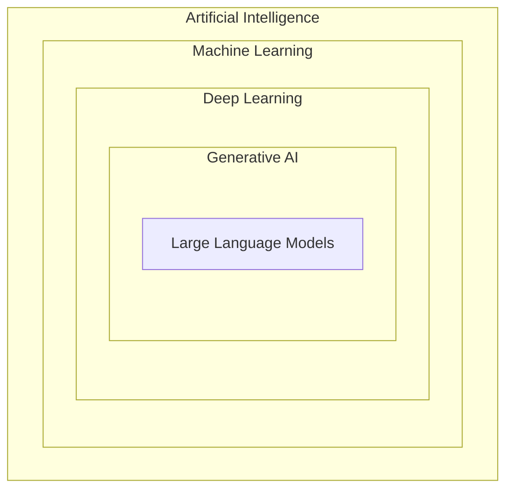
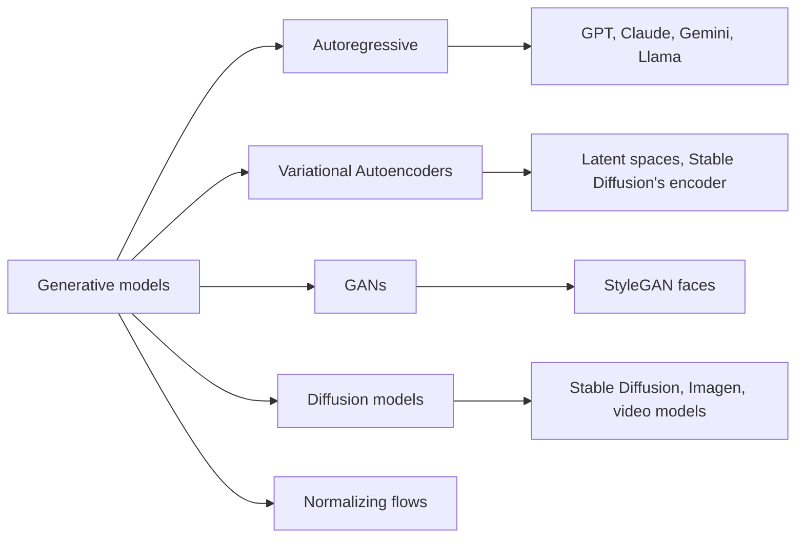
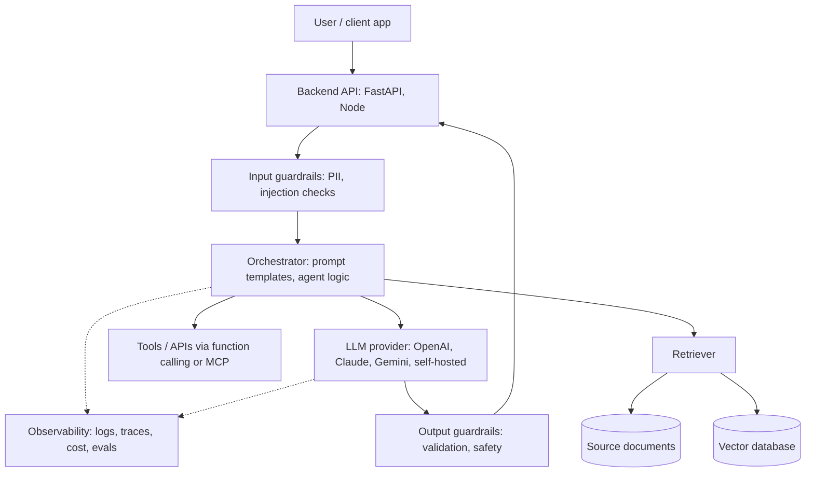

# 01. Introduction to Generative AI

[Home](README.md) › 01. Introduction to Generative AI

> **Level:** Beginner · **Time:** ~2 hours · **Prerequisites:** none

## Learning objectives

By the end of this chapter you will be able to:

- Explain AI, Machine Learning and Deep Learning, and how they relate.
- Describe what makes a model *generative* rather than *discriminative*.
- Name the main families of generative models and what each is good at.
- Sketch the architecture of a typical Generative AI application.
- Judge when Generative AI is the right tool, and when it is not.

---

## 1. What is Artificial Intelligence?

**Artificial Intelligence (AI)** is the field of computer science that builds systems able to do tasks that normally need human intelligence: understanding language, recognising images, making decisions, planning and learning from experience.

AI has gone through several eras:

| Era | Approach | Example |
|---|---|---|
| 1950s–1980s | **Symbolic AI / rules.** Humans write explicit `if-then` rules. | Expert systems for medical diagnosis |
| 1990s–2010s | **Machine Learning.** Systems learn patterns from data. | Spam filters, recommendation engines |
| 2012–2017 | **Deep Learning.** Neural networks with many layers learn features automatically. | Image classification (ImageNet), speech recognition |
| 2017–today | **Foundation models & Generative AI.** Huge Transformer models pre-trained on internet-scale data. | ChatGPT, Claude, Gemini, Stable Diffusion |

### Why it matters

Rule-based systems break when the world doesn't match the rules. Nobody can write rules for every way a person might phrase a question. Learning-based AI handles this messiness by learning from examples, which is why modern AI works on open-ended problems like language.

---

## 2. AI vs Machine Learning vs Deep Learning

These terms are nested. Each is a subset of the one before it.



| | Artificial Intelligence | Machine Learning | Deep Learning | Generative AI |
|---|---|---|---|---|
| **Definition** | Any technique that makes machines act intelligently | Algorithms that learn from data instead of explicit rules | ML using multi-layer neural networks | Deep learning models that create new content |
| **Needs data?** | Not always (rules) | Yes | Yes, lots | Yes, enormous amounts |
| **Feature engineering** | Manual | Often manual | Automatic | Automatic |
| **Typical output** | Decision or action | Prediction or label | Prediction, embedding | Text, image, audio, code, video |
| **Example** | Chess engine with search rules | Linear regression for house prices | CNN that detects tumours | LLM that writes a report |

### Machine Learning in one example

Traditional programming takes **rules + data** and produces **answers**. Machine learning takes **data + answers** and produces **rules** (a model).

```python
# A tiny ML model: learn y = 2x + 1 from examples
import numpy as np
from sklearn.linear_model import LinearRegression

X = np.array([[1], [2], [3], [4], [5]])   # inputs
y = np.array([3, 5, 7, 9, 11])            # known answers

model = LinearRegression().fit(X, y)      # learn the "rule"
print(model.coef_, model.intercept_)      # ≈ [2.] 1.0
print(model.predict([[10]]))              # ≈ [21.]
```

The three main ML paradigms:

| Paradigm | Learns from | Example |
|---|---|---|
| **Supervised** | Labelled examples (input → correct output) | Email → spam / not spam |
| **Unsupervised** | Unlabelled data; finds structure | Customer segmentation with clustering |
| **Reinforcement** | Rewards from an environment | Game-playing agents; RLHF for LLMs |

LLM pre-training is **self-supervised**: the labels come from the data itself (the "label" for each position is simply the next word).

### Deep Learning in one paragraph

A **neural network** is layers of simple units ("neurons"). Each computes a weighted sum of its inputs and applies a non-linear function. Stacking many layers lets the network learn hierarchical features. In images, early layers detect edges and later layers detect faces. In text, early layers capture word identity and later layers capture meaning and context. Training adjusts the weights with **gradient descent**, using **backpropagation** to work out how each weight affected the error.

```python
# A minimal neural network in PyTorch
import torch
import torch.nn as nn

model = nn.Sequential(
    nn.Linear(10, 32),  # input layer: 10 features → 32 hidden units
    nn.ReLU(),          # non-linearity
    nn.Linear(32, 1),   # output layer
)
x = torch.randn(4, 10)  # batch of 4 examples
print(model(x).shape)   # torch.Size([4, 1])
```

---

## 3. What is Generative AI?

**Generative AI** refers to models that **create new content** (text, images, audio, video, code, 3D shapes, molecules) that resembles their training data without copying it.

### Discriminative vs generative models

| | Discriminative model | Generative model |
|---|---|---|
| **Learns** | The boundary between classes: `P(label \| input)` | The distribution of the data itself: `P(data)` or `P(next token \| previous tokens)` |
| **Answers** | "Is this email spam?" | "Write an email." |
| **Output** | A label or a number | New samples |
| **Examples** | Logistic regression, BERT classifier, ResNet | GPT, Claude, Gemini, Stable Diffusion |

### How generation works, intuitively

A generative model learns a **probability distribution** over its training data. Generation means **sampling** from that distribution.

For a language model, that distribution is factored into one-token-at-a-time predictions:

```
P("The cat sat on the mat") =
    P("The") × P("cat" | "The") × P("sat" | "The cat") × ... × P("mat" | "The cat sat on the")
```

To generate, the model predicts a distribution over the next token, picks one (sampling), appends it, and repeats. Chapter 02 covers this in detail.

### Why Generative AI matters

1. **One model, many tasks.** A single LLM can summarise, translate, classify, extract and write code just by changing the prompt. Before, each task needed its own model.
2. **A natural language interface.** Anyone can use software by describing what they want.
3. **Unstructured data becomes usable.** Most enterprise data is text (emails, PDFs, tickets). LLMs can read and act on it.
4. **Faster prototyping.** Features that once took a team months to build can be prototyped in days.

---

## 4. Types of Generative AI

### 4.1 By model family



| Family | Core idea | Strengths | Weaknesses | Used for |
|---|---|---|---|---|
| **Autoregressive Transformers** | Predict the next token given all previous tokens | Excellent for sequences; scales very well | Generation is sequential, so it can be slow | Text, code, also images and audio as tokens |
| **Variational Autoencoders (VAEs)** | Compress data into a smooth latent space, then decode | Stable training; meaningful latent space | Outputs can be blurry | Representation learning, compression inside diffusion pipelines |
| **Generative Adversarial Networks (GANs)** | A generator tries to fool a discriminator | Sharp, realistic images; fast sampling | Unstable training, mode collapse | Faces, style transfer, super-resolution |
| **Diffusion models** | Learn to reverse a gradual noising process | State-of-the-art image and video quality; diverse | Many denoising steps (slower) | Text-to-image, text-to-video, audio |
| **Normalizing flows** | Invertible transforms with exact likelihood | Exact probabilities | Architectural constraints | Density estimation, science |

### 4.2 By modality

| Modality | Input → Output | Example systems |
|---|---|---|
| Text generation | Text → text | GPT, Claude, Gemini, Llama |
| Code generation | Text → code | Claude Code, GitHub Copilot, Codex |
| Image generation | Text → image | Imagen, Stable Diffusion, GPT image models |
| Speech | Text ↔ audio | Text-to-speech, Whisper (speech-to-text) |
| Video | Text/image → video | Veo, Sora |
| Multimodal | Text + image + audio → text (and more) | Gemini, GPT, Claude (vision input) |
| Embeddings | Any content → vector | Used for search and RAG (Chapter 06) |

---

## 5. Real-world applications

| Industry | Application | How Generative AI helps |
|---|---|---|
| **Customer support** | Support chatbots, ticket triage, reply drafting | Answers routine questions using company docs (RAG); routes complex cases to humans |
| **Software engineering** | Code completion, code review, test generation, coding agents | Speeds up development; explains unfamiliar code |
| **Healthcare** | Clinical note summarisation, medical coding | Cuts documentation time; a clinician stays in the loop |
| **Legal** | Contract review, clause extraction, research | Speeds up reading thousands of pages |
| **Finance** | Report generation, earnings-call analysis, KYC document processing | Pulls structured data from unstructured filings |
| **HR** | Resume screening, job descriptions, policy Q&A | Answers employee questions from policy documents |
| **Marketing** | Copywriting, personalisation, image creation | Produces variants for A/B testing at scale |
| **Education** | Personalised tutors, quiz generation | Gives explanations adapted to the learner |
| **Data analytics** | Text-to-SQL, insight summarisation | Non-technical users can query data in plain English |

---

## 6. Generative AI architecture overview

A production Generative AI application is much more than a model. This is the typical architecture you'll build throughout this guide:



| Layer | Responsibility | Chapter |
|---|---|---|
| **Model layer** | The foundation model (API-hosted or self-hosted) | 02, 03, 05, 09 |
| **Prompt layer** | Instructions, templates, few-shot examples, output schemas | 04 |
| **Data / knowledge layer** | Embeddings, vector DB, document ingestion | 06, 07, 08 |
| **Orchestration layer** | Chains, agents, tool calling, memory | 10, 11, 12 |
| **Safety layer** | Guardrails, moderation, prompt-injection defence | 13 |
| **Operations layer** | Evaluation, monitoring, cost and latency control | 13 |

### The Generative AI tech stack

| Layer | Popular choices |
|---|---|
| Foundation models (closed) | OpenAI GPT, Anthropic Claude, Google Gemini |
| Foundation models (open-weight) | Llama, Mistral, Qwen, Gemma, DeepSeek |
| Model hubs and serving | Hugging Face, vLLM, Ollama, TGI |
| Orchestration | LangChain, LangGraph, LlamaIndex, provider SDKs |
| Vector stores | ChromaDB, FAISS, Pinecone, Weaviate, pgvector, Qdrant |
| Evaluation & observability | LangSmith, Langfuse, Ragas, DeepEval, OpenTelemetry |
| Tool integration | Function calling, Model Context Protocol (MCP) |

---

## 7. Your first Generative AI program

```bash
pip install openai python-dotenv
```

```python
# first_genai.py
import os
from dotenv import load_dotenv
from openai import OpenAI

load_dotenv()                       # reads OPENAI_API_KEY from .env
client = OpenAI()                   # picks up the key from the environment

MODEL = "gpt-6-luna"                # small, low-cost model; check the models page for current IDs

response = client.responses.create(
    model=MODEL,
    instructions="You are a friendly teacher. Explain things in two sentences.",
    input="What is Generative AI?",
)
print(response.output_text)
```

This program shows the whole idea: you send **instructions + input**, and the model **generates** new text. Chapters 04 and 05 go much deeper.

---

## 8. Advantages, disadvantages and limitations

### Advantages

- **Versatile:** one model handles many tasks through prompting.
- **Natural language interface:** lowers the barrier for users.
- **Works on unstructured data:** text, images, audio.
- **Fast to prototype:** no training needed for many use cases.
- **Scalable creativity:** generates drafts, variants and ideas at volume.

### Disadvantages

- **Hallucinations:** produces fluent but false statements (Chapter 13).
- **Non-deterministic:** the same prompt can give different outputs.
- **Cost and latency:** large models are expensive and slower than classic ML.
- **Data privacy:** sending sensitive data to third-party APIs needs governance.
- **Bias:** models reflect biases in their training data.

### Limitations

- **Knowledge cutoff:** the model doesn't know about events after its training data ends unless you give it that information (RAG, tools).
- **Context limits:** a model can only "see" a finite number of tokens at once.
- **Weak exact computation:** arithmetic and precise counting are unreliable without tools.
- **No real-world grounding by default:** it predicts plausible text, not verified truth.
- **Intellectual property and regulation:** copyright questions and laws like the EU AI Act affect deployment.

### When NOT to use Generative AI

| Situation | Better tool |
|---|---|
| Deterministic business rules (tax calculation) | Regular code |
| Tabular prediction (churn, fraud scores) | Gradient-boosted trees (XGBoost, LightGBM) |
| Exact lookups ("order #123 status") | Database query |
| Hard real-time latency (< 10 ms) | Classic ML or rules |
| Zero tolerance for errors with no human review | Deterministic systems |

---

## 9. Best practices and common mistakes

### Best practices

1. **Start with the problem, not the model.** Define success criteria and an evaluation set before you build.
2. **Prototype with the strongest model, then optimise down** to cheaper models once quality is proven.
3. **Keep a human in the loop** for high-stakes outputs.
4. **Ground the model** with your own data (RAG) instead of trusting its memory.
5. **Measure everything:** quality, latency, cost and user feedback.

### Common mistakes

| Mistake | Why it hurts | Fix |
|---|---|---|
| Treating the LLM as a database of facts | It hallucinates and goes stale | Retrieve facts from a trusted source |
| Using GenAI for everything | Expensive, slow, unreliable for deterministic tasks | Use plain code where rules are clear |
| No evaluation | You can't tell whether changes help or hurt | Build a test set early |
| Ignoring cost at scale | A $0.01 call × 1M users/day is $10,000/day | Estimate token costs up front |
| Leaking secrets or PII into prompts | Privacy and compliance violations | Redact; check provider data policies |

---

## 10. Interview questions and answers

**Q1. What is the difference between AI, ML and Deep Learning?**
AI is the broad goal of making machines act intelligently. ML is a subset of AI where systems learn patterns from data instead of following hand-written rules. Deep Learning is a subset of ML that uses multi-layer neural networks to learn features automatically from raw data. Generative AI and LLMs are applications of deep learning.

**Q2. What is the difference between a discriminative and a generative model?**
A discriminative model learns `P(y|x)`, the boundary between classes, so it can label inputs. A generative model learns the data distribution `P(x)` (or `P(next token | context)`), so it can create new samples. A spam classifier is discriminative; GPT is generative.

**Q3. Name the main types of generative models.**
Autoregressive models (GPT-style Transformers), VAEs, GANs, diffusion models and normalizing flows. Text is dominated by autoregressive Transformers; images and video are dominated by diffusion models.

**Q4. Why did Generative AI take off after 2017?**
Three things came together. The Transformer architecture (2017) parallelises training well. GPUs and TPUs became available at scale. Internet-scale text datasets existed. Scaling laws showed that bigger models trained on more data improve predictably. RLHF and instruction-tuning (around 2022) then made models helpful enough for products like ChatGPT.

**Q5. What are the main risks of deploying Generative AI?**
Hallucinations, prompt injection, data leakage, bias, copyright concerns, unpredictable cost, and over-reliance by users. Mitigations include grounding (RAG), guardrails, evaluation, human review and monitoring.

**Q6. What is a foundation model?**
A large model pre-trained on broad data that can be adapted to many downstream tasks through prompting, RAG or fine-tuning. Examples: GPT, Claude, Gemini, Llama.

**Q7. When would you not use an LLM?**
When the task is deterministic, needs exact computation, has strict latency limits, or is a well-structured tabular prediction problem. Traditional code or classic ML is cheaper, faster and more reliable there.

---

## 11. Hands-on exercises

1. **Classify the problem.** For each task, say whether it needs rules, classic ML or Generative AI, and why: (a) calculate shipping cost, (b) predict customer churn from 20 numeric features, (c) summarise customer complaints, (d) detect credit card fraud in real time, (e) draft product descriptions.
2. **Run your first program.** Run `first_genai.py`. Change `instructions` to make the model answer like a pirate, then like a senior engineer. Note how the output changes.
3. **Non-determinism experiment.** Run the same prompt five times and save the outputs. How different are they? (You'll learn to control this with `temperature` in Chapter 05.)
4. **Draw the architecture.** Pick an AI product you use, such as a coding assistant. Draw its likely architecture as a Mermaid diagram using the layers from Section 6.

### Assignment

Write a one-page **"Generative AI opportunity brief"** for a company of your choice:
- Three problems Generative AI could solve, and one it should **not** be used for.
- The data needed for each.
- The main risks and how you would mitigate them.
- How you would measure success.

---

## 12. References

- [Google — Introduction to Generative AI (learning path)](https://www.cloudskillsboost.google/paths/118)
- [Vaswani et al., 2017 — "Attention Is All You Need"](https://arxiv.org/abs/1706.03762)
- [Goodfellow et al., 2014 — "Generative Adversarial Networks"](https://arxiv.org/abs/1406.2661)
- [Ho et al., 2020 — "Denoising Diffusion Probabilistic Models"](https://arxiv.org/abs/2006.11239)
- [Kingma & Welling, 2013 — "Auto-Encoding Variational Bayes"](https://arxiv.org/abs/1312.6114)
- [Bommasani et al., 2021 — "On the Opportunities and Risks of Foundation Models"](https://arxiv.org/abs/2108.07258)
- [OpenAI API documentation](https://developers.openai.com/api/docs)
- [Deep Learning book — Goodfellow, Bengio, Courville (free online)](https://www.deeplearningbook.org/)

---

| ← Previous | Index | Next → |
|---|---|---|
| — | [Home](README.md) | [02. Understanding LLMs](02-understanding-llms.md) |
