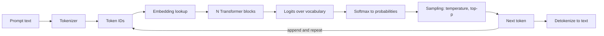
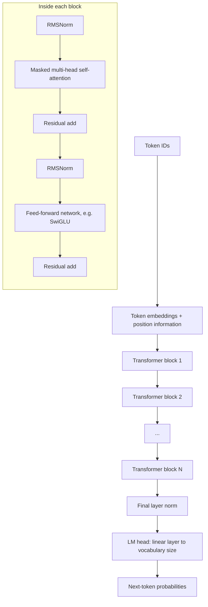
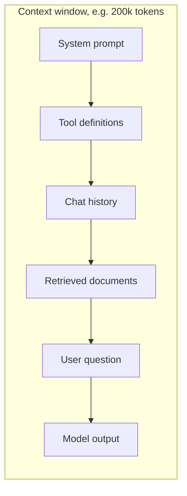
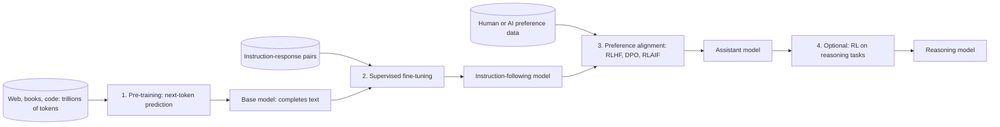

# 02. Understanding Large Language Models (LLMs)

[Home](README.md) › 02. Understanding LLMs

> **Level:** Beginner · **Time:** ~3 hours · **Prerequisites:** [Chapter 01](01-introduction-to-generative-ai.md)

## Learning objectives

- Define an LLM and explain next-token prediction.
- Trace a prompt through tokenization, the model and decoding.
- Count tokens and reason about context windows and cost.
- Explain parameters, model size and scaling laws.
- Describe the full training pipeline: pre-training, instruction tuning and alignment.
- Compare popular closed and open-weight model families.

---

## 1. What is an LLM?

A **Large Language Model** is a neural network, almost always a **Transformer**, trained on a very large amount of text to **predict the next token** in a sequence.

- **Large** — billions to trillions of parameters, trained on trillions of tokens.
- **Language** — trained mostly on text and code (many are now multimodal).
- **Model** — a learned mathematical function: `tokens in → probability distribution over the next token`.

### Why such a simple objective works

To predict the next word well across all of the internet, a model has to learn grammar, facts, reasoning patterns, coding conventions, and even some ability to model other people's intentions. Take *"The capital of France is ___"* or *"def fibonacci(n): ___"*. Getting these right means internalising knowledge and structure. The capabilities **emerge** from scale.

---

## 2. How LLMs work internally

The end-to-end flow for one request:



Step by step:

1. **Tokenization.** Text is split into tokens and mapped to integer IDs.
2. **Embedding.** Each ID is looked up in an embedding table and becomes a vector (for example 4,096 numbers).
3. **Transformer layers.** Dozens of layers mix information between tokens (attention) and transform it (feed-forward networks). Chapter 03 explains these layers.
4. **Logits.** The final vector for the **last position** is projected to a score for every token in the vocabulary (often 100k–200k scores).
5. **Softmax.** The scores become probabilities that sum to 1.
6. **Sampling.** One token is chosen using a decoding strategy.
7. **Loop.** The chosen token is appended and the process repeats until a stop token or a length limit.

This is called **autoregressive generation**: each output token becomes part of the input for the next step.

### Decoding strategies

```python
import numpy as np

vocab = ["mat", "sofa", "roof", "moon", "car"]
logits = np.array([3.0, 2.0, 1.0, 0.2, -1.0])  # raw scores from the model

def softmax(x, temperature=1.0):
    z = x / temperature
    z = z - z.max()                  # numerical stability
    e = np.exp(z)
    return e / e.sum()

for t in [0.2, 1.0, 2.0]:
    print(t, dict(zip(vocab, softmax(logits, t).round(3))))

# Greedy: always pick the most likely token
print("greedy:", vocab[int(np.argmax(logits))])

# Top-p (nucleus) sampling: sample only from the smallest set whose probability sums to >= p
def top_p_sample(logits, p=0.9, temperature=1.0, rng=np.random.default_rng(0)):
    probs = softmax(logits, temperature)
    order = np.argsort(probs)[::-1]
    cum = np.cumsum(probs[order])
    keep = order[: np.searchsorted(cum, p) + 1]
    kept = probs[keep] / probs[keep].sum()
    return vocab[rng.choice(keep, p=kept)]

print("top-p:", top_p_sample(logits))
```

| Strategy | How it works | Effect |
|---|---|---|
| **Greedy** | Always pick the highest-probability token | Deterministic, can be repetitive |
| **Temperature** | Divide logits by `T` before softmax | `T < 1` sharper and more focused; `T > 1` flatter and more random |
| **Top-k** | Sample from the `k` most likely tokens | Cuts off the long tail |
| **Top-p (nucleus)** | Sample from the smallest set with cumulative probability ≥ `p` | Adapts the candidate set to how confident the model is |
| **Beam search** | Keep the `b` best partial sequences | Common in translation; rare for chat |

---

## 3. LLM architecture

Almost all modern LLMs are **decoder-only Transformers**:



Common design choices in modern open models (Llama, Qwen, Mistral, Gemma families):

| Component | Original Transformer (2017) | Typical modern LLM |
|---|---|---|
| Structure | Encoder–decoder | Decoder-only |
| Normalisation | LayerNorm after each sub-layer | RMSNorm *before* each sub-layer (pre-norm) |
| Position | Sinusoidal absolute | Rotary Position Embeddings (RoPE) |
| Activation | ReLU | SwiGLU / GeLU |
| Attention | Multi-head | Grouped-Query Attention (GQA) for faster inference |
| Scaling | Dense | Dense or **Mixture-of-Experts (MoE)** |

**Mixture-of-Experts** replaces the single feed-forward network with many "expert" networks plus a router that sends each token to a few of them. This gives a model a huge total parameter count while each token only uses a fraction of it, so inference is cheaper than a dense model of the same size.

---

## 4. Tokens and tokenization

### What is a token?

A **token** is the unit of text the model reads and writes. It can be a whole word, part of a word, a single character or punctuation. In English, **1 token ≈ 4 characters ≈ 0.75 words** on average.

```
"Tokenization is fascinating!"  →  ["Token", "ization", " is", " fascinating", "!"]
```

### Why subword tokenization?

| Approach | Problem |
|---|---|
| Word-level | Huge vocabulary; can't handle new words ("ChatGPTify") |
| Character-level | Very long sequences, so slow and harder to learn |
| **Subword (BPE, WordPiece, SentencePiece)** | Balances vocabulary size and sequence length; any string can be encoded |

### How Byte-Pair Encoding (BPE) works

1. Start with a vocabulary of individual bytes or characters.
2. Count every adjacent pair of symbols in the training corpus.
3. Merge the most frequent pair into a new symbol and add it to the vocabulary.
4. Repeat until the vocabulary reaches the target size (for example 100k).

```python
# A toy BPE to see the idea
from collections import Counter

corpus = ["low", "lower", "lowest", "newer", "wider"]
words = [list(w) + ["</w>"] for w in corpus]

def most_frequent_pair(words):
    pairs = Counter()
    for w in words:
        for a, b in zip(w, w[1:]):
            pairs[(a, b)] += 1
    return pairs.most_common(1)[0][0]

def merge(words, pair):
    merged = []
    for w in words:
        out, i = [], 0
        while i < len(w):
            if i < len(w) - 1 and (w[i], w[i + 1]) == pair:
                out.append(w[i] + w[i + 1]); i += 2
            else:
                out.append(w[i]); i += 1
        merged.append(out)
    return merged

for step in range(5):
    pair = most_frequent_pair(words)
    words = merge(words, pair)
    print(f"merge {step + 1}: {pair} -> {words}")
```

### Counting tokens in practice

```bash
pip install tiktoken
```

```python
import tiktoken

enc = tiktoken.get_encoding("o200k_base")   # encoding used by recent OpenAI models
text = "Large Language Models predict the next token."
ids = enc.encode(text)
print(len(ids), ids)
print([enc.decode([i]) for i in ids])
```

Each provider uses its own tokenizer, so the same text gives different token counts. Use the provider's counting tools for exact numbers. For example, Anthropic has a `count_tokens` endpoint and Gemini has `count_tokens`.

### Why tokens matter to an engineer

- **Cost:** APIs bill per input and output token.
- **Limits:** context windows and `max_output_tokens` are measured in tokens.
- **Latency:** output tokens are generated one at a time, so more output means slower responses.
- **Quirks:** models struggle with tasks below the token level, such as counting letters in "strawberry", because they never see individual characters.
- **Languages:** non-English text often needs more tokens per word, which raises cost.

---

## 5. Context windows

The **context window** is the maximum number of tokens the model can process in one request: **input + output combined**. It includes the system prompt, conversation history, retrieved documents, tool definitions and the generated answer.



### Key facts

- LLMs are **stateless**. They don't remember previous requests. "Memory" in chat apps comes from resending the history each time.
- Attention cost grows with sequence length (quadratically in the standard formulation), so long contexts cost more and run slower.
- **"Lost in the middle":** models often use information at the start and end of a long context more reliably than information in the middle.
- A bigger context window doesn't remove the need for retrieval. Sending only *relevant* text is cheaper, faster and often more accurate.

### Managing context in a chat app

```python
def trim_history(messages, max_tokens, count_tokens):
    """Keep the system message and the most recent turns that fit the budget."""
    system, rest = messages[0], messages[1:]
    kept, used = [], count_tokens(system["content"])
    for msg in reversed(rest):                 # newest first
        t = count_tokens(msg["content"])
        if used + t > max_tokens:
            break
        kept.append(msg)
        used += t
    return [system] + list(reversed(kept))
```

Other strategies: **summarise** older turns, store long-term facts in a **memory store**, or **retrieve** only relevant history (Chapter 11).

---

## 6. Parameters and model size

**Parameters** are the learned weights of the network. A "7B" model has about 7 billion of them.

### Memory needed to load a model

```
memory ≈ parameters × bytes per parameter
```

| Precision | Bytes/param | 7B model | 70B model |
|---|---|---|---|
| FP32 | 4 | ~28 GB | ~280 GB |
| FP16 / BF16 | 2 | ~14 GB | ~140 GB |
| INT8 | 1 | ~7 GB | ~70 GB |
| INT4 | 0.5 | ~3.5 GB | ~35 GB |

Inference also needs memory for the **KV cache** (stored attention keys and values for every token in the context), and that grows with context length and batch size.

### Scaling laws

Research by Kaplan et al. (2020) and Hoffmann et al. (2022, "Chinchilla") showed that loss falls predictably as you increase **parameters**, **training tokens** and **compute** together. Chinchilla's finding: for a fixed compute budget, models were under-trained, and roughly **~20 tokens per parameter** is compute-optimal. Modern models are often trained well past that ratio because a smaller, over-trained model is cheaper to *serve*.

### Bigger isn't always better

| Choose a smaller model when | Choose a larger model when |
|---|---|
| The task is narrow (classification, extraction) | The task needs complex reasoning or planning |
| Latency and cost dominate | Quality is critical |
| You need on-device or self-hosted deployment | You need broad world knowledge |
| You can fine-tune it | Few-shot prompting must be enough |

---

## 7. Pre-training and fine-tuning

An LLM like ChatGPT or Claude goes through several training stages:



| Stage | Data | Goal | Cost |
|---|---|---|---|
| **Pre-training** | Trillions of tokens of unlabelled text and code | Learn language, knowledge and patterns | Millions of dollars; thousands of GPUs for weeks or months |
| **Supervised fine-tuning (SFT)** | Tens of thousands of curated (instruction, ideal response) pairs | Follow instructions, use a chat format | Much cheaper |
| **Preference alignment** | Human or AI rankings of responses | Be helpful, honest and harmless | Moderate |
| **Reasoning RL** | Verifiable problems (maths, code) with reward signals | Better step-by-step reasoning | Moderate to high |

- A **base model** just continues text. Ask it "What is the capital of France?" and it may continue with more quiz questions.
- An **instruction-tuned** or **chat** model answers the question.
- **RLHF** (Reinforcement Learning from Human Feedback) trains a reward model on human preferences, then optimises the LLM against it. **DPO** (Direct Preference Optimization) skips the separate reward model. **Constitutional AI / RLAIF** uses AI feedback guided by written principles.

As an AI engineer, you'll usually **start from a chat model** and then adapt it with prompting, RAG or your own fine-tuning (Chapter 09).

---

## 8. Popular LLM models

The landscape changes every few months. Learn the *families* and how to compare them, not a fixed leaderboard.

### Closed (API) models

| Provider | Family | Notes |
|---|---|---|
| OpenAI | GPT | Strong general and reasoning models; Responses API; broad tooling |
| Anthropic | Claude (Opus, Sonnet, Haiku tiers) | Strong at coding, agents and long documents; created MCP |
| Google | Gemini (Pro, Flash, Flash-Lite tiers) | Natively multimodal; very long context; integrates with Google Cloud |

### Open-weight models

| Family | Organisation | Notes |
|---|---|---|
| Llama | Meta | Large ecosystem; many fine-tunes |
| Qwen | Alibaba | Strong multilingual and coding models; many sizes |
| Mistral / Mixtral | Mistral AI | Efficient; early popular MoE models |
| Gemma | Google | Small, efficient open models |
| DeepSeek | DeepSeek | Strong reasoning and MoE models |

### How to choose a model

| Criterion | Questions to ask |
|---|---|
| **Quality** | How does it score on *your* evaluation set, not just public benchmarks? |
| **Cost** | Price per million input and output tokens? |
| **Latency** | Time to first token and tokens per second? |
| **Context window** | Does your input fit comfortably? |
| **Features** | Tool calling, structured output, vision, streaming, caching? |
| **Deployment** | API only, or can you self-host for data residency? |
| **Licence** | Is commercial use allowed? |

> **Tip:** Public leaderboards such as LMArena and benchmarks such as MMLU-Pro, GPQA and SWE-bench are useful signals, but always confirm with an evaluation on your own task.

### Run an open model locally

```bash
pip install transformers torch accelerate
```

```python
from transformers import pipeline

MODEL_ID = "Qwen/Qwen2.5-0.5B-Instruct"   # tiny; runs on a laptop CPU

chat = pipeline("text-generation", model=MODEL_ID)
messages = [
    {"role": "system", "content": "You are a concise assistant."},
    {"role": "user", "content": "Explain a context window in one sentence."},
]
out = chat(messages, max_new_tokens=80)
print(out[0]["generated_text"][-1]["content"])
```

Or use [Ollama](https://ollama.com) for a one-command local model server (`ollama run llama3.2`).

---

## 9. Advantages, disadvantages and limitations

| Advantages | Disadvantages / limitations |
|---|---|
| General-purpose: one model, many tasks | Hallucinations: confident but wrong |
| Understands messy natural language | Knowledge cutoff |
| Few-shot learning from examples in the prompt | Finite context window; "lost in the middle" |
| Strong at code, summarisation, extraction | Weak at exact arithmetic and character-level tasks |
| Multilingual | Non-deterministic outputs |
| Improving rapidly | Cost and latency grow with tokens and model size |
| | Sensitive to prompt wording |
| | Reflects biases in training data |

---

## 10. Best practices and common mistakes

### Best practices

- **Estimate token usage** before launch: `(input + output tokens) × price × requests`.
- **Put long documents first and the question last** in the prompt. Long-context guides from providers recommend this.
- **Use the smallest model that passes your evaluations.**
- **Set `max_output_tokens`** to bound cost and latency.
- **Pin model versions** (dated snapshots) in production so behaviour doesn't change under you.

### Common mistakes

| Mistake | Fix |
|---|---|
| Assuming the model remembers earlier requests | Send history explicitly, or use a stateful API feature |
| Assuming words = tokens | Count tokens with the provider's tokenizer |
| Stuffing the whole knowledge base into context | Retrieve only relevant chunks (RAG) |
| Comparing models only on public benchmarks | Build a task-specific evaluation set |
| Using a base model for chat | Use instruction-tuned or chat variants |

---

## 11. Interview questions and answers

**Q1. How does an LLM generate text?**
It's autoregressive. The prompt is tokenized and passed through the Transformer, which outputs logits for every vocabulary token at the last position. Softmax turns them into probabilities, a decoding strategy (greedy, temperature, top-p) picks one token, the token is appended, and the process repeats until a stop token or a length limit.

**Q2. What is a token, and why do LLMs use subword tokenization?**
A token is the basic unit the model processes, often a sub-word. Subword tokenization (BPE, WordPiece, SentencePiece) keeps the vocabulary manageable, can represent any string including new words, and keeps sequences shorter than character-level encoding.

**Q3. What is a context window? What happens when you exceed it?**
It's the maximum number of tokens (input + output) the model can attend to in one call. Going over it causes an API error or truncation. You handle it by trimming history, summarising, or retrieving only relevant content.

**Q4. What does temperature do?**
It scales logits before softmax. Low temperature sharpens the distribution (more deterministic, good for extraction). High temperature flattens it (more diverse, good for brainstorming). Temperature 0 is approximately greedy decoding, but outputs can still vary slightly because of floating-point and batching effects. Some reasoning models ignore or restrict sampling parameters.

**Q5. Explain pre-training vs fine-tuning.**
Pre-training learns general language and knowledge through self-supervised next-token prediction on huge unlabelled corpora; it's expensive. Fine-tuning adapts the pre-trained model to a specific behaviour, format or domain using a much smaller labelled dataset; it's much cheaper.

**Q6. What is RLHF?**
Reinforcement Learning from Human Feedback. Humans rank model responses, a reward model is trained on those rankings, and the LLM is optimised (for example with PPO) to maximise the reward while staying close to the original model. DPO is a simpler alternative that optimises directly on preference pairs.

**Q7. How much GPU memory do you need to serve a 13B model in FP16?**
About 13B × 2 bytes ≈ 26 GB for the weights, plus KV cache and activation overhead, so a 40 GB or larger GPU in practice. With 4-bit quantization the weights take about 6.5 GB.

**Q8. What is Mixture-of-Experts?**
An architecture where each feed-forward layer contains many expert networks and a learned router activates only a few per token. It increases total capacity without a proportional increase in compute per token.

**Q9. What is the KV cache?**
During generation, the keys and values computed for previous tokens are stored, so each new token only computes attention for itself instead of reprocessing the whole sequence. It speeds up decoding a lot but uses memory proportional to context length.

---

## 12. Hands-on exercises

1. **Tokenizer exploration.** Use `tiktoken` to count tokens for the same paragraph in English, Hindi and Python code. Which uses the most tokens per character, and why?
2. **Temperature lab.** Modify the decoding script to sample 1,000 times at temperatures 0.2, 1.0 and 2.0. Plot how often each word appears.
3. **Cost calculator.** Write a function `estimate_cost(input_tokens, output_tokens, price_in, price_out)` and compute the monthly cost of a chatbot with 10,000 conversations/day × 6 turns × 800 input tokens × 200 output tokens.
4. **Local model.** Run a small open model with `transformers` or Ollama. Compare its answer quality with an API model on five questions.
5. **Base vs chat.** On Hugging Face, compare a base model (for example `Qwen/Qwen2.5-0.5B`) and its instruct version on the prompt "What is the capital of France?"

### Assignment

Write a **model selection report** for a customer-support chatbot. Compare three models (at least one open-weight) on quality (10 test questions you write), latency, cost per 1,000 conversations, context window and data-privacy considerations. Recommend one and justify it.

---

## 13. References

- [Vaswani et al. — Attention Is All You Need](https://arxiv.org/abs/1706.03762)
- [Brown et al. — Language Models are Few-Shot Learners (GPT-3)](https://arxiv.org/abs/2005.14165)
- [Kaplan et al. — Scaling Laws for Neural Language Models](https://arxiv.org/abs/2001.08361)
- [Hoffmann et al. — Training Compute-Optimal LLMs (Chinchilla)](https://arxiv.org/abs/2203.15556)
- [Ouyang et al. — Training language models to follow instructions with human feedback](https://arxiv.org/abs/2203.02155)
- [Rafailov et al. — Direct Preference Optimization](https://arxiv.org/abs/2305.18290)
- [Liu et al. — Lost in the Middle](https://arxiv.org/abs/2307.03172)
- [OpenAI tiktoken](https://github.com/openai/tiktoken)
- [Hugging Face — Tokenizers summary](https://huggingface.co/docs/transformers/tokenizer_summary)
- [Hugging Face LLM Course](https://huggingface.co/learn/llm-course)
- [OpenAI models](https://developers.openai.com/api/docs/models) · [Claude models](https://docs.claude.com/en/docs/about-claude/models/overview) · [Gemini models](https://ai.google.dev/gemini-api/docs/models)

---

| ← Previous | Index | Next → |
|---|---|---|
| [01. Introduction to Generative AI](01-introduction-to-generative-ai.md) | [Home](README.md) | [03. Transformer Architecture](03-transformer-architecture.md) |
