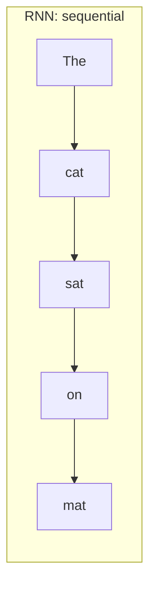
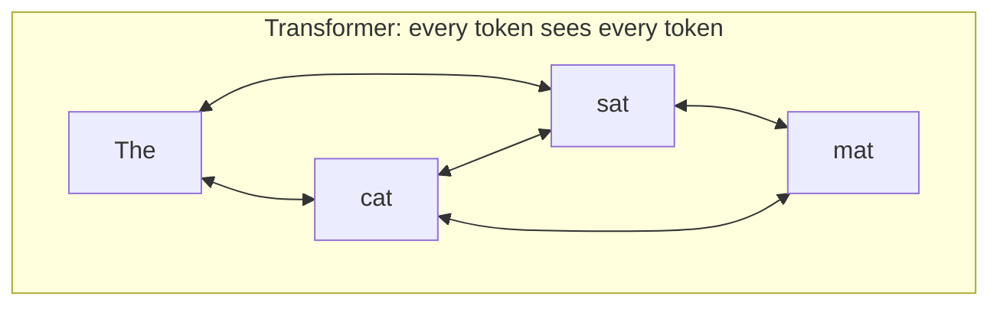
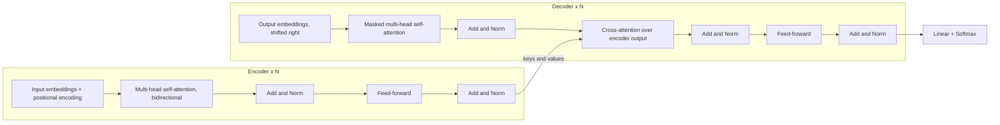
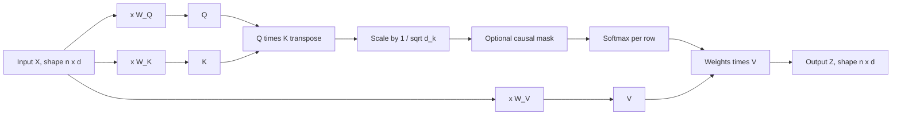
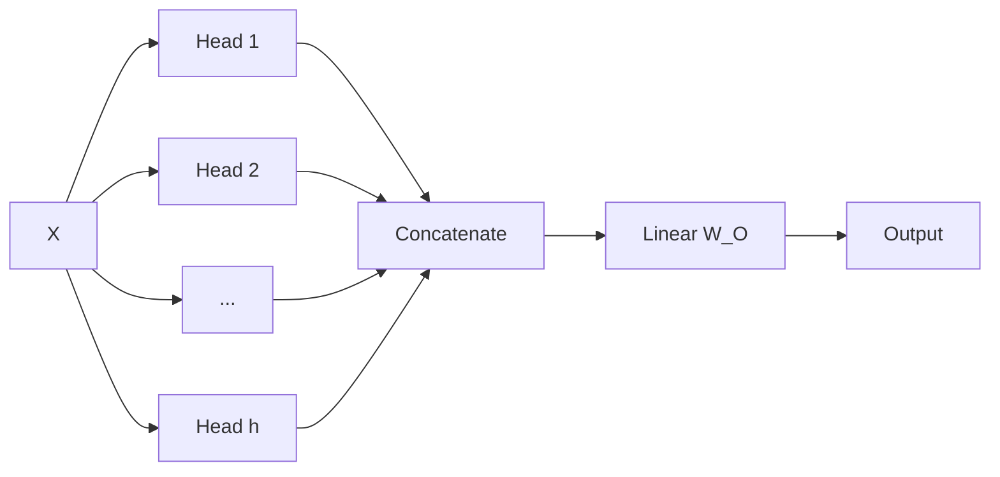
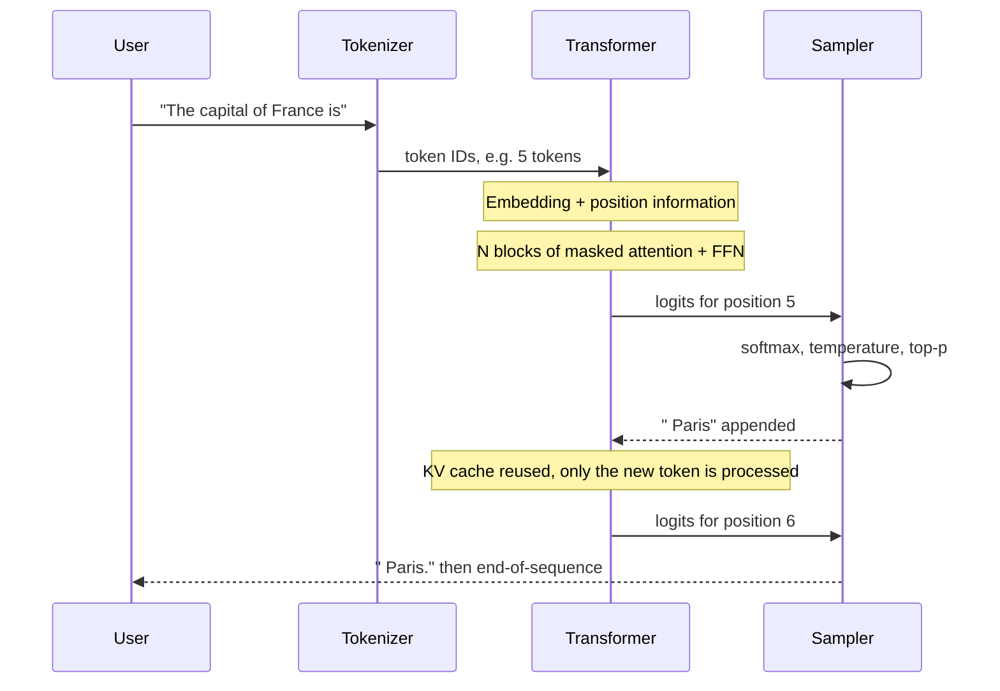

# 03. Transformer Architecture

[Home](README.md) › 03. Transformer Architecture

> **Level:** Intermediate · **Time:** ~4 hours · **Prerequisites:** [Chapter 02](02-understanding-llms.md), basic linear algebra (vectors, matrix multiplication)

## Learning objectives

- Explain why Transformers replaced RNNs and LSTMs.
- Describe encoder-only, decoder-only and encoder–decoder architectures.
- Derive and implement scaled dot-product self-attention from scratch.
- Explain multi-head attention, positional encoding, feed-forward layers, residual connections and normalisation.
- Walk through exactly how GPT turns a prompt into the next token.

---

## 1. What is a Transformer?

The **Transformer** is a neural network architecture introduced in *"Attention Is All You Need"* (Vaswani et al., 2017). Its key idea: process all tokens of a sequence **in parallel** and let each token **attend** directly to every other token to gather context.

### Why it was needed

Before Transformers, sequences were processed by **Recurrent Neural Networks (RNNs)** and **LSTMs**, which read one token at a time:





| Problem with RNNs | How Transformers solve it |
|---|---|
| Sequential processing, so they can't parallelise on GPUs | All positions are processed at once with matrix multiplications |
| Long-range dependencies fade (vanishing gradients) | Any token can attend to any other token in one step |
| Slow to train on large datasets | Training scales to trillions of tokens |

This parallelism is what made today's huge models possible.

---

## 2. Encoder and decoder architecture

The original Transformer had two stacks: an **encoder** that reads the input, and a **decoder** that generates the output.



### Three families

| Family | Attention | Training objective | Best for | Examples |
|---|---|---|---|---|
| **Encoder-only** | Bidirectional: each token sees left and right | Masked language modelling (fill in the blank) | Classification, NER, **embeddings**, search | BERT, RoBERTa, many embedding models |
| **Decoder-only** | Causal: each token sees only the left | Next-token prediction | Text generation, chat, code | GPT, Claude, Llama, Gemini |
| **Encoder–decoder** | Encoder bidirectional; decoder causal + cross-attention | Sequence-to-sequence | Translation, summarisation | T5, BART, original Transformer |

Decoder-only models dominate today because one simple objective (next-token prediction) scales well and covers almost every task once the task is phrased as text.

---

## 3. Self-attention mechanism

Self-attention lets each token build a **context-aware representation** by taking a weighted mix of information from the other tokens.

Example: in *"The animal didn't cross the street because **it** was too tired"*, attention lets "it" draw most of its information from "animal".

### The Query–Key–Value intuition

Think of a library search:

- **Query (Q):** what this token is looking for.
- **Key (K):** what each token offers (like a book's index label).
- **Value (V):** the actual content each token passes on.

Each token compares its query with every key. Matching pairs get high scores, and the token takes a weighted average of the values.

### The formula

```
Attention(Q, K, V) = softmax( Q · Kᵀ / √d_k ) · V
```



Step by step:

1. **Project** each token embedding into Q, K and V with learned weight matrices `W_Q`, `W_K`, `W_V`.
2. **Score**: `Q · Kᵀ` gives an `n × n` matrix, the relevance of every token to every other.
3. **Scale** by `√d_k`. Without it, dot products grow with dimension, softmax saturates and gradients vanish.
4. **Mask** (decoders only): set future positions to `-∞` so a token can't see tokens after it.
5. **Softmax** each row so the weights sum to 1.
6. **Weighted sum** of the values gives the new representation for each token.

### Implementation from scratch (NumPy)

```python
import numpy as np

def softmax(x, axis=-1):
    x = x - x.max(axis=axis, keepdims=True)
    e = np.exp(x)
    return e / e.sum(axis=axis, keepdims=True)

def scaled_dot_product_attention(Q, K, V, causal=False):
    d_k = Q.shape[-1]
    scores = Q @ K.T / np.sqrt(d_k)                    # (n, n)
    if causal:
        n = scores.shape[0]
        mask = np.triu(np.ones((n, n), dtype=bool), k=1)
        scores = np.where(mask, -np.inf, scores)       # hide future tokens
    weights = softmax(scores, axis=-1)                  # each row sums to 1
    return weights @ V, weights

rng = np.random.default_rng(42)
n_tokens, d_model, d_k = 4, 8, 8
X = rng.normal(size=(n_tokens, d_model))               # 4 token embeddings

W_Q, W_K, W_V = (rng.normal(size=(d_model, d_k)) for _ in range(3))
Q, K, V = X @ W_Q, X @ W_K, X @ W_V

out, w = scaled_dot_product_attention(Q, K, V, causal=True)
np.set_printoptions(precision=2, suppress=True)
print("attention weights (row = query token):\n", w)
print("output shape:", out.shape)
```

In the printed weights, the upper triangle is all zeros. That's the causal mask at work: token 1 sees only itself, and token 4 sees tokens 1–4.

### Complexity

Attention compares every token with every other, so compute and memory are **O(n²)** in sequence length. That's why long contexts are expensive. Optimisations include **FlashAttention** (an I/O-aware exact attention kernel), **sliding-window attention**, **sparse attention**, and **GQA/MQA** (sharing keys and values across heads to shrink the KV cache).

---

## 4. Multi-head attention

One attention operation can only focus on one kind of relationship at a time. **Multi-head attention** runs `h` attention operations ("heads") in parallel, each with its own projections, then concatenates the results.

```
head_i  = Attention(X·W_Q_i, X·W_K_i, X·W_V_i)
MHA(X)  = Concat(head_1, ..., head_h) · W_O
```

Different heads tend to specialise. One may track syntax (subject → verb), another coreference ("it" → "animal"), another nearby positions.



```python
import torch
import torch.nn as nn
import torch.nn.functional as F

class MultiHeadAttention(nn.Module):
    def __init__(self, d_model: int, n_heads: int):
        super().__init__()
        assert d_model % n_heads == 0
        self.n_heads, self.d_head = n_heads, d_model // n_heads
        self.qkv = nn.Linear(d_model, 3 * d_model)    # Q, K, V in one matmul
        self.out = nn.Linear(d_model, d_model)

    def forward(self, x):                              # x: (batch, seq, d_model)
        B, T, D = x.shape
        q, k, v = self.qkv(x).split(D, dim=-1)
        # reshape to (batch, heads, seq, d_head)
        q, k, v = (t.view(B, T, self.n_heads, self.d_head).transpose(1, 2) for t in (q, k, v))
        # PyTorch's fused kernel (uses FlashAttention when available)
        y = F.scaled_dot_product_attention(q, k, v, is_causal=True)
        y = y.transpose(1, 2).contiguous().view(B, T, D)
        return self.out(y)

mha = MultiHeadAttention(d_model=64, n_heads=8)
print(mha(torch.randn(2, 10, 64)).shape)   # torch.Size([2, 10, 64])
```

---

## 5. Positional encoding

Attention on its own is **permutation-invariant**: it treats "dog bites man" and "man bites dog" the same, because it has no notion of order. Positional information has to be injected.

| Method | How it works | Used by |
|---|---|---|
| **Sinusoidal (absolute)** | Add fixed sine/cosine waves of different frequencies to each embedding | Original Transformer |
| **Learned absolute** | Learn a vector per position | GPT-2, BERT |
| **RoPE (Rotary)** | Rotate Q and K vectors by an angle proportional to position, so their dot product depends on *relative* distance | Llama, Qwen, Mistral and most modern LLMs |
| **ALiBi** | Add a distance-based penalty to attention scores | Some long-context models |

Sinusoidal formula:

```
PE(pos, 2i)   = sin(pos / 10000^(2i/d_model))
PE(pos, 2i+1) = cos(pos / 10000^(2i/d_model))
```

```python
import numpy as np

def sinusoidal_positional_encoding(max_len: int, d_model: int) -> np.ndarray:
    pos = np.arange(max_len)[:, None]                      # (max_len, 1)
    i = np.arange(d_model)[None, :]                         # (1, d_model)
    angle_rates = 1 / np.power(10000, (2 * (i // 2)) / d_model)
    angles = pos * angle_rates
    pe = np.zeros((max_len, d_model))
    pe[:, 0::2] = np.sin(angles[:, 0::2])
    pe[:, 1::2] = np.cos(angles[:, 1::2])
    return pe

pe = sinusoidal_positional_encoding(50, 16)
print(pe.shape)  # (50, 16)  -> added to token embeddings
```

**Why RoPE is popular:** it encodes *relative* position directly into attention, generalises better to different lengths, and can be extended to longer contexts with techniques like position interpolation and YaRN.

---

## 6. Feed-forward networks, residuals and normalisation

### Feed-forward network (FFN)

After attention mixes information *between* tokens, the FFN processes each token *independently*:

```
FFN(x) = W_2 · activation(W_1 · x + b_1) + b_2
```

- It usually expands the dimension about 4× (for example 4,096 → 16,384) and then projects back.
- FFN layers hold most of a model's parameters, and research suggests they store much of its factual knowledge.
- Modern models use **SwiGLU**: `FFN(x) = W_2 · (SiLU(W_1·x) ⊙ W_3·x)`.

### Residual connections

Each sub-layer's output is **added** to its input: `x = x + SubLayer(x)`. This creates a direct path for gradients, which makes it possible to train networks with 100+ layers.

### Layer normalisation

Normalisation keeps activations at a stable scale. Modern LLMs use **pre-norm** (normalise *before* each sub-layer) with **RMSNorm**, which trains more stably than the original post-norm LayerNorm.

### A complete decoder block

```python
class FeedForward(nn.Module):
    def __init__(self, d_model, hidden_mult=4):
        super().__init__()
        self.net = nn.Sequential(
            nn.Linear(d_model, hidden_mult * d_model),
            nn.GELU(),
            nn.Linear(hidden_mult * d_model, d_model),
        )

    def forward(self, x):
        return self.net(x)

class DecoderBlock(nn.Module):
    def __init__(self, d_model, n_heads):
        super().__init__()
        self.ln1 = nn.LayerNorm(d_model)
        self.attn = MultiHeadAttention(d_model, n_heads)
        self.ln2 = nn.LayerNorm(d_model)
        self.ffn = FeedForward(d_model)

    def forward(self, x):
        x = x + self.attn(self.ln1(x))   # pre-norm + residual
        x = x + self.ffn(self.ln2(x))
        return x
```

---

## 7. How GPT works

**GPT (Generative Pre-trained Transformer)** is a decoder-only Transformer trained on next-token prediction.

### A minimal GPT

```python
class MiniGPT(nn.Module):
    def __init__(self, vocab_size, d_model=128, n_heads=4, n_layers=4, max_len=256):
        super().__init__()
        self.tok_emb = nn.Embedding(vocab_size, d_model)
        self.pos_emb = nn.Embedding(max_len, d_model)       # learned positions (GPT-2 style)
        self.blocks = nn.ModuleList(DecoderBlock(d_model, n_heads) for _ in range(n_layers))
        self.ln_f = nn.LayerNorm(d_model)
        self.head = nn.Linear(d_model, vocab_size, bias=False)

    def forward(self, idx, targets=None):
        B, T = idx.shape
        pos = torch.arange(T, device=idx.device)
        x = self.tok_emb(idx) + self.pos_emb(pos)
        for block in self.blocks:
            x = block(x)
        logits = self.head(self.ln_f(x))                     # (B, T, vocab)
        loss = None
        if targets is not None:
            loss = F.cross_entropy(logits.view(-1, logits.size(-1)), targets.view(-1))
        return logits, loss

    @torch.no_grad()
    def generate(self, idx, max_new_tokens, temperature=1.0):
        for _ in range(max_new_tokens):
            logits, _ = self(idx[:, -self.pos_emb.num_embeddings:])
            probs = F.softmax(logits[:, -1, :] / temperature, dim=-1)
            next_id = torch.multinomial(probs, num_samples=1)
            idx = torch.cat([idx, next_id], dim=1)
        return idx

# Character-level training on a tiny text
text = "to be or not to be that is the question " * 50
chars = sorted(set(text))
stoi = {c: i for i, c in enumerate(chars)}
itos = {i: c for c, i in stoi.items()}
data = torch.tensor([stoi[c] for c in text])

model = MiniGPT(vocab_size=len(chars), max_len=64)
opt = torch.optim.AdamW(model.parameters(), lr=3e-3)

for step in range(300):
    ix = torch.randint(0, len(data) - 65, (16,))
    x = torch.stack([data[i:i + 64] for i in ix])
    y = torch.stack([data[i + 1:i + 65] for i in ix])     # targets = inputs shifted by one
    _, loss = model(x, y)
    opt.zero_grad(); loss.backward(); opt.step()
    if step % 100 == 0:
        print(step, round(loss.item(), 3))

start = torch.tensor([[stoi["t"]]])
print("".join(itos[i] for i in model.generate(start, 40)[0].tolist()))
```

The key training trick is in `y`: the **targets are the inputs shifted by one position**. With the causal mask, one forward pass trains the model to predict *every* next token in the sequence at the same time.

### Step-by-step: what happens when you send "The capital of France is"



1. **Tokenize:** `["The", " capital", " of", " France", " is"]` → `[791, 6864, 315, 9822, 374]` (IDs are illustrative).
2. **Embed:** each ID → a `d_model` vector, plus position information.
3. **Prefill:** all 5 tokens pass through every layer in parallel. Keys and values are stored in the **KV cache**.
4. **Attend:** in each layer, the vector for " is" attends to " capital" and " France", collecting the information it needs.
5. **Predict:** the final hidden state of " is" → LM head → logits over the whole vocabulary. " Paris" gets the highest probability.
6. **Sample:** " Paris" is chosen and appended.
7. **Decode:** only the new token is processed, reusing cached keys and values. This repeats until an end-of-sequence token.

This is why LLM latency has two parts: **time to first token** (the prefill, which grows with prompt length) and **time per output token** (decoding, limited by memory bandwidth).

---

## 8. Use cases of the architecture choices

| Need | Architecture choice |
|---|---|
| Semantic search embeddings | Encoder-only (bidirectional context gives better sentence representations) |
| Chatbots, agents, code generation | Decoder-only |
| Translation with a fixed input→output mapping | Encoder–decoder |
| Very long documents | Efficient attention (FlashAttention, sliding window) + RoPE scaling |
| Cheap inference at large scale | MoE + GQA + quantization |

---

## 9. Advantages, disadvantages and limitations

| Advantages | Disadvantages / limitations |
|---|---|
| Highly parallel training on GPUs/TPUs | O(n²) attention cost in sequence length |
| Captures long-range dependencies directly | Large memory footprint (weights + KV cache) |
| One architecture for text, images, audio and video | Sequential decoding at inference |
| Scales predictably with data and compute | Needs huge data to train from scratch |
| Transfer learning: pre-train once, adapt many times | Hard to interpret ("black box") |

---

## 10. Best practices and common mistakes

### Best practices

- Use `torch.nn.functional.scaled_dot_product_attention` rather than hand-written attention in real code. It picks optimised kernels.
- Learn the architecture by **building a small GPT** (nanoGPT-style). It's the fastest way to really understand it.
- When serving, think in terms of **prefill vs decode**: long prompts hurt time-to-first-token; long outputs hurt total latency.

### Common mistakes

| Mistake | Correction |
|---|---|
| Forgetting the `√d_k` scaling | Softmax saturates and training stalls |
| Forgetting the causal mask in a decoder | The model "cheats" by seeing future tokens; training loss looks great, generation is garbage |
| Thinking attention weights fully explain the model | They are one signal; interpretability needs more than attention maps |
| Confusing parameters with context length | They are independent: a small model can have a long context, and the reverse |

---

## 11. Interview questions and answers

**Q1. Explain self-attention in simple terms.**
Each token makes a query, a key and a value. It compares its query with every token's key to get relevance scores, normalises them with softmax, and takes a weighted average of the values. The result is a representation of the token that includes relevant context from the whole sequence.

**Q2. Why divide by √d_k?**
Dot products of high-dimensional vectors have variance that grows with dimension. Large values push softmax into regions with tiny gradients. Dividing by √d_k keeps the variance around 1, which stabilises training.

**Q3. Why multi-head attention instead of a single head?**
Several heads let the model attend to different kinds of relationships (syntax, coreference, position) in different representation subspaces at the same time, at about the same compute cost as one large head.

**Q4. Why do Transformers need positional encoding?**
Attention is permutation-invariant; without position information it can't tell word order. Positional encodings (sinusoidal, learned, RoPE, ALiBi) supply order information.

**Q5. What's the difference between BERT and GPT?**
BERT is encoder-only with bidirectional attention, trained with masked language modelling. It's good for understanding tasks and embeddings. GPT is decoder-only with causal attention, trained on next-token prediction. It's good for generation.

**Q6. What is the purpose of the causal mask?**
It stops each position attending to future positions during training, so the model learns to predict the next token using only past context, which matches how it generates at inference.

**Q7. What is the KV cache and why does it matter?**
It stores keys and values of already-processed tokens so each decoding step only computes attention for the new token. Without it, generation would recompute the whole sequence at every step.

**Q8. What role do residual connections and layer norm play?**
Residuals give gradients a direct path through deep networks, which avoids vanishing gradients. Normalisation keeps activations stable. Together they make very deep Transformers trainable.

**Q9. What is cross-attention?**
Attention where queries come from one sequence (the decoder) and keys and values come from another (the encoder output). It lets the decoder look at the source sentence in translation. It's also used in multimodal models.

**Q10. How do you reduce attention's quadratic cost?**
FlashAttention (memory-efficient exact attention), sparse or sliding-window attention, linear-attention approximations, GQA/MQA to shrink the KV cache, and retrieval to keep contexts short.

---

## 12. Hands-on exercises

1. **Attention by hand.** With 3 tokens and `d_k = 2`, pick small Q, K, V matrices and compute attention on paper. Check against the NumPy code.
2. **Visualise attention.** Install `bertviz` and visualise the attention heads of `bert-base-uncased` on the sentence about "the animal… it". Which heads resolve "it"?
3. **Remove the mask.** Train `MiniGPT` with `is_causal=False`. Watch the training loss collapse while generation quality gets worse. Explain why.
4. **Positional encoding heatmap.** Plot `sinusoidal_positional_encoding(100, 64)` with matplotlib and describe the pattern.
5. **Scale up.** Train `MiniGPT` on a public-domain book and experiment with `n_layers`, `d_model` and `n_heads`.

### Assignment

Follow Andrej Karpathy's *"Let's build GPT: from scratch, in code, spelled out"* and implement a character-level GPT on a dataset of your choice. Write a README explaining each component (embedding, attention, FFN, residual, layer norm, LM head) in your own words, with a Mermaid diagram of your model.

---

## 13. References

- [Vaswani et al. — Attention Is All You Need](https://arxiv.org/abs/1706.03762)
- [Jay Alammar — The Illustrated Transformer](https://jalammar.github.io/illustrated-transformer/)
- [Harvard NLP — The Annotated Transformer](https://nlp.seas.harvard.edu/annotated-transformer/)
- [Andrej Karpathy — nanoGPT](https://github.com/karpathy/nanoGPT) and [Let's build GPT (video)](https://www.youtube.com/watch?v=kCc8FmEb1nY)
- [Devlin et al. — BERT](https://arxiv.org/abs/1810.04805)
- [Su et al. — RoFormer: Rotary Position Embedding](https://arxiv.org/abs/2104.09864)
- [Dao et al. — FlashAttention](https://arxiv.org/abs/2205.14135)
- [Shazeer — GLU Variants Improve Transformer](https://arxiv.org/abs/2002.05202)
- [PyTorch — scaled_dot_product_attention](https://pytorch.org/docs/stable/generated/torch.nn.functional.scaled_dot_product_attention.html)
- [3Blue1Brown — Attention in transformers, visually explained](https://www.youtube.com/watch?v=eMlx5fFNoYc)

---

| ← Previous | Index | Next → |
|---|---|---|
| [02. Understanding LLMs](02-understanding-llms.md) | [Home](README.md) | [04. Prompt Engineering](04-prompt-engineering.md) |
