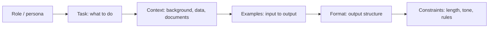

# 04. Prompt Engineering

[Home](README.md) › 04. Prompt Engineering

> **Level:** Beginner → Intermediate · **Time:** ~3 hours · **Prerequisites:** [Chapter 02](02-understanding-llms.md)

## Learning objectives

- Explain why prompt wording changes model behaviour.
- Use system, user and assistant messages correctly.
- Apply zero-shot, few-shot, chain-of-thought and role-based prompting.
- Get reliable structured (JSON) output validated with Pydantic.
- Build reusable, versioned prompt templates.
- Evaluate and iterate on prompts systematically.

---

## 1. What is prompt engineering?

**Prompt engineering** is designing the input to an LLM so it reliably produces the output you want. A prompt is effectively the **program** for an LLM: instructions, context, examples and output format, all in natural language.

### Why it matters

- It's the **cheapest and fastest** way to change model behaviour. No training needed.
- The same model can score very differently on a task depending on the prompt.
- In production, prompts are **code**: they need versioning, testing and review.

### How it works internally

An LLM predicts the most likely continuation of its input. A clear, specific prompt narrows the probability distribution towards the outputs you want. Instruction-tuned models were trained on (instruction → response) pairs, so prompts that look like clear instructions with context work best.

### Anatomy of a good prompt



| Component | Example |
|---|---|
| **Role** | "You are a senior customer-support agent for an e-commerce company." |
| **Task** | "Classify the customer message and draft a reply." |
| **Context** | "Our return window is 30 days. Shipping is free over $50." |
| **Examples** | One or more input → output pairs |
| **Format** | "Return JSON with keys `category`, `sentiment`, `reply`." |
| **Constraints** | "Reply in under 80 words. Never promise refunds." |

---

## 2. System, user and assistant messages

Chat models take a list of **messages**, each with a **role**:

| Role | Purpose | Who writes it |
|---|---|---|
| **System** (also *developer* or *instructions*) | Sets persistent behaviour: persona, rules, format, safety | You, the developer |
| **User** | The end user's request | The user (untrusted input) |
| **Assistant** | The model's previous replies; also used to give example answers | The model, or you for few-shot examples |
| **Tool** | Results returned from a function or tool call | Your code |

```python
messages = [
    {"role": "system", "content": "You are a helpful Python tutor. Answer in under 100 words."},
    {"role": "user", "content": "What is a list comprehension?"},
    {"role": "assistant", "content": "A list comprehension is a compact way to build a list..."},
    {"role": "user", "content": "Show me an example with a condition."},
]
```

How each provider expresses the system message:

| Provider | Where the system prompt goes |
|---|---|
| OpenAI Responses API | `instructions="..."`, or an input item with role `developer`/`system` |
| Anthropic Claude | Top-level `system="..."` parameter |
| Google Gemini | `config=GenerateContentConfig(system_instruction="...")` |

> **Why the separation matters:** models are trained to give system instructions higher priority than user content. Put rules there, and treat everything in user messages, especially retrieved documents, as **untrusted data** (see prompt injection in [Chapter 13](13-llm-evaluation-and-production.md)).

The examples below use a small helper so the focus stays on the prompt:

```python
# llm.py — tiny helper used throughout this chapter
from dotenv import load_dotenv
from openai import OpenAI

load_dotenv()
client = OpenAI()
MODEL = "gpt-6-luna"   # check https://developers.openai.com/api/docs/models for current IDs

def ask(prompt: str, system: str | None = None, **kwargs) -> str:
    response = client.responses.create(
        model=MODEL,
        instructions=system,
        input=prompt,
        **kwargs,
    )
    return response.output_text
```

---

## 3. Zero-shot prompting

**Zero-shot** means asking the model to do a task **with no examples**, relying on what it learned in training.

```python
from llm import ask

print(ask(
    "Classify the sentiment of this review as positive, negative or neutral. "
    "Reply with one word.\n\nReview: The delivery was late but the product is excellent."
))
```

**When to use:** simple, common tasks (summarise, translate, classify into obvious categories).
**Limitation:** less control over format and edge cases.

---

## 4. Few-shot prompting

**Few-shot** prompting includes a few **input → output examples** so the model can infer the pattern. This is **in-context learning**: the model adapts without any weight updates.

```python
from llm import ask

prompt = """Extract the product and issue from each support message.

Message: My AirPods won't connect to my laptop.
Output: {"product": "AirPods", "issue": "connectivity"}

Message: The blender arrived with a cracked jar.
Output: {"product": "blender", "issue": "damaged on arrival"}

Message: I was charged twice for my Kindle subscription.
Output:"""

print(ask(prompt))
```

You can also give examples as alternating user/assistant messages, which chat models often follow more faithfully:

```python
few_shot = [
    {"role": "user", "content": "Translate to formal English: gonna be late, traffic's crazy"},
    {"role": "assistant", "content": "I will be arriving late due to heavy traffic."},
    {"role": "user", "content": "Translate to formal English: can't make it tmrw, sorry"},
    {"role": "assistant", "content": "I apologise, but I will be unable to attend tomorrow."},
    {"role": "user", "content": "Translate to formal English: pls send the doc asap"},
]
```

### Tips for good examples

- **Diverse:** cover different cases, including edge cases.
- **Consistent format:** the model copies your formatting exactly.
- **Balanced:** for classification, don't put all examples in one class, or you bias the model.
- **Relevant:** in production, retrieve the examples most similar to the current input (*dynamic few-shot*) using embeddings ([Chapter 06](06-embeddings.md)).

---

## 5. Chain-of-thought (CoT) concepts

**Chain-of-thought** prompting asks the model to **reason step by step** before answering. Each generated token is extra computation, so writing out intermediate steps gives the model room to "think" and improves accuracy on maths, logic and multi-step problems.

```python
from llm import ask

question = (
    "A store has 23 apples. It sells 9 in the morning and receives a delivery of 3 boxes "
    "with 12 apples each. Then it sells 15 more. How many apples are left?"
)

# Without CoT: the model may jump to an answer
print(ask(question + " Answer with just the number."))

# With CoT: ask for reasoning, then a clearly marked final answer
print(ask(
    question + "\n\nThink through it step by step, then give the final answer on the last "
    "line in the form 'ANSWER: <number>'."
))
```

### Variants

| Technique | Idea |
|---|---|
| **Zero-shot CoT** | Add "Let's think step by step." |
| **Few-shot CoT** | Examples that include worked reasoning |
| **Self-consistency** | Sample several reasoning paths at higher temperature and take the majority answer |
| **Tree of Thoughts** | Explore and evaluate several reasoning branches |
| **ReAct** | Interleave reasoning with tool actions (the basis of agents, [Chapter 11](11-ai-agents.md)) |

### Reasoning models

Many current models (for example OpenAI reasoning models, Claude with extended thinking, Gemini thinking models) **reason internally** before answering, often controlled by a `reasoning effort` or `thinking budget` parameter. With them:

- You usually **don't need** "think step by step". Give a clear goal and constraints instead.
- More reasoning means better results on hard problems, at the cost of extra latency and tokens.
- Ask for the **final answer in a parseable format**, and don't depend on the raw reasoning text.

---

## 6. Role-based prompting

Assigning a **role or persona** sets the model's vocabulary, depth, tone and priorities.

```python
from llm import ask

code = "def avg(xs): return sum(xs) / len(xs)"

print(ask(
    f"Review this function:\n<code>\n{code}\n</code>",
    system=(
        "You are a senior Python engineer doing code review. Focus on bugs, edge cases "
        "and readability. Use a bullet list. Be direct and specific."
    ),
))
```

Effective roles are **specific**: "a senior site-reliability engineer reviewing a Kubernetes incident" works better than "an expert".

---

## 7. Structured output

Applications need **machine-readable** output. Approaches from least to most reliable:

| Approach | Reliability |
|---|---|
| "Respond in JSON" in the prompt | Usually works; sometimes adds prose or invalid JSON |
| JSON mode | Guarantees valid JSON, not your schema |
| **Structured outputs / JSON Schema** | Output conforms to your schema (constrained decoding) |
| **Tool / function calling** with a schema | Same guarantee; also used for actions |

### Structured output with Pydantic (OpenAI)

```python
from pydantic import BaseModel, Field
from typing import Literal
from openai import OpenAI

client = OpenAI()
MODEL = "gpt-6-luna"

class TicketAnalysis(BaseModel):
    category: Literal["billing", "shipping", "product", "account", "other"]
    sentiment: Literal["positive", "neutral", "negative"]
    urgency: int = Field(ge=1, le=5, description="1 = low, 5 = critical")
    summary: str = Field(description="One-sentence summary")

response = client.responses.parse(
    model=MODEL,
    instructions="Analyse the customer support ticket.",
    input="I've been charged twice this month and nobody replies to my emails! Fix this now.",
    text_format=TicketAnalysis,
)
ticket: TicketAnalysis = response.output_parsed
print(ticket.model_dump())
```

### Provider-neutral fallback: validate and retry

```python
import json
from pydantic import BaseModel, ValidationError
from llm import ask

def ask_structured(prompt: str, schema: type[BaseModel], retries: int = 2) -> BaseModel:
    instruction = (
        f"{prompt}\n\nRespond with ONLY a JSON object matching this JSON Schema:\n"
        f"{json.dumps(schema.model_json_schema())}"
    )
    last_error = None
    for _ in range(retries + 1):
        raw = ask(instruction if last_error is None else
                  f"{instruction}\n\nYour previous output was invalid: {last_error}. Fix it.")
        try:
            fence = "`" * 3                            # strip a Markdown code fence if the model added one
            return schema.model_validate_json(raw.strip().removeprefix(fence + "json").removesuffix(fence))
        except ValidationError as e:
            last_error = str(e)
    raise ValueError(f"Could not get valid output: {last_error}")
```

> Claude and Gemini also support schema-constrained output (Gemini `response_schema`; Claude structured outputs and tool `input_schema`). See [Chapter 05](05-working-with-llm-apis.md).

---

## 8. Prompt templates

Hard-coding prompts in strings scattered across a codebase becomes unmaintainable. Use **templates** with variables, and keep them in one place.

### Plain Python

```python
from string import Template

SUMMARY_PROMPT = Template("""You are an assistant for $company.

Summarise the following $doc_type for a $audience audience.
- Maximum $max_words words
- Use bullet points
- End with one line: "Action items: ..."

<document>
$document
</document>""")

prompt = SUMMARY_PROMPT.substitute(
    company="Acme Corp", doc_type="meeting transcript", audience="executive",
    max_words=120, document="...transcript text...",
)
```

### Jinja2 (loops and conditionals)

```python
from jinja2 import Template

RAG_PROMPT = Template("""Answer the question using ONLY the sources below.
If the answer is not in the sources, say "I don't know."
Cite sources as [1], [2], ...


[{{ loop.index }}] {{ doc.title }}
{{ doc.text }}


Question: {{ question }}""")

print(RAG_PROMPT.render(
    question="What is the refund window?",
    docs=[{"title": "Returns policy", "text": "Refunds are accepted within 30 days."}],
))
```

### Prompts as versioned assets

```
prompts/
├── support_reply/
│   ├── v1.jinja
│   ├── v2.jinja          # current
│   └── tests.yaml        # evaluation cases for this prompt
└── summarise/
    └── v1.jinja
```

Log the **prompt version** with every LLM call so you can trace quality changes to prompt changes ([Chapter 13](13-llm-evaluation-and-production.md)).

---

## 9. Advanced techniques

| Technique | Description | Example |
|---|---|---|
| **Delimiters / XML tags** | Separate instructions from data clearly | `<document>...</document>` |
| **Prompt chaining** | Split a complex task into steps; one prompt's output feeds the next | Extract → validate → summarise |
| **Prefilling** | Start the assistant's reply to steer the format (supported by some providers) | Begin with `{` to force JSON |
| **Self-critique / reflection** | Ask the model to review and improve its own draft | "Check your answer against the requirements and fix any issues." |
| **Meta-prompting** | Use an LLM to write or improve prompts | "Improve this prompt for clarity…" |
| **Negative → positive instructions** | Say what to do rather than what not to do | "Use plain language" instead of "Don't use jargon" |

### Prompt chaining example

```python
from llm import ask

article = open("article.txt").read()

facts = ask(f"List the 5 most important factual claims in this article:\n<article>{article}</article>")
summary = ask(f"Write a 3-sentence summary for a busy executive, based only on these facts:\n{facts}")
headline = ask(f"Write a 10-word headline for this summary:\n{summary}")
print(headline, summary, sep="\n\n")
```

---

## 10. Evaluating prompts

Never judge a prompt on one example. Build a small **test set** and score each prompt version.

```python
from llm import ask

test_cases = [
    {"input": "The package never arrived.", "expected": "negative"},
    {"input": "Fast delivery, love it!", "expected": "positive"},
    {"input": "It's okay, does the job.", "expected": "neutral"},
    {"input": "Great product, terrible support.", "expected": "neutral"},
]

PROMPTS = {
    "v1": "Sentiment of: {text}",
    "v2": ("Classify the sentiment of the review as exactly one word: positive, negative or neutral.\n"
           "Mixed reviews are neutral.\nReview: {text}"),
}

for name, template in PROMPTS.items():
    correct = sum(
        ask(template.format(text=c["input"])).strip().lower().rstrip(".") == c["expected"]
        for c in test_cases
    )
    print(f"{name}: {correct}/{len(test_cases)}")
```

---

## 11. Real-world use cases

| Use case | Prompt techniques |
|---|---|
| Support ticket triage | Few-shot + structured output |
| Contract clause extraction | Role + XML delimiters + JSON schema |
| SQL generation | Schema in context + few-shot examples + validation |
| Marketing copy variants | Role + constraints + higher temperature |
| Maths tutoring | Chain-of-thought / reasoning model + Socratic role |
| Data cleaning | Few-shot normalisation examples + batch processing |

---

## 12. Advantages, disadvantages and limitations

| Advantages | Disadvantages / limitations |
|---|---|
| No training data or GPUs needed | Brittle: small wording changes can change outputs |
| Iterate in minutes | Long prompts raise cost and latency |
| Works across models | Prompts don't always transfer between models or versions |
| Easy to version and review | Can't teach truly new knowledge or skills (use RAG or fine-tuning) |
| | Vulnerable to prompt injection |

---

## 13. Best practices and common mistakes

### Best practices

1. **Be explicit and specific.** Say the audience, length, format and what "good" looks like.
2. **Give context and reasons.** "Keep it short because it's shown on a mobile notification" works better than "Keep it short".
3. **Separate instructions from data** with XML tags or delimiters.
4. **Show, don't just tell:** add 2–5 diverse examples for format-sensitive tasks.
5. **Specify a fallback:** "If the answer isn't in the context, say 'I don't know'."
6. **Use structured outputs** for anything a program will parse.
7. **Put long documents before the question.**
8. **Version, test and log** your prompts.
9. **Read the provider's prompting guide** for the model you're using.

### Common mistakes

| Mistake | Fix |
|---|---|
| Vague instructions ("make it better") | Define the criteria for "better" |
| Contradictory rules | Review the prompt as a whole; rank priorities |
| Parsing free text with regex | Use structured outputs |
| Testing on one example | Use an evaluation set of 20–100 cases |
| Putting secrets in prompts | Prompts can leak; keep secrets server-side |
| Over-long system prompts full of edge cases | Keep core rules short; handle rare cases in code or with retrieval |
| Using CoT and then parsing the whole response | Ask for a clearly delimited final answer |

---

## 14. Interview questions and answers

**Q1. What is the difference between zero-shot and few-shot prompting?**
Zero-shot gives only instructions. Few-shot adds a few input-output examples so the model infers the pattern through in-context learning. Few-shot improves format consistency and accuracy on less common tasks.

**Q2. What is chain-of-thought prompting and why does it work?**
It asks the model to produce intermediate reasoning steps before the final answer. Because the model generates one token at a time, writing out steps gives it more computation and lets later tokens build on earlier conclusions, which improves multi-step reasoning.

**Q3. What is the role of the system prompt?**
It sets persistent behaviour (persona, rules, output format, safety constraints) and models give it higher priority than user messages. It's written by the developer, while user content is untrusted.

**Q4. How do you get reliable JSON from an LLM?**
Use the provider's structured-output feature with a JSON Schema or Pydantic model, which constrains decoding. Alternatively use tool calling with an input schema. Always validate with Pydantic and retry with the error message if validation fails.

**Q5. How would you improve a prompt that gives inconsistent results?**
Build an evaluation set, then iterate: clarify instructions, add diverse examples, specify the output format, separate data with delimiters, lower temperature, break the task into a chain, or move to a stronger model. Measure each change.

**Q6. What is self-consistency?**
Sampling several chain-of-thought answers at non-zero temperature and picking the most common final answer. It trades extra cost for higher accuracy.

**Q7. How do you defend a prompt against injection?**
Keep instructions in the system prompt, wrap untrusted content in delimiters and tell the model to treat it as data, limit tool permissions, validate outputs, and add input and output guardrails. No prompt-only defence is complete, so design for least privilege.

---

## 15. Hands-on exercises

1. **Prompt makeover.** Take the prompt "write about dogs" and rewrite it with role, task, context, format and constraints. Compare outputs.
2. **Few-shot classifier.** Build an intent classifier (order status, refund, product question, complaint) with five few-shot examples. Test on 20 messages you write and measure accuracy.
3. **CoT comparison.** Write 10 multi-step word problems. Compare accuracy with and without chain-of-thought.
4. **Structured extraction.** Extract `name`, `email`, `skills` and `years_of_experience` from three resumes into a Pydantic model.
5. **Template library.** Create a `prompts/` folder with three Jinja2 templates and a loader function `load_prompt(name, version, **vars)`.

### Assignment

Build a **prompt evaluation harness**: a script that loads prompt versions from files, runs them against a YAML test set, scores them (exact match plus an LLM-as-judge score for open-ended outputs) and prints a comparison table. Use it to improve one prompt through at least three versions, and document what changed and why.

---

## 16. References

- [OpenAI — Prompt engineering guide](https://developers.openai.com/api/docs/guides/prompt-engineering)
- [OpenAI — Structured outputs](https://developers.openai.com/api/docs/guides/structured-outputs)
- [Anthropic — Prompt engineering overview](https://docs.claude.com/en/docs/build-with-claude/prompt-engineering/overview)
- [Google — Prompt design strategies (Gemini)](https://ai.google.dev/gemini-api/docs/prompting-strategies)
- [Wei et al. — Chain-of-Thought Prompting](https://arxiv.org/abs/2201.11903)
- [Kojima et al. — Large Language Models are Zero-Shot Reasoners](https://arxiv.org/abs/2205.11916)
- [Wang et al. — Self-Consistency](https://arxiv.org/abs/2203.11171)
- [Yao et al. — ReAct](https://arxiv.org/abs/2210.03629)
- [Prompting Guide (DAIR.AI)](https://www.promptingguide.ai/)

---

| ← Previous | Index | Next → |
|---|---|---|
| [03. Transformer Architecture](03-transformer-architecture.md) | [Home](README.md) | [05. Working with LLM APIs](05-working-with-llm-apis.md) |
