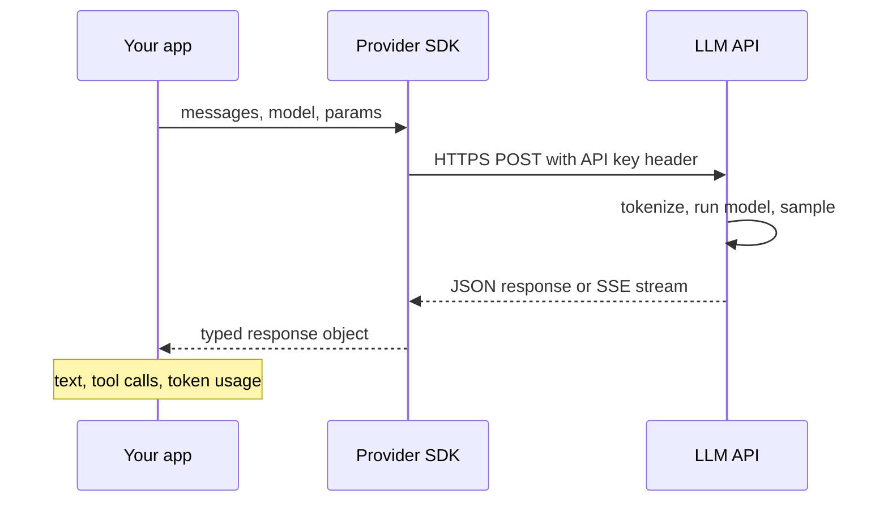
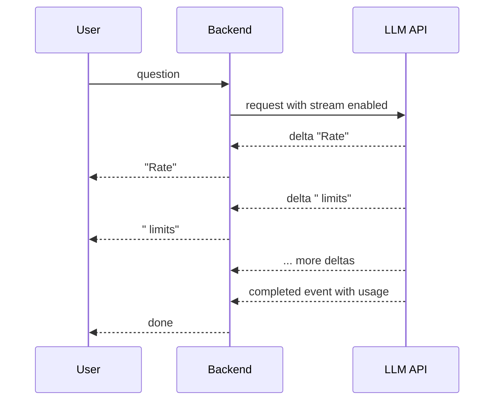
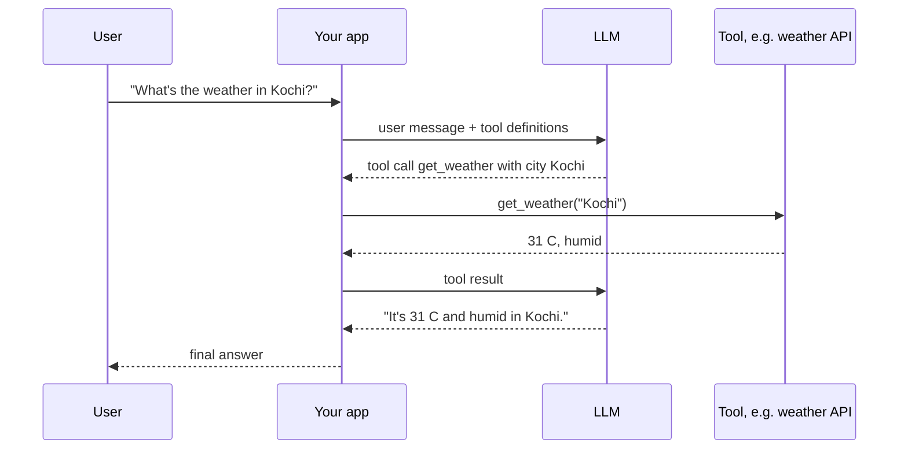

# 05. Working with LLM APIs

[Home](README.md) › 05. Working with LLM APIs

> **Level:** Beginner → Intermediate · **Time:** ~5 hours · **Prerequisites:** [Chapter 04](04-prompt-engineering.md), Python, HTTP basics

## Learning objectives

- Authenticate securely with the OpenAI, Google Gemini and Anthropic Claude APIs.
- Send prompts, handle responses and keep multi-turn conversations.
- Stream tokens for a responsive UX.
- Tune generation parameters for the task.
- Implement function/tool calling end to end.
- Handle errors, timeouts and rate limits like a production engineer.
- Build a provider-agnostic wrapper.

---

## 1. Why use LLM APIs?

Hosted APIs give you state-of-the-art models **without managing GPUs**. You pay per token, scale instantly and get new models as they're released.



Every provider follows the same pattern: **authenticate → build a request (model + messages + parameters) → receive a response (content + metadata + usage)**. Once you understand one, the others are easy.

| Concept | OpenAI (Responses API) | Anthropic Claude (Messages API) | Google Gemini (`google-genai`) |
|---|---|---|---|
| Python package | `openai` | `anthropic` | `google-genai` |
| API key env var | `OPENAI_API_KEY` | `ANTHROPIC_API_KEY` | `GEMINI_API_KEY` |
| Main call | `client.responses.create()` | `client.messages.create()` | `client.models.generate_content()` |
| System prompt | `instructions=` | `system=` | `config.system_instruction` |
| Output text | `response.output_text` | `response.content[0].text` | `response.text` |
| Max output | `max_output_tokens` | `max_tokens` (required) | `config.max_output_tokens` |
| Token usage | `response.usage` | `response.usage` | `response.usage_metadata` |

> **Model IDs used in this chapter** (checked October 2026; always confirm on the models pages linked in [References](#16-references)):
> `gpt-6-luna` (OpenAI, low-cost), `claude-sonnet-5-5` (Anthropic), `gemini-3.8-flash` (Google).

---

## 2. API authentication

```bash
pip install openai anthropic google-genai python-dotenv tenacity
```

```bash
# .env  — add .env to .gitignore!
OPENAI_API_KEY=sk-...
ANTHROPIC_API_KEY=sk-ant-...
GEMINI_API_KEY=...
```

```python
from dotenv import load_dotenv
load_dotenv()  # loads keys into environment variables

from openai import OpenAI
from anthropic import Anthropic
from google import genai

openai_client = OpenAI()          # reads OPENAI_API_KEY
claude_client = Anthropic()       # reads ANTHROPIC_API_KEY
gemini_client = genai.Client()    # reads GEMINI_API_KEY
```

### Security rules

- **Never hard-code keys** or commit them. Use environment variables or a secrets manager (AWS Secrets Manager, GCP Secret Manager, Vault).
- **Never call LLM APIs directly from frontend code.** Keys in browsers or mobile apps can be extracted. Route requests through your backend.
- Use **separate keys per environment** (dev/staging/prod) and per service, with spending limits.
- **Rotate** keys regularly and immediately if leaked. Enable secret scanning on GitHub.

---

## 3. OpenAI API

### Sending a prompt and receiving a response

```python
from openai import OpenAI

client = OpenAI()
MODEL = "gpt-6-luna"

response = client.responses.create(
    model=MODEL,
    instructions="You are a concise technical assistant.",
    input="Explain what an API rate limit is in two sentences.",
    max_output_tokens=200,
)

print(response.output_text)                       # convenience accessor for all text output
print(response.id)                                # response ID (useful for logging)
print(response.usage.input_tokens, response.usage.output_tokens)
```

### Multi-turn conversations

The API is stateless by default, so send the history yourself:

```python
history = [{"role": "user", "content": "My name is Priya and I'm learning RAG."}]
first = client.responses.create(model=MODEL, input=history)
history += [{"role": "assistant", "content": first.output_text},
            {"role": "user", "content": "What's my name and what am I learning?"}]
second = client.responses.create(model=MODEL, input=history)
print(second.output_text)
```

Or let OpenAI store the conversation state and chain responses by ID:

```python
first = client.responses.create(model=MODEL, input="My name is Priya.")
second = client.responses.create(
    model=MODEL,
    previous_response_id=first.id,
    input="What's my name?",
)
print(second.output_text)
```

> The older **Chat Completions API** (`client.chat.completions.create(messages=[...])`) is still widely used and supported, and many open-source servers (vLLM, Ollama) expose a Chat Completions-compatible endpoint. New OpenAI projects should prefer the Responses API.

---

## 4. Google Gemini API

```python
from google import genai
from google.genai import types

client = genai.Client()
MODEL = "gemini-3.8-flash"

response = client.models.generate_content(
    model=MODEL,
    contents="Explain what an API rate limit is in two sentences.",
    config=types.GenerateContentConfig(
        system_instruction="You are a concise technical assistant.",
        max_output_tokens=200,
        temperature=0.3,
    ),
)
print(response.text)
print(response.usage_metadata.prompt_token_count, response.usage_metadata.candidates_token_count)
```

### Multi-turn chat

```python
chat = client.chats.create(model=MODEL)
print(chat.send_message("My name is Priya and I'm learning RAG.").text)
print(chat.send_message("What am I learning?").text)   # history is kept by the chat object
```

### Multimodal input (image + text)

```python
from pathlib import Path

image_bytes = Path("invoice.png").read_bytes()
response = client.models.generate_content(
    model=MODEL,
    contents=[
        types.Part.from_bytes(data=image_bytes, mime_type="image/png"),
        "Extract the invoice number, date and total as JSON.",
    ],
)
print(response.text)
```

> Use the **`google-genai`** package. The older `google-generativeai` package is deprecated.

---

## 5. Anthropic Claude API

```python
from anthropic import Anthropic

client = Anthropic()
MODEL = "claude-sonnet-5-5"

message = client.messages.create(
    model=MODEL,
    max_tokens=300,                                        # required by the Messages API
    system="You are a concise technical assistant.",
    messages=[
        {"role": "user", "content": "Explain what an API rate limit is in two sentences."}
    ],
)

print(message.content[0].text)    # content is a list of blocks (text, tool_use, ...)
print(message.stop_reason)        # "end_turn", "max_tokens", "tool_use", ...
print(message.usage.input_tokens, message.usage.output_tokens)
```

### Multi-turn conversation

```python
messages = [{"role": "user", "content": "My name is Priya and I'm learning RAG."}]
reply = client.messages.create(model=MODEL, max_tokens=300, messages=messages)
messages += [
    {"role": "assistant", "content": reply.content},       # pass the content blocks back
    {"role": "user", "content": "What am I learning?"},
]
reply = client.messages.create(model=MODEL, max_tokens=300, messages=messages)
print(reply.content[0].text)
```

Claude also supports **prompt caching**. Mark a long, reused prefix (system prompt, documents) with `cache_control`, and later calls reuse it at a lower cost and latency. It's covered in [Chapter 13](13-llm-evaluation-and-production.md).

---

## 6. Streaming responses

Without streaming, users wait for the **entire** response. With streaming, tokens arrive as they're generated over **Server-Sent Events (SSE)**, so the first words appear in a fraction of a second.



### OpenAI

```python
stream = client.responses.create(
    model="gpt-6-luna",
    input="Write a haiku about vector databases.",
    stream=True,
)
for event in stream:
    if event.type == "response.output_text.delta":
        print(event.delta, end="", flush=True)
    elif event.type == "response.completed":
        print("\n\nTokens used:", event.response.usage.total_tokens)
```

### Gemini

```python
for chunk in gemini_client.models.generate_content_stream(
    model="gemini-3.8-flash",
    contents="Write a haiku about vector databases.",
):
    print(chunk.text, end="", flush=True)
```

### Claude

```python
with claude_client.messages.stream(
    model="claude-sonnet-5-5",
    max_tokens=300,
    messages=[{"role": "user", "content": "Write a haiku about vector databases."}],
) as stream:
    for text in stream.text_stream:
        print(text, end="", flush=True)
    final = stream.get_final_message()
print("\n\nOutput tokens:", final.usage.output_tokens)
```

### Streaming to a web client with FastAPI

```python
# server.py — run: uvicorn server:app --reload
from fastapi import FastAPI
from fastapi.responses import StreamingResponse
from openai import AsyncOpenAI

app = FastAPI()
client = AsyncOpenAI()

@app.get("/chat")
async def chat(q: str):
    async def token_stream():
        stream = await client.responses.create(model="gpt-6-luna", input=q, stream=True)
        async for event in stream:
            if event.type == "response.output_text.delta":
                yield f"data: {event.delta}\n\n"          # SSE format
        yield "data: [DONE]\n\n"
    return StreamingResponse(token_stream(), media_type="text/event-stream")
```

---

## 7. Temperature and other parameters

| Parameter | What it does | Typical values |
|---|---|---|
| `temperature` | Randomness of sampling | 0–0.3 extraction, classification, code · 0.7–1.0 creative writing |
| `top_p` | Nucleus sampling cutoff | 0.9–1.0 (change temperature **or** top_p, not both) |
| `top_k` | Sample only from the top k tokens (Gemini, Claude) | 20–40 |
| Max output tokens | Hard cap on generated tokens | Set it to bound cost and latency |
| Stop sequences | Stop generating when a string appears | `["\n\n###"]` |
| Reasoning effort / thinking budget | How much internal reasoning a reasoning model does | low / medium / high, or a token budget |
| `seed` | Best-effort reproducibility (some providers) | Any integer |

```python
for t in (0.0, 0.7, 1.2):
    r = gemini_client.models.generate_content(
        model="gemini-3.8-flash",
        contents="Suggest a name for a coffee shop run by robots. Reply with the name only.",
        config=types.GenerateContentConfig(temperature=t),
    )
    print(t, r.text.strip())
```

> **Note:** Reasoning models often **ignore or restrict** sampling parameters such as `temperature` and `top_p`, and use a *reasoning effort* or *thinking* setting instead. If a call fails with an "unsupported parameter" error, check the model's documentation.

### Choosing parameters by task

| Task | Temperature | Notes |
|---|---|---|
| Data extraction / JSON | 0–0.2 | Plus structured outputs |
| Classification | 0 | Deterministic labels |
| Q&A over documents (RAG) | 0–0.3 | Stay faithful to sources |
| Code generation | 0–0.3 | Correctness over creativity |
| Brainstorming / marketing | 0.8–1.0 | Diversity matters |

---

## 8. Function calling and tool calling

**Tool calling** lets the model ask your code to run a function, such as fetching weather, querying a database or sending an email, and then use the result in its answer. The model **never executes code itself**. It outputs a structured request (function name + JSON arguments), and **your application** decides whether to execute it.



Our shared tool implementation:

```python
import json

def get_weather(city: str, unit: str = "celsius") -> dict:
    """Fake weather lookup — replace with a real API call."""
    data = {"kochi": 31, "london": 14, "new york": 20}
    temp = data.get(city.lower(), 25)
    if unit == "fahrenheit":
        temp = round(temp * 9 / 5 + 32)
    return {"city": city, "temperature": temp, "unit": unit, "condition": "humid"}

TOOLS_IMPL = {"get_weather": get_weather}

WEATHER_SCHEMA = {
    "type": "object",
    "properties": {
        "city": {"type": "string", "description": "City name, e.g. 'Kochi'"},
        "unit": {"type": "string", "enum": ["celsius", "fahrenheit"]},
    },
    "required": ["city"],
}
```

### OpenAI tool calling (full loop)

```python
from openai import OpenAI

client = OpenAI()
MODEL = "gpt-6-luna"

tools = [{
    "type": "function",
    "name": "get_weather",
    "description": "Get the current weather for a city.",
    "parameters": WEATHER_SCHEMA,
}]

input_items = [{"role": "user", "content": "What's the weather in Kochi and London?"}]

while True:
    response = client.responses.create(model=MODEL, input=input_items, tools=tools)
    calls = [item for item in response.output if item.type == "function_call"]
    if not calls:
        print(response.output_text)
        break
    input_items += response.output                       # keep the model's tool-call items
    for call in calls:
        result = TOOLS_IMPL[call.name](**json.loads(call.arguments))
        input_items.append({
            "type": "function_call_output",
            "call_id": call.call_id,
            "output": json.dumps(result),
        })
```

### Claude tool use (full loop)

```python
from anthropic import Anthropic

client = Anthropic()
MODEL = "claude-sonnet-5-5"

tools = [{
    "name": "get_weather",
    "description": "Get the current weather for a city.",
    "input_schema": WEATHER_SCHEMA,
}]

messages = [{"role": "user", "content": "What's the weather in Kochi and London?"}]

while True:
    response = client.messages.create(model=MODEL, max_tokens=1024, tools=tools, messages=messages)
    if response.stop_reason != "tool_use":
        print(next(b.text for b in response.content if b.type == "text"))
        break
    messages.append({"role": "assistant", "content": response.content})
    tool_results = []
    for block in response.content:
        if block.type == "tool_use":
            result = TOOLS_IMPL[block.name](**block.input)
            tool_results.append({
                "type": "tool_result",
                "tool_use_id": block.id,
                "content": json.dumps(result),
            })
    messages.append({"role": "user", "content": tool_results})
```

### Gemini function calling (automatic)

The Gemini SDK can turn a Python function, using its type hints and docstring, into a tool declaration and run the loop for you:

```python
from google import genai
from google.genai import types

client = genai.Client()

def get_weather(city: str, unit: str = "celsius") -> dict:
    """Get the current weather for a city.

    Args:
        city: City name, e.g. 'Kochi'.
        unit: 'celsius' or 'fahrenheit'.
    """
    return {"city": city, "temperature": 31, "unit": unit, "condition": "humid"}

response = client.models.generate_content(
    model="gemini-3.8-flash",
    contents="What's the weather in Kochi?",
    config=types.GenerateContentConfig(tools=[get_weather]),   # automatic function calling
)
print(response.text)
```

### Tool design tips

- Write **clear names and descriptions**. The model chooses tools based on them.
- Keep schemas **small and typed**; use `enum` for fixed choices.
- **Validate arguments** before executing. The model can produce invalid or malicious values.
- Require **human confirmation** for destructive actions (delete, pay, send).
- Return **concise, structured** results, and return errors as data (`{"error": "city not found"}`) so the model can recover.
- Models can request **several tools in parallel**. Handle every call in a turn.

---

## 9. Structured output across providers

```python
from pydantic import BaseModel

class Invoice(BaseModel):
    invoice_number: str
    total: float
    currency: str

text = "Invoice INV-2041, total due: 1,250.00 EUR"

# OpenAI
r = openai_client.responses.parse(model="gpt-6-luna", input=text, text_format=Invoice)
print(r.output_parsed)

# Gemini
r = gemini_client.models.generate_content(
    model="gemini-3.8-flash",
    contents=text,
    config=types.GenerateContentConfig(response_mime_type="application/json", response_schema=Invoice),
)
print(r.parsed)

# Claude — use a tool whose input schema is the output schema, and force the tool
r = claude_client.messages.create(
    model="claude-sonnet-5-5",
    max_tokens=500,
    tools=[{"name": "record_invoice", "description": "Record invoice data.",
            "input_schema": Invoice.model_json_schema()}],
    tool_choice={"type": "tool", "name": "record_invoice"},
    messages=[{"role": "user", "content": text}],
)
print(Invoice.model_validate(r.content[0].input))
```

---

## 10. Error handling and rate limits

### Common errors

| HTTP status | Meaning | What to do |
|---|---|---|
| 400 | Bad request (invalid params, context too long) | Fix the request; **don't retry** |
| 401 / 403 | Invalid key or no permission | Check the key and permissions; don't retry |
| 404 | Unknown model or endpoint | Check the model ID |
| 408 / timeout | Request took too long | Retry with backoff; consider streaming |
| **429** | **Rate limit** or quota exceeded | Retry with exponential backoff + jitter; respect `retry-after` |
| 500 / 502 / 503 / 529 | Provider error or overload | Retry with backoff; fall back to another model |

### Rate limits

Providers limit **requests per minute (RPM)**, **tokens per minute (TPM)** and sometimes daily quotas, per model and per usage tier. Check the response headers (for example `x-ratelimit-remaining-tokens`) and your dashboard.

### Built-in retries

The OpenAI and Anthropic SDKs already retry connection errors, 408, 429 and 5xx a few times with backoff:

```python
openai_client = OpenAI(max_retries=5, timeout=30.0)
claude_client = Anthropic(max_retries=5, timeout=30.0)
```

### Custom retry with `tenacity`

```python
import openai
from tenacity import retry, retry_if_exception_type, stop_after_attempt, wait_random_exponential

RETRYABLE = (openai.RateLimitError, openai.APITimeoutError,
             openai.APIConnectionError, openai.InternalServerError)

@retry(
    retry=retry_if_exception_type(RETRYABLE),
    wait=wait_random_exponential(min=1, max=60),   # exponential backoff with jitter
    stop=stop_after_attempt(6),
    reraise=True,
)
def generate(prompt: str) -> str:
    return openai_client.responses.create(model="gpt-6-luna", input=prompt).output_text

try:
    print(generate("Hello!"))
except openai.BadRequestError as e:
    print("Fix the request:", e.message)
except openai.AuthenticationError:
    print("Check OPENAI_API_KEY")
except RETRYABLE as e:
    print("Still failing after retries:", e)
```

Anthropic exposes the same exception names (`anthropic.RateLimitError`, `anthropic.APIStatusError`, ...). The Gemini SDK raises `google.genai.errors.APIError` with a `.code` attribute.

### Controlling concurrency

```python
import asyncio
from openai import AsyncOpenAI

aclient = AsyncOpenAI()
semaphore = asyncio.Semaphore(5)          # at most 5 requests in flight

async def summarise(text: str) -> str:
    async with semaphore:
        r = await aclient.responses.create(model="gpt-6-luna", input=f"Summarise in one line: {text}")
        return r.output_text

async def main(texts):
    return await asyncio.gather(*(summarise(t) for t in texts))

results = asyncio.run(main(["doc one ...", "doc two ...", "doc three ..."]))
```

For large offline jobs (thousands of documents), use the providers' **Batch APIs**, which are typically about 50% cheaper and run asynchronously.

### Fallbacks

```python
def generate_with_fallback(prompt: str) -> str:
    try:
        return openai_client.responses.create(model="gpt-6-luna", input=prompt).output_text
    except (openai.APIStatusError, openai.APIConnectionError):
        msg = claude_client.messages.create(
            model="claude-sonnet-5-5", max_tokens=1024,
            messages=[{"role": "user", "content": prompt}],
        )
        return msg.content[0].text
```

---

## 11. A provider-agnostic wrapper

Hiding providers behind one interface makes it easy to switch models, run A/B tests and add fallbacks.

```python
# llm_client.py
from dataclasses import dataclass
from typing import Protocol

from anthropic import Anthropic
from google import genai
from google.genai import types
from openai import OpenAI

@dataclass
class LLMResponse:
    text: str
    input_tokens: int
    output_tokens: int
    model: str

class LLM(Protocol):
    def generate(self, prompt: str, system: str = "", max_tokens: int = 1024) -> LLMResponse: ...

class OpenAILLM:
    def __init__(self, model: str = "gpt-6-luna"):
        self.client, self.model = OpenAI(), model

    def generate(self, prompt, system="", max_tokens=1024):
        r = self.client.responses.create(model=self.model, instructions=system or None,
                                         input=prompt, max_output_tokens=max_tokens)
        return LLMResponse(r.output_text, r.usage.input_tokens, r.usage.output_tokens, self.model)

class ClaudeLLM:
    def __init__(self, model: str = "claude-sonnet-5-5"):
        self.client, self.model = Anthropic(), model

    def generate(self, prompt, system="", max_tokens=1024):
        kwargs = {"system": system} if system else {}
        r = self.client.messages.create(model=self.model, max_tokens=max_tokens,
                                        messages=[{"role": "user", "content": prompt}], **kwargs)
        text = "".join(b.text for b in r.content if b.type == "text")
        return LLMResponse(text, r.usage.input_tokens, r.usage.output_tokens, self.model)

class GeminiLLM:
    def __init__(self, model: str = "gemini-3.8-flash"):
        self.client, self.model = genai.Client(), model

    def generate(self, prompt, system="", max_tokens=1024):
        r = self.client.models.generate_content(
            model=self.model, contents=prompt,
            config=types.GenerateContentConfig(system_instruction=system or None,
                                               max_output_tokens=max_tokens))
        u = r.usage_metadata
        return LLMResponse(r.text or "", u.prompt_token_count, u.candidates_token_count or 0, self.model)

def get_llm(provider: str) -> LLM:
    return {"openai": OpenAILLM, "claude": ClaudeLLM, "gemini": GeminiLLM}[provider]()

if __name__ == "__main__":
    for p in ("openai", "claude", "gemini"):
        res = get_llm(p).generate("Name one benefit of streaming responses.", system="One sentence.")
        print(f"[{res.model}] {res.text}  ({res.input_tokens}+{res.output_tokens} tokens)")
```

> Libraries such as **LiteLLM** and **LangChain's chat model interface** ([Chapter 10](10-ai-frameworks.md)) offer ready-made versions of this abstraction.

---

## 12. Real-world use cases

| Use case | API features used |
|---|---|
| Customer chat widget | Streaming, multi-turn history, moderation |
| Invoice/receipt processing | Vision input + structured output |
| Internal Slack bot that queries Jira | Tool calling |
| Nightly summarisation of 50k tickets | Batch API, concurrency limits |
| Mission-critical assistant | Fallback across providers, retries, timeouts |

---

## 13. Advantages, disadvantages, best practices and common mistakes

| Advantages | Disadvantages / limitations |
|---|---|
| State-of-the-art models with no infrastructure | Data leaves your infrastructure (check data-retention terms) |
| Pay-per-use; scales instantly | Cost grows with usage; rate limits |
| Fast access to new models | Vendor lock-in; models get deprecated |
| Built-in tooling (tools, caching, batch) | Network latency; outages |

### Best practices

- Centralise LLM calls in **one module**; log model, prompt version, tokens, latency and cost for each call.
- **Always set timeouts and max output tokens.**
- **Stream** for user-facing responses.
- **Pin dated model versions** in production; test before upgrading.
- Use **structured outputs** instead of parsing prose.
- Use **batch APIs** for offline jobs and **prompt caching** for repeated long prefixes.

### Common mistakes

| Mistake | Fix |
|---|---|
| Retrying 400 errors | Retry only 408/429/5xx and connection errors |
| No `max_tokens`, leading to runaway cost | Always cap output |
| Executing tool calls without validation | Validate arguments; allowlist tools; confirm destructive actions |
| Exposing API keys in frontend code | Proxy through your backend |
| Forgetting to append the assistant's tool-call turn before tool results | Follow each provider's message ordering exactly |
| Unbounded `asyncio.gather` over thousands of requests | Use a semaphore or a batch API |

---

## 14. Interview questions and answers

**Q1. How does function calling work?**
You send tool definitions (name, description, JSON schema) with the request. If the model decides a tool is needed, it returns a structured tool call instead of text. Your code validates and runs the function, sends the result back as a tool-result message, and the model uses it to produce the final answer. The model never executes code itself.

**Q2. How do you handle rate limits?**
Retry 429s with exponential backoff and jitter, respect `retry-after`, limit concurrency with a semaphore or queue, use batch APIs for offline work, cache responses, reduce tokens, request higher limits, and spread load across models or providers.

**Q3. Why stream responses?**
It cuts perceived latency: users see the first tokens within a few hundred milliseconds instead of waiting for the whole response. It also lets you cancel generation early. The total generation time is unchanged.

**Q4. How do you keep conversation state with a stateless API?**
Resend the relevant message history with each request, trimmed or summarised to fit the context window, or use a provider feature such as OpenAI's `previous_response_id` or conversation objects.

**Q5. How would you design for provider outages?**
Wrap providers behind a common interface, set timeouts, retry transient errors, fall back to a secondary model or provider, use circuit breakers, and monitor error rates. Evaluate the fallback model's quality beforehand.

**Q6. What's the difference between temperature and top-p?**
Temperature rescales the whole probability distribution. Top-p truncates it to the smallest set of tokens whose cumulative probability is at least p, then samples from that set. Usually you tune one of them, not both.

**Q7. How do you secure API keys in a web app?**
Keep keys on the server (env vars or a secrets manager), proxy requests through your backend with user authentication and per-user rate limits, set spending limits, rotate keys and enable secret scanning.

---

## 15. Hands-on exercises

1. **Three providers, one prompt.** Use `llm_client.py` to send the same 5 prompts to all three providers. Compare quality, latency and token counts in a table.
2. **Streaming CLI chat.** Build a terminal chatbot that streams responses and keeps history until the user types `exit`.
3. **Tool calling.** Add `get_time(timezone)` and `convert_currency(amount, from, to)` tools to the OpenAI or Claude loop. Ask a question that needs both.
4. **Resilience.** Simulate failures by raising `RateLimitError` randomly in a mock, and verify your retry logic with logs.
5. **Cost tracker.** Extend `LLMResponse` with a `cost_usd` field computed from a per-model pricing table.

### Assignment

Build a **FastAPI LLM gateway** service with:
- `POST /generate` (JSON) and `GET /stream` (SSE) endpoints
- Provider selection via a request parameter, with automatic fallback
- Retries, timeouts and per-user rate limiting
- Structured logging of model, tokens, latency and cost
- A `README.md` with an architecture diagram, plus a `Dockerfile`

---

## 16. References

- [OpenAI — API reference](https://developers.openai.com/api/reference) · [Responses API guide](https://developers.openai.com/api/docs/guides/text) · [Function calling](https://developers.openai.com/api/docs/guides/function-calling) · [Streaming](https://developers.openai.com/api/docs/guides/streaming-responses) · [Rate limits](https://developers.openai.com/api/docs/guides/rate-limits) · [Models](https://developers.openai.com/api/docs/models)
- [Anthropic — Claude API docs](https://docs.claude.com/en/api/overview) · [Messages API](https://docs.claude.com/en/api/messages) · [Tool use](https://docs.claude.com/en/docs/agents-and-tools/tool-use/overview) · [Streaming](https://docs.claude.com/en/docs/build-with-claude/streaming) · [Models](https://docs.claude.com/en/docs/about-claude/models/overview)
- [Google — Gemini API docs](https://ai.google.dev/gemini-api/docs) · [Text generation](https://ai.google.dev/gemini-api/docs/text-generation) · [Function calling](https://ai.google.dev/gemini-api/docs/function-calling) · [Structured output](https://ai.google.dev/gemini-api/docs/structured-output) · [Models](https://ai.google.dev/gemini-api/docs/models)
- [google-genai Python SDK](https://googleapis.github.io/python-genai/)
- [Tenacity — retrying library](https://tenacity.readthedocs.io/)

---

| ← Previous | Index | Next → |
|---|---|---|
| [04. Prompt Engineering](04-prompt-engineering.md) | [Home](README.md) | [06. Embeddings](06-embeddings.md) |
