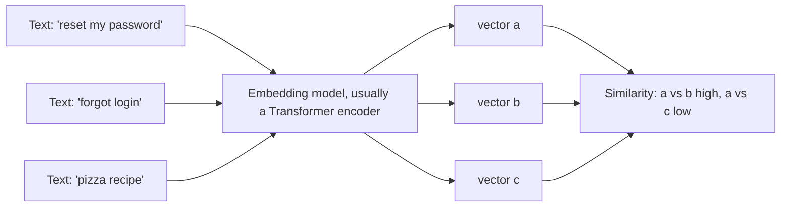
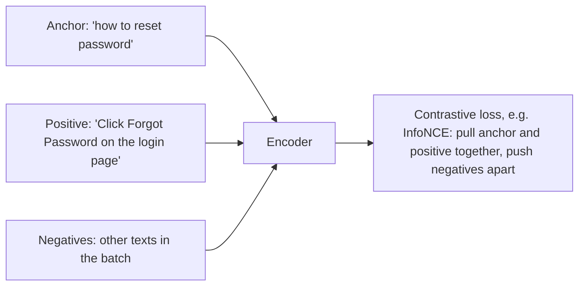

# 06. Embeddings

[Home](README.md) › 06. Embeddings

> **Level:** Intermediate · **Time:** ~3 hours · **Prerequisites:** [Chapter 05](05-working-with-llm-apis.md), vectors and dot products

## Learning objectives

- Explain what an embedding is and why it captures meaning.
- Describe how embedding models are trained (contrastive learning).
- Compute semantic similarity with cosine similarity, dot product and Euclidean distance.
- Generate embeddings with OpenAI, Gemini and open-source models.
- Build a semantic search engine from scratch.
- Choose an embedding model for a real project.

---

## 1. What are embeddings?

An **embedding** is a list of numbers (a **vector**) that represents the *meaning* of a piece of content: a word, sentence, document, image or audio clip.

```
"How do I reset my password?"  →  [0.021, -0.113, 0.087, ..., 0.004]   (e.g. 1536 numbers)
"I forgot my login credentials" →  [0.019, -0.108, 0.091, ..., 0.010]   (very close!)
"Best pizza in Naples"          →  [-0.150, 0.042, -0.033, ..., 0.120]  (far away)
```

Texts with **similar meaning** get vectors that are **close together** in the vector space, even when they share no words.

### Why embeddings matter

Keyword search fails when users and documents use different words ("forgot login" vs "reset password"). Embeddings enable **semantic search**: finding by meaning. They are the foundation of:

- **RAG** — retrieving relevant documents for an LLM ([Chapter 07](07-retrieval-augmented-generation.md))
- **Semantic search** and **recommendations**
- **Clustering** and topic discovery
- **Classification** with few labels
- **Deduplication** and **anomaly detection**
- **Dynamic few-shot example selection** and **semantic caching**

---

## 2. How embeddings work

### Intuition: a map of meaning

Imagine a map where every concept has coordinates. "King" and "queen" are near each other; "banana" is far away. Real embeddings use hundreds or thousands of dimensions, and each dimension captures some learned aspect of meaning. Individual dimensions usually aren't human-interpretable.



### A short history

| Generation | Method | Limitation |
|---|---|---|
| One-hot / bag-of-words / TF-IDF | Sparse vectors of word counts | No notion of meaning; synonyms are unrelated |
| **Word2Vec, GloVe** (2013–14) | Dense word vectors learned from co-occurrence | One vector per word: "bank" (river) = "bank" (money) |
| **Contextual embeddings** (BERT, 2018) | Each token's vector depends on its context | Not directly optimised for sentence similarity |
| **Sentence embeddings** (Sentence-BERT, 2019 →) | Transformer + pooling, trained contrastively | Today's standard for search and RAG |

The famous Word2Vec example shows that directions in the space encode relationships:

```
vector("king") - vector("man") + vector("woman") ≈ vector("queen")
```

### How a modern text-embedding model produces a vector

1. **Tokenize** the text.
2. Pass the tokens through a **Transformer encoder** (bidirectional attention, [Chapter 03](03-transformer-architecture.md)), giving one vector per token.
3. **Pool** the token vectors into one vector: mean pooling, the `[CLS]` token, or the last token for decoder-based embedders.
4. Usually **normalise** to unit length.

### How embedding models are trained: contrastive learning

The model learns from **pairs** that should be close (a question and its answer, a title and its article) and pushes apart unrelated texts.



The **InfoNCE** loss for an anchor `q`, positive `p⁺` and negatives `pᵢ`:

```
loss = -log( exp(sim(q, p⁺)/τ) / Σ_i exp(sim(q, p_i)/τ) )
```

Training on millions of such pairs from search logs, Q&A sites and curated datasets teaches the model what "similar meaning" means.

---

## 3. Vector representations

| Property | Meaning | Typical values |
|---|---|---|
| **Dimensions** | Length of the vector | 384, 768, 1024, 1536, 3072 |
| **Dense vs sparse** | Dense: every value is non-zero (neural embeddings). Sparse: mostly zeros (TF-IDF, BM25, SPLADE) | Hybrid search combines both |
| **Normalisation** | Scaled to length 1 | Makes dot product = cosine similarity |
| **Data type** | float32, float16, int8, binary | Quantised vectors use 4–32× less storage |
| **Matryoshka (MRL)** | The first *k* dimensions are themselves a useful embedding | Truncate 3072 → 256 to save storage |

### Storage maths

```
storage = num_vectors × dimensions × bytes_per_value
1,000,000 chunks × 1536 dims × 4 bytes (float32) ≈ 6.1 GB
```

That's why dimension reduction (Matryoshka truncation) and quantisation matter at scale.

---

## 4. Semantic similarity

### The three main measures

| Measure | Formula | Range | Notes |
|---|---|---|---|
| **Cosine similarity** | `a·b / (‖a‖ ‖b‖)` | −1 to 1 | Compares direction only; the most common for text |
| **Dot product** | `Σ aᵢbᵢ` | unbounded | Equals cosine if vectors are normalised; fastest |
| **Euclidean (L2) distance** | `√Σ(aᵢ−bᵢ)²` | 0 to ∞ | Smaller = more similar; ranks the same as cosine for normalised vectors |

```python
import numpy as np

def cosine_similarity(a: np.ndarray, b: np.ndarray) -> float:
    return float(np.dot(a, b) / (np.linalg.norm(a) * np.linalg.norm(b)))

def euclidean_distance(a, b):
    return float(np.linalg.norm(a - b))

a = np.array([1.0, 2.0, 3.0])
b = np.array([2.0, 4.0, 6.0])     # same direction, twice the length
c = np.array([-3.0, 0.5, 1.0])

print(cosine_similarity(a, b))     # 1.0   -> identical direction
print(cosine_similarity(a, c))     # ~0.06 -> nearly unrelated
print(euclidean_distance(a, b))    # 3.74  -> L2 sees them as different
```

**Why cosine?** Text embeddings encode meaning in the **direction** of the vector; length mostly reflects things like text length. Cosine ignores length.

> **Important:** similarity scores are **relative**, not absolute. A cosine of 0.8 may be "very similar" with one model and "somewhat related" with another. Calibrate thresholds on your own data.

---

## 5. Embedding models

| Provider / model | Dimensions | Notes |
|---|---|---|
| OpenAI `text-embedding-3-small` | 1536 (can be shortened) | Cheap, strong default |
| OpenAI `text-embedding-3-large` | 3072 (can be shortened) | Higher quality |
| Google `gemini-embedding-001` | 3072 (supports smaller output sizes) | Multilingual; task types (`RETRIEVAL_QUERY`, `RETRIEVAL_DOCUMENT`, ...) |
| Voyage AI (recommended by Anthropic) | varies | Domain-specific models (code, law, finance) |
| Cohere Embed | varies | Multilingual, int8/binary outputs |
| `sentence-transformers/all-MiniLM-L6-v2` | 384 | Small, fast, runs on CPU; good for learning |
| BAAI `bge-*`, `e5-*`, `gte-*`, Nomic, Jina | 384–1024+ | Strong open-source options |

> Anthropic doesn't offer its own embedding model; its docs recommend Voyage AI. Check the **[MTEB leaderboard](https://huggingface.co/spaces/mteb/leaderboard)** for current rankings, then test on your own data.

### How to choose

| Criterion | Question |
|---|---|
| **Retrieval quality** | How does it perform on *your* queries and documents? |
| **Language / domain** | Multilingual? Code? Legal or medical? |
| **Max input length** | 512 tokens or 8k+? It affects chunk size. |
| **Dimensions** | Storage and search cost |
| **Cost and latency** | API price vs self-hosting |
| **Privacy** | Can the data leave your infrastructure? |

> **Golden rule:** use the **same embedding model** for documents and queries. Vectors from different models live in different spaces and **can't be compared**. Changing models means re-embedding everything.

---

## 6. Practical implementation with Python

### 6.1 OpenAI embeddings

```python
from openai import OpenAI
import numpy as np

client = OpenAI()
EMBED_MODEL = "text-embedding-3-small"

def embed(texts: list[str]) -> np.ndarray:
    response = client.embeddings.create(model=EMBED_MODEL, input=texts)   # batch in one call
    return np.array([d.embedding for d in response.data])

vectors = embed(["How do I reset my password?", "I forgot my login credentials", "Best pizza in Naples"])
print(vectors.shape)        # (3, 1536)

# Shorter vectors to save storage (Matryoshka-style truncation done by the API)
small = client.embeddings.create(model=EMBED_MODEL, input="hello", dimensions=256)
print(len(small.data[0].embedding))   # 256
```

### 6.2 Gemini embeddings

```python
from google import genai
from google.genai import types

client = genai.Client()

result = client.models.embed_content(
    model="gemini-embedding-001",
    contents=["How do I reset my password?", "I forgot my login credentials"],
    config=types.EmbedContentConfig(task_type="RETRIEVAL_DOCUMENT", output_dimensionality=768),
)
vectors = [e.values for e in result.embeddings]
print(len(vectors), len(vectors[0]))   # 2 768
```

Use `task_type="RETRIEVAL_QUERY"` when embedding search queries and `RETRIEVAL_DOCUMENT` for documents. These asymmetric task types improve retrieval.

### 6.3 Open-source with Sentence Transformers (runs locally, free)

```bash
pip install sentence-transformers
```

```python
from sentence_transformers import SentenceTransformer

model = SentenceTransformer("sentence-transformers/all-MiniLM-L6-v2")
sentences = ["How do I reset my password?", "I forgot my login credentials", "Best pizza in Naples"]
emb = model.encode(sentences, normalize_embeddings=True)
print(emb.shape)                        # (3, 384)
print(model.similarity(emb, emb))       # 3x3 cosine similarity matrix
```

### 6.4 Build a semantic search engine from scratch

```python
import numpy as np
from sentence_transformers import SentenceTransformer

model = SentenceTransformer("sentence-transformers/all-MiniLM-L6-v2")

documents = [
    "To reset your password, click 'Forgot password' on the login page.",
    "Refunds are processed within 5–7 business days after we receive the item.",
    "Our support team is available Monday to Friday, 9am to 6pm IST.",
    "You can change your delivery address from the Orders page before shipping.",
    "Premium members get free shipping on all orders.",
]
doc_vectors = model.encode(documents, normalize_embeddings=True)    # index once

def search(query: str, k: int = 3):
    q = model.encode([query], normalize_embeddings=True)[0]
    scores = doc_vectors @ q                       # dot product = cosine (normalised)
    top = np.argsort(-scores)[:k]
    return [(round(float(scores[i]), 3), documents[i]) for i in top]

for score, doc in search("I can't log into my account"):
    print(score, doc)
```

Notice that the query shares almost no words with the password document, yet it's ranked first. That's semantic search.

### 6.5 Visualising embeddings

```python
import matplotlib.pyplot as plt
from sklearn.decomposition import PCA

words = ["king", "queen", "man", "woman", "apple", "banana", "mango", "car", "bus", "train"]
vecs = model.encode(words)
points = PCA(n_components=2).fit_transform(vecs)

plt.figure(figsize=(7, 5))
plt.scatter(points[:, 0], points[:, 1])
for (x, y), w in zip(points, words):
    plt.annotate(w, (x, y))
plt.title("Embeddings projected to 2D with PCA")
plt.show()
```

You should see clusters: royalty and people, fruits, and vehicles.

### 6.6 Clustering and classification

```python
from sklearn.cluster import KMeans

tickets = [
    "My card was charged twice", "Refund not received yet", "Payment failed at checkout",
    "Package arrived damaged", "Delivery is late by a week", "Wrong item shipped",
    "App crashes on login", "Can't reset password", "2FA code not arriving",
]
X = model.encode(tickets, normalize_embeddings=True)
labels = KMeans(n_clusters=3, n_init="auto", random_state=0).fit_predict(X)
for label, t in sorted(zip(labels, tickets)):
    print(label, t)
```

You can then ask an LLM to **name each cluster**, which gives you automatic topic discovery for support tickets or feedback.

---

## 7. Advanced topics

| Topic | Summary |
|---|---|
| **Bi-encoder vs cross-encoder** | Bi-encoders embed query and document separately (fast, scalable). Cross-encoders read them together (more accurate, slow), so they're used for **reranking** ([Chapter 07](07-retrieval-augmented-generation.md)). |
| **Hybrid search** | Combine dense vectors with sparse keyword scores (BM25) to catch exact terms such as product codes and names. |
| **Multimodal embeddings** | CLIP-style models put images and text in one space for text→image search. |
| **Fine-tuning embedders** | Train on your (query, relevant doc) pairs with Sentence Transformers to improve domain retrieval. |
| **Late interaction (ColBERT)** | Keeps one vector per token for finer matching; more storage. |
| **Quantisation** | int8/binary embeddings cut storage 4–32× with a small accuracy loss. |

---

## 8. Real-world use cases

| Use case | How embeddings are used |
|---|---|
| Knowledge-base search | Embed articles; match user questions by meaning |
| E-commerce "similar products" | Embed product descriptions and images |
| Duplicate ticket detection | Flag new tickets very similar to open ones |
| Resume ↔ job matching | Rank candidates by similarity to a job description |
| Semantic caching | Return a cached LLM answer when a new question is close to an old one |
| Content moderation | Compare against embeddings of known bad content |

---

## 9. Advantages, disadvantages and limitations

| Advantages | Disadvantages / limitations |
|---|---|
| Captures meaning, synonyms and paraphrases | Can miss exact matches (IDs, codes, rare names); use hybrid search |
| Language-agnostic with multilingual models | Not explainable: you can't see *why* two texts are similar |
| Cheap compared with LLM generation | Similarity ≠ relevance ≠ correctness |
| One representation for many tasks | Re-embedding everything is needed when you switch models |
| Scales to millions of items with ANN indexes | Long texts get "averaged", losing detail; chunking is needed |
| | Negation is weak: "X is safe" and "X is not safe" can be close |

---

## 10. Best practices and common mistakes

### Best practices

- **Batch** embedding calls (hundreds of texts per request) for throughput.
- **Cache** embeddings. Store the model name and version with every vector.
- **Normalise** vectors and use dot product or cosine consistently.
- **Embed meaningful chunks** (a paragraph or section), not whole books or single words.
- **Evaluate retrieval** with Recall@k and MRR on real queries before choosing a model.
- Use **query vs document task types or prefixes** when the model supports them (Gemini task types; `query:`/`passage:` prefixes for E5).

### Common mistakes

| Mistake | Consequence | Fix |
|---|---|---|
| Mixing embedding models | Meaningless similarity scores | One model per index; re-embed on change |
| Hard-coded similarity thresholds copied from blogs | Wrong filtering | Calibrate on your data |
| Embedding huge documents as one vector | Diluted meaning, poor retrieval | Chunk first |
| Ignoring the model's max input length | Silent truncation | Check limits; chunk accordingly |
| Re-embedding unchanged documents | Wasted money | Hash content; only embed new or changed chunks |

---

## 11. Interview questions and answers

**Q1. What is an embedding?**
A dense vector representing the meaning of content, produced by a neural network so that semantically similar items are close together in vector space.

**Q2. Why is cosine similarity preferred for text embeddings?**
It measures the angle between vectors and ignores magnitude, and in text embeddings meaning is mostly encoded in direction. For normalised vectors, cosine equals dot product and gives the same ranking as Euclidean distance.

**Q3. How are sentence-embedding models trained?**
With contrastive learning on pairs of related texts (query–answer, title–body). A loss such as InfoNCE pulls positive pairs together and pushes in-batch negatives apart.

**Q4. What's the difference between a bi-encoder and a cross-encoder?**
A bi-encoder encodes query and document independently into vectors and compares them, so document vectors can be precomputed: fast and scalable. A cross-encoder processes the query and document together through one Transformer and outputs a relevance score: more accurate, but too slow for searching millions of documents. It's used to rerank a shortlist.

**Q5. Can you compare embeddings from two different models?**
No. Each model has its own vector space. Switching models means re-embedding the whole corpus.

**Q6. What are the limitations of dense embeddings for search?**
They can miss exact keyword matches (SKUs, error codes, names), struggle with negation and very long texts, and aren't explainable. Hybrid search (dense + BM25) and reranking address most of this.

**Q7. How would you reduce storage for 100M embeddings?**
Use fewer dimensions (Matryoshka truncation or a smaller model), quantise to int8 or binary, use compressed ANN indexes (IVF-PQ), and deduplicate.

---

## 12. Hands-on exercises

1. **Similarity matrix.** Embed 10 sentences (2 per topic across 5 topics) and print a cosine similarity heatmap. Do same-topic pairs score highest?
2. **Model comparison.** Compare `all-MiniLM-L6-v2` and `text-embedding-3-small` on 20 query → correct-document pairs. Measure Recall@1 and Recall@3.
3. **Negation test.** Compare the similarity of "The medicine is safe for children" vs "The medicine is not safe for children". What does this mean for search?
4. **Semantic cache.** Build a cache that returns a stored LLM answer if a new question has cosine > 0.92 with a previous one. Test with paraphrases.
5. **Cluster your notes.** Embed your own notes or emails, cluster them with K-Means and have an LLM name each cluster.

### Assignment

Build a **semantic FAQ search** CLI or Streamlit app over at least 50 FAQs from a real product. Include: embedding caching to disk, top-k results with scores, a hybrid mode (BM25 + embeddings, using `rank_bm25`), and an evaluation script reporting Recall@3 for 20 test queries. Document which configuration worked best and why.

---

## 13. References

- [OpenAI — Embeddings guide](https://developers.openai.com/api/docs/guides/embeddings)
- [Google — Gemini embeddings](https://ai.google.dev/gemini-api/docs/embeddings)
- [Anthropic — Embeddings (Voyage AI recommendation)](https://docs.claude.com/en/docs/build-with-claude/embeddings)
- [Sentence Transformers documentation](https://sbert.net/)
- [MTEB leaderboard](https://huggingface.co/spaces/mteb/leaderboard)
- [Mikolov et al. — Word2Vec](https://arxiv.org/abs/1301.3781)
- [Reimers & Gurevych — Sentence-BERT](https://arxiv.org/abs/1908.10084)
- [Kusupati et al. — Matryoshka Representation Learning](https://arxiv.org/abs/2205.13147)
- [Hugging Face — Embeddings course chapter](https://huggingface.co/learn/llm-course/chapter5/6)

---

| ← Previous | Index | Next → |
|---|---|---|
| [05. Working with LLM APIs](05-working-with-llm-apis.md) | [Home](README.md) | [07. Retrieval-Augmented Generation](07-retrieval-augmented-generation.md) |
