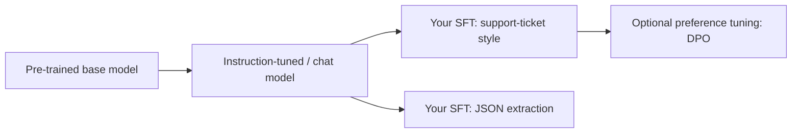
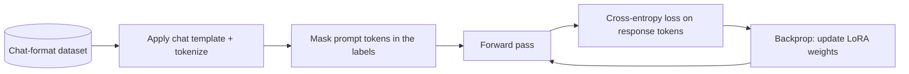
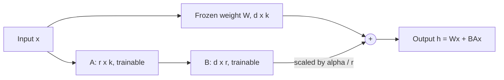
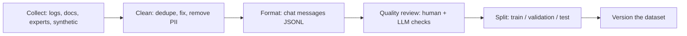
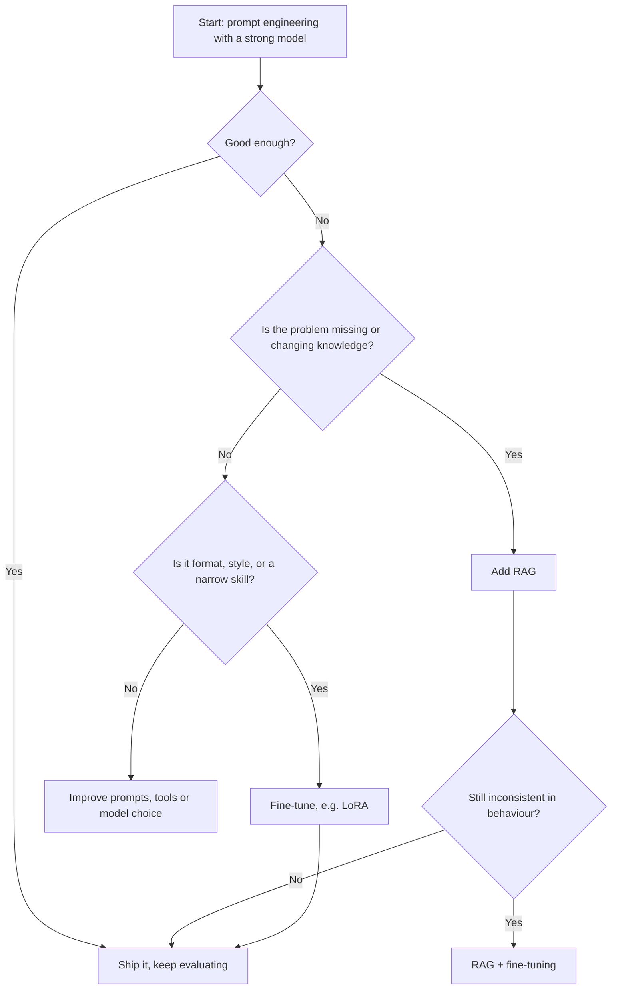

# 09. Fine-Tuning LLMs

[Home](README.md) › 09. Fine-Tuning LLMs

> **Level:** Advanced · **Time:** ~6 hours · **Prerequisites:** [Chapter 02](02-understanding-llms.md), [Chapter 03](03-transformer-architecture.md), basic PyTorch. A GPU helps (a free Google Colab T4 is enough for the examples).

## Learning objectives

- Explain what fine-tuning changes inside a model, and what it doesn't.
- Distinguish pre-training, supervised fine-tuning and preference tuning.
- Explain the maths behind LoRA and why QLoRA makes fine-tuning cheap.
- Prepare a high-quality instruction dataset in chat format.
- Fine-tune an open model with Hugging Face TRL + PEFT, and use a provider's fine-tuning API.
- Evaluate fine-tuned models and decide between RAG, prompting and fine-tuning.

---

## 1. What is fine-tuning?

**Fine-tuning** continues training a pre-trained model on a **smaller, task-specific dataset**, updating its weights so it behaves the way you want: a specific style, format, domain vocabulary or skill.

> Pre-training teaches a model *language and the world*. Fine-tuning teaches it *your job*.

### Why it matters

- **Consistency:** reliably follows a format or tone that prompting only achieves sometimes.
- **Efficiency:** a fine-tuned **small** model can match a large general model on a narrow task, at a fraction of the cost and latency.
- **Shorter prompts:** behaviour moves from long instructions and examples into the weights, which saves tokens on every call.
- **Specialisation:** domain language (legal, medical, internal jargon), classification and extraction tasks.
- **Privacy / control:** run your own fine-tuned open model on your own infrastructure.

### What fine-tuning is NOT good for

- **Adding lots of new facts that change.** Models learn facts from fine-tuning unreliably, and the facts go stale. Use RAG.
- **Fixing a broken prompt or bad data.**
- **Guaranteeing correctness.** Fine-tuned models can still hallucinate.

---

## 2. Pre-training vs fine-tuning

| | Pre-training | Fine-tuning |
|---|---|---|
| **Goal** | General language understanding and knowledge | Specific behaviour, task or domain |
| **Data** | Trillions of unlabelled tokens | Hundreds to tens of thousands of curated examples |
| **Objective** | Next-token prediction on raw text | Next-token prediction on **target responses** (SFT), or preference objectives |
| **Compute** | Thousands of GPUs, weeks to months | One GPU, minutes to hours (with LoRA) |
| **Cost** | Millions of dollars | Dollars to thousands of dollars |
| **Who does it** | Model labs | Application teams (you) |



### Types of fine-tuning

| Type | What's updated | Data | Typical use |
|---|---|---|---|
| **Full fine-tuning** | All weights | Large | Labs, major domain shifts; expensive |
| **PEFT (LoRA, QLoRA, adapters)** | Small added parameters | Small–medium | Most application fine-tuning |
| **Supervised fine-tuning (SFT)** | Any of the above | (prompt, ideal response) pairs | Format, style, task skills |
| **Preference tuning (DPO, ORPO, RLHF)** | Any of the above | (prompt, chosen, rejected) | Tone, helpfulness, safety preferences |
| **Continued pre-training** | All or most weights | Raw domain text | Teach domain language (e.g. legal corpus) |
| **Distillation** | Student model | Outputs of a larger teacher model | Shrink a big model's skill into a small one |

---

## 3. Supervised fine-tuning (SFT)

In SFT, the model is trained on examples of **inputs and the exact outputs you want**. The loss is next-token cross-entropy, usually computed **only on the assistant's response tokens** (the prompt tokens are masked), so the model learns to *produce* answers, not to repeat questions.



Example training record (chat format):

```json
{"messages": [
  {"role": "system", "content": "You are Acme's support assistant. Be brief and friendly."},
  {"role": "user", "content": "My order hasn't arrived and it's been 10 days."},
  {"role": "assistant", "content": "Sorry about the wait! Please share your order number and I'll check the delivery status right away."}
]}
```

---

## 4. LoRA (Low-Rank Adaptation)

### The problem

Full fine-tuning of a 7B model updates 7 billion parameters. With optimizer states that needs **~100+ GB of GPU memory**, and every fine-tuned version is a full 14 GB copy.

### The idea

LoRA **freezes** the original weights `W` and learns a small **low-rank update**:

```
W' = W + ΔW = W + (α / r) · B · A

W: d × k  (frozen)        B: d × r  (trainable, initialised to 0)
A: r × k  (trainable)     r ≪ min(d, k), e.g. r = 16
```



**Why it works:** research (Hu et al., 2021) found that the weight *changes* needed for adaptation have low "intrinsic rank", so a small matrix product can capture them.

### Parameter savings

For one 4096 × 4096 projection matrix:

| | Parameters |
|---|---|
| Full update | 16,777,216 |
| LoRA r = 16 | 4096×16 + 16×4096 = **131,072** (0.78%) |

### Key hyperparameters

| Parameter | Meaning | Typical |
|---|---|---|
| `r` | Rank of the update | 8–64 |
| `lora_alpha` | Scaling factor (effective scale `alpha/r`) | 16–64 (often 2×r) |
| `target_modules` | Which layers get adapters | Attention `q_proj, k_proj, v_proj, o_proj` + MLP `gate_proj, up_proj, down_proj`, or `"all-linear"` |
| `lora_dropout` | Regularisation | 0.0–0.1 |
| Learning rate | Higher than full fine-tuning | 1e-4 to 2e-4 |

### Benefits

- Trains on a single GPU; adapters are only **megabytes**.
- One base model can serve **many adapters** (one per customer or task).
- Adapters can be **merged** into the base weights for zero extra inference latency.

```python
from peft import LoraConfig, get_peft_model
from transformers import AutoModelForCausalLM

model = AutoModelForCausalLM.from_pretrained("Qwen/Qwen2.5-0.5B-Instruct")
lora = LoraConfig(r=16, lora_alpha=32, lora_dropout=0.05,
                  target_modules="all-linear", task_type="CAUSAL_LM")
model = get_peft_model(model, lora)
model.print_trainable_parameters()
# trainable params: ~8.8M || all params: ~503M || trainable%: ~1.75
```

---

## 5. QLoRA

**QLoRA** (Dettmers et al., 2023) = **LoRA on top of a 4-bit quantized frozen base model**.

| Innovation | What it does |
|---|---|
| **4-bit NormalFloat (NF4)** | A data type optimised for normally distributed weights |
| **Double quantization** | Also quantizes the quantization constants, saving more memory |
| **Paged optimizers** | Avoid out-of-memory spikes by paging optimizer state |
| Compute in BF16 | Weights are de-quantized on the fly for matrix multiplication |

**Result:** fine-tune a 7–8B model on a **single 16–24 GB GPU**, and much larger models on one 48–80 GB GPU, with quality close to 16-bit LoRA.

| Method | GPU memory for a 7B model (approx.) |
|---|---|
| Full fine-tuning (BF16 + Adam) | 100+ GB |
| LoRA (BF16 base) | ~16–20 GB |
| **QLoRA (4-bit base)** | **~6–10 GB** |

```python
import torch
from transformers import AutoModelForCausalLM, BitsAndBytesConfig

bnb_config = BitsAndBytesConfig(
    load_in_4bit=True,
    bnb_4bit_quant_type="nf4",
    bnb_4bit_use_double_quant=True,
    bnb_4bit_compute_dtype=torch.bfloat16,     # use torch.float16 on GPUs without bf16 (e.g. T4)
)
model = AutoModelForCausalLM.from_pretrained(
    "Qwen/Qwen2.5-1.5B-Instruct",
    quantization_config=bnb_config,
    device_map="auto",
)
```

---

## 6. Dataset preparation

**Data quality matters more than anything else in fine-tuning.** 500 excellent examples beat 50,000 noisy ones.

### Steps



1. **Define the task precisely.** What input, what output, what style?
2. **Collect examples** from real data (support transcripts, expert-written answers), or **generate synthetic data** with a strong model and review it.
3. **Clean:** remove duplicates, PII, broken or contradictory examples; fix formatting.
4. **Cover the distribution:** easy and hard cases, edge cases, refusals ("I can't help with that").
5. **Format** as chat messages using the model's **chat template**.
6. **Split:** e.g. 80/10/10 train/validation/test. Never evaluate on training data.
7. **Version** the dataset (DVC, Hugging Face Hub, or Git LFS).

### Preparing a dataset with Hugging Face `datasets`

```python
import json
from datasets import Dataset

raw = [
    {"ticket": "Charged twice for order #551", "reply": "Sorry about that! I've flagged the duplicate charge; a refund will reach you in 3–5 business days."},
    {"ticket": "How do I change my email?", "reply": "Go to Settings → Account → Email, enter your new address and confirm via the link we send."},
    # ... hundreds more
]

SYSTEM = "You are Acme's support assistant. Be brief, friendly and specific."

def to_chat(example):
    return {"messages": [
        {"role": "system", "content": SYSTEM},
        {"role": "user", "content": example["ticket"]},
        {"role": "assistant", "content": example["reply"]},
    ]}

ds = Dataset.from_list(raw).map(to_chat, remove_columns=["ticket", "reply"])
ds = ds.train_test_split(test_size=0.1, seed=42)
ds["train"].to_json("train.jsonl")
ds["test"].to_json("test.jsonl")
```

### Dataset checklist

| Check | Why |
|---|---|
| Consistent system prompt and format | The model learns exactly what it sees |
| No duplicates across train/test | Avoids inflated evaluation scores |
| PII removed | Fine-tuned models can memorise and leak data |
| Lengths within `max_length` | Truncated examples teach incomplete answers |
| Balanced classes / cases | Avoids bias towards common cases |
| Contains refusal / "don't know" examples | Teaches appropriate boundaries |

---

## 7. Fine-tuning in practice

### 7.1 QLoRA with TRL `SFTTrainer` (open model)

```bash
pip install "transformers>=4.46" "trl>=0.20" peft bitsandbytes accelerate datasets
```

```python
# finetune_qlora.py
import torch
from datasets import load_dataset
from peft import LoraConfig
from transformers import AutoModelForCausalLM, AutoTokenizer, BitsAndBytesConfig
from trl import SFTConfig, SFTTrainer

BASE_MODEL = "Qwen/Qwen2.5-1.5B-Instruct"
OUTPUT_DIR = "acme-support-lora"

tokenizer = AutoTokenizer.from_pretrained(BASE_MODEL)

model = AutoModelForCausalLM.from_pretrained(
    BASE_MODEL,
    quantization_config=BitsAndBytesConfig(
        load_in_4bit=True,
        bnb_4bit_quant_type="nf4",
        bnb_4bit_use_double_quant=True,
        bnb_4bit_compute_dtype=torch.bfloat16,
    ),
    device_map="auto",
)

dataset = load_dataset("json", data_files={"train": "train.jsonl", "test": "test.jsonl"})

peft_config = LoraConfig(
    r=16,
    lora_alpha=32,
    lora_dropout=0.05,
    target_modules="all-linear",
    task_type="CAUSAL_LM",
)

args = SFTConfig(
    output_dir=OUTPUT_DIR,
    num_train_epochs=3,
    per_device_train_batch_size=4,
    gradient_accumulation_steps=4,          # effective batch size 16
    learning_rate=2e-4,
    lr_scheduler_type="cosine",
    warmup_ratio=0.03,
    max_length=1024,
    logging_steps=10,
    eval_strategy="epoch",
    save_strategy="epoch",
    bf16=True,                              # set fp16=True instead on GPUs without bf16
    gradient_checkpointing=True,
    assistant_only_loss=True,               # loss only on assistant tokens (needs a template that supports it)
    report_to="none",
)

trainer = SFTTrainer(
    model=model,
    args=args,
    train_dataset=dataset["train"],
    eval_dataset=dataset["test"],
    processing_class=tokenizer,
    peft_config=peft_config,
)
trainer.train()
trainer.save_model(OUTPUT_DIR)              # saves only the LoRA adapter (a few MB)
```

> TRL's argument names change between releases (for example `max_seq_length` → `max_length`). If an argument isn't recognised, check the [TRL SFTTrainer docs](https://huggingface.co/docs/trl/sft_trainer) for your installed version. If `assistant_only_loss` isn't supported by your model's chat template, remove it.

### 7.2 Inference with the adapter, and merging

```python
import torch
from peft import AutoPeftModelForCausalLM
from transformers import AutoTokenizer

tok = AutoTokenizer.from_pretrained("Qwen/Qwen2.5-1.5B-Instruct")
model = AutoPeftModelForCausalLM.from_pretrained("acme-support-lora", torch_dtype=torch.bfloat16, device_map="auto")

messages = [
    {"role": "system", "content": "You are Acme's support assistant. Be brief, friendly and specific."},
    {"role": "user", "content": "I want to return my headphones."},
]
inputs = tok.apply_chat_template(messages, add_generation_prompt=True, return_tensors="pt").to(model.device)
out = model.generate(inputs, max_new_tokens=150, do_sample=False)
print(tok.decode(out[0][inputs.shape[-1]:], skip_special_tokens=True))

# Merge the adapter into the base weights for deployment (vLLM, TGI, Ollama via GGUF conversion)
merged = model.merge_and_unload()
merged.save_pretrained("acme-support-merged")
tok.save_pretrained("acme-support-merged")
```

### 7.3 Fine-tuning through a provider API (OpenAI example)

Managed fine-tuning removes GPU management. You upload JSONL in chat format and the provider trains and hosts the model.

```python
from openai import OpenAI

client = OpenAI()
BASE_MODEL = "<a fine-tunable model listed in the OpenAI fine-tuning guide>"

training_file = client.files.create(file=open("train.jsonl", "rb"), purpose="fine-tune")
validation_file = client.files.create(file=open("test.jsonl", "rb"), purpose="fine-tune")

job = client.fine_tuning.jobs.create(
    model=BASE_MODEL,
    training_file=training_file.id,
    validation_file=validation_file.id,
)
print(job.id, job.status)

# Later: check status and get the fine-tuned model name
job = client.fine_tuning.jobs.retrieve(job.id)
print(job.status, job.fine_tuned_model)   # use fine_tuned_model as the `model` in API calls
```

Google (Vertex AI) and Amazon Bedrock offer similar managed tuning for their supported models. Which models can be fine-tuned changes often, so check each provider's current docs.

### 7.4 Preference tuning with DPO (optional)

After SFT, **Direct Preference Optimization** teaches the model which of two answers is preferred:

```json
{"prompt": [{"role": "user", "content": "Explain recursion."}],
 "chosen": [{"role": "assistant", "content": "Recursion is when a function calls itself... (clear, with a base case example)"}],
 "rejected": [{"role": "assistant", "content": "It's a loop."}]}
```

TRL's `DPOTrainer` uses the same LoRA setup as above, with a dataset in this format.

---

## 8. Model evaluation

Evaluate **before and after** fine-tuning on the **same held-out test set**, and compare against the **baseline** (the base model with a good prompt) and a **strong API model**.

| Evaluation | What it measures | How |
|---|---|---|
| **Training / validation loss** | Learning progress; overfitting (validation loss rising) | Trainer logs |
| **Task metrics** | Accuracy, F1 (classification/extraction), exact match, JSON validity rate | Scripts on the test set |
| **LLM-as-judge** | Helpfulness, tone, correctness for open-ended outputs | Rubric-based grading by a strong model |
| **Human evaluation** | Real quality and preference | Blind A/B comparisons |
| **Regression / safety** | Did general ability or safety degrade? | General benchmarks, red-team prompts |
| **Latency and cost** | Production fit | Load tests |

```python
import json
from pydantic import BaseModel
from openai import OpenAI

judge = OpenAI()

class Grade(BaseModel):
    score: int          # 1–5
    reason: str

RUBRIC = """Grade the support reply from 1 to 5:
5 = correct, specific, friendly, concise; 3 = acceptable but generic; 1 = wrong or unhelpful.
Ticket: {ticket}
Reference reply: {reference}
Candidate reply: {candidate}"""

def grade(ticket, reference, candidate) -> Grade:
    r = judge.responses.parse(
        model="gpt-6-luna",
        input=RUBRIC.format(ticket=ticket, reference=reference, candidate=candidate),
        text_format=Grade,
    )
    return r.output_parsed

def evaluate(generate_fn, test_path="test.jsonl"):
    scores = []
    for line in open(test_path):
        msgs = json.loads(line)["messages"]
        ticket, reference = msgs[1]["content"], msgs[2]["content"]
        scores.append(grade(ticket, reference, generate_fn(msgs[:2])).score)
    return sum(scores) / len(scores)

# print("base:", evaluate(base_generate)); print("fine-tuned:", evaluate(ft_generate))
```

**Watch for catastrophic forgetting:** heavy fine-tuning can degrade general abilities. LoRA, small learning rates, few epochs and mixing in some general data all reduce the risk.

---

## 9. When to use RAG vs fine-tuning

| Need | Prompting | RAG | Fine-tuning |
|---|---|---|---|
| Answer from private / changing knowledge | ❌ | ✅ **Best** | ⚠️ Unreliable, goes stale |
| Citations and traceability | ❌ | ✅ | ❌ |
| Consistent style, tone or format | ⚠️ | ❌ | ✅ **Best** |
| Teach a narrow task to a small, cheap model | ⚠️ | ❌ | ✅ |
| Reduce prompt length / latency | ❌ | ❌ | ✅ |
| Quick iteration, no ML infrastructure | ✅ **Best** | ✅ | ❌ |
| Per-user access control over knowledge | ❌ | ✅ | ❌ |
| Domain jargon understanding | ⚠️ | ⚠️ | ✅ |



**Rule of thumb:** *RAG for knowledge, fine-tuning for behaviour, prompting first for everything.* They're complementary. A fine-tuned model that's better at using retrieved context ("RAFT") is a common advanced pattern.

---

## 10. Real-world use cases

| Use case | Approach |
|---|---|
| Support replies in a brand voice | SFT on approved historical replies |
| Structured extraction from medical or legal documents | SFT a small model to output a strict JSON schema |
| Ticket classification at very high volume | Fine-tune a small model (cheaper than a large model per call) |
| Code generation in an internal framework | SFT on internal code + RAG on docs |
| On-device assistant | QLoRA on a small open model, quantized for mobile or edge |
| Distilling an expensive model | Generate labelled data with a large model, SFT a small one |

---

## 11. Advantages, disadvantages and limitations

| Advantages | Disadvantages / limitations |
|---|---|
| Consistent behaviour and format | Needs high-quality labelled data |
| Smaller, cheaper, faster models for narrow tasks | Training, evaluation and MLOps effort |
| Shorter prompts | Risk of overfitting and catastrophic forgetting |
| Can run privately on your infrastructure | Knowledge goes stale; needs retraining |
| LoRA adapters are tiny and swappable | Can weaken safety behaviours if done carelessly |
| | Licensing constraints of open models |

---

## 12. Best practices and common mistakes

### Best practices

1. **Exhaust prompting (and RAG) first.** Fine-tune only with a clear, measured gap.
2. **Build the evaluation set before training.**
3. **Start small:** 200–1,000 high-quality examples, a small model, LoRA r = 16.
4. **Use the model's chat template** for training *and* inference.
5. **Track experiments** (Weights & Biases, MLflow): data version, hyperparameters, metrics.
6. **Monitor validation loss** and stop when it rises.
7. **Compare against baselines** (base model + prompt, strong API model).
8. **Red-team** the fine-tuned model for safety regressions.

### Common mistakes

| Mistake | Consequence | Fix |
|---|---|---|
| Fine-tuning to add facts | Hallucinated or stale facts | Use RAG |
| Training/inference prompt mismatch | Poor results in production | Same system prompt and chat template |
| Too many epochs | Overfitting, memorisation | 1–3 epochs; early stopping |
| Learning rate too high | Training diverges or forgets | 1e-4 to 2e-4 for LoRA |
| Evaluating on training data | Inflated scores | Strict train/test split |
| Leaving PII in the data | The model can leak it | Scrub data before training |

---

## 13. Interview questions and answers

**Q1. What's the difference between fine-tuning and RAG?**
Fine-tuning changes model weights to alter behaviour, style or skills. RAG keeps the model unchanged and supplies relevant knowledge in the prompt at query time. Use RAG for dynamic or private knowledge with citations; use fine-tuning for consistent format and style or narrow tasks. They can be combined.

**Q2. Explain LoRA.**
LoRA freezes the pre-trained weights and adds a trainable low-rank decomposition `ΔW = BA` (with rank r much smaller than the matrix dimensions) to selected layers. Only A and B are trained, often under 1% of parameters, which cuts memory and storage. Adapters can be merged into the weights for inference with no extra latency.

**Q3. How does QLoRA differ from LoRA?**
QLoRA loads the frozen base model in 4-bit NF4 precision (with double quantization and paged optimizers) and trains LoRA adapters in higher precision on top. This cuts memory several-fold, so 7B+ models can be fine-tuned on a single consumer GPU with little quality loss.

**Q4. What is catastrophic forgetting and how do you prevent it?**
The model loses general capabilities while learning the new task. Prevent it with PEFT (LoRA), low learning rates, few epochs, mixing in general instruction data, and regression evaluations.

**Q5. How much data do you need to fine-tune?**
It depends on the task. Format and style changes can work with a few hundred high-quality examples; complex skills may need thousands. Quality, diversity and consistency matter more than volume. Start small, evaluate, then add data where errors cluster.

**Q6. What is the difference between SFT and DPO?**
SFT trains on (prompt, ideal response) pairs with cross-entropy loss. DPO trains on (prompt, chosen, rejected) triples, directly increasing the likelihood of preferred responses relative to rejected ones, without training a separate reward model as in RLHF.

**Q7. How do you evaluate a fine-tuned model?**
On a held-out test set, with task-specific metrics (accuracy, F1, JSON validity), LLM-as-judge rubrics for open-ended outputs, and human A/B tests, always compared with baselines. Also check for regressions in general ability, safety, latency and cost.

**Q8. What does `target_modules` mean in LoRA?**
It's the set of layers that get adapters, typically the attention projections (q, k, v, o) and often the MLP projections. Targeting more modules increases capacity and usually quality, at the cost of more trainable parameters.

---

## 14. Hands-on exercises

1. **LoRA maths.** Compute LoRA parameter counts for a 7B Llama-style model (32 layers, hidden size 4096) with r = 8 on `q_proj` and `v_proj` only, then on all linear layers.
2. **Dataset building.** Create 300 examples for a task (for example converting informal emails into formal ones) using a strong LLM, then manually review 50. Document your quality criteria.
3. **QLoRA run.** Fine-tune `Qwen2.5-0.5B-Instruct` or `1.5B-Instruct` on Colab with the script above. Plot training and validation loss.
4. **Before vs after.** Evaluate base vs fine-tuned with the LLM-as-judge script on 50 test examples.
5. **Decision memo.** For three scenarios (legal Q&A over 10k contracts, brand-voice marketing copy, classifying 5M tickets/month), decide between prompting, RAG and fine-tuning, and justify your choice.

### Assignment

Fine-tune a small open model for **structured information extraction** (for example job postings → JSON with title, location, salary range, skills):
- Build and document a 500+ example dataset with a train/val/test split.
- Train with QLoRA and track the experiment.
- Report JSON-validity rate, field-level accuracy and latency vs (a) the base model with few-shot prompting and (b) an API model.
- Publish the adapter to the Hugging Face Hub with a model card.

---

## 15. References

- [Hu et al. — LoRA: Low-Rank Adaptation of Large Language Models](https://arxiv.org/abs/2106.09685)
- [Dettmers et al. — QLoRA](https://arxiv.org/abs/2305.14314)
- [Rafailov et al. — Direct Preference Optimization](https://arxiv.org/abs/2305.18290)
- [Hugging Face TRL — SFTTrainer](https://huggingface.co/docs/trl/sft_trainer) · [DPOTrainer](https://huggingface.co/docs/trl/dpo_trainer)
- [Hugging Face PEFT documentation](https://huggingface.co/docs/peft)
- [bitsandbytes documentation](https://huggingface.co/docs/bitsandbytes)
- [Hugging Face — Chat templates](https://huggingface.co/docs/transformers/chat_templating)
- [OpenAI — Fine-tuning guide](https://developers.openai.com/api/docs/guides/fine-tuning)
- [Google Cloud — Tune Gemini models](https://cloud.google.com/vertex-ai/generative-ai/docs/models/tune-models)
- [Unsloth — fast LoRA/QLoRA fine-tuning](https://docs.unsloth.ai/)

---

| ← Previous | Index | Next → |
|---|---|---|
| [08. Vector Databases](08-vector-databases.md) | [Home](README.md) | [10. AI Frameworks](10-ai-frameworks.md) |
