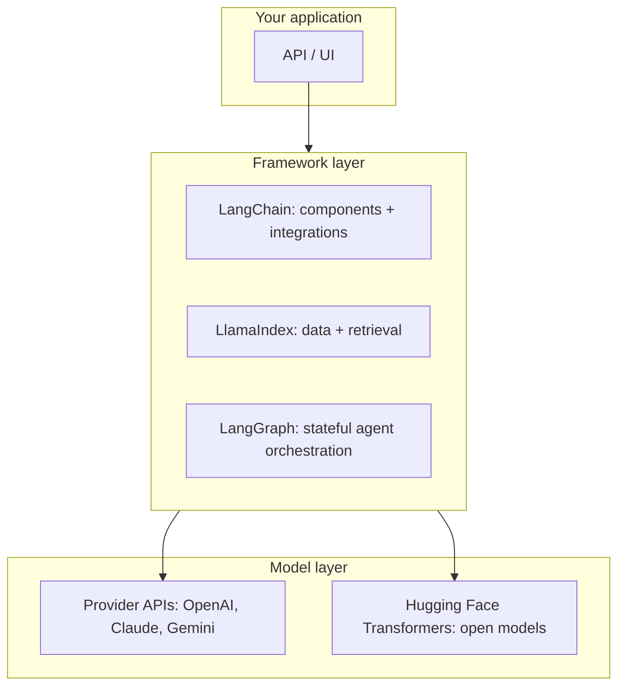
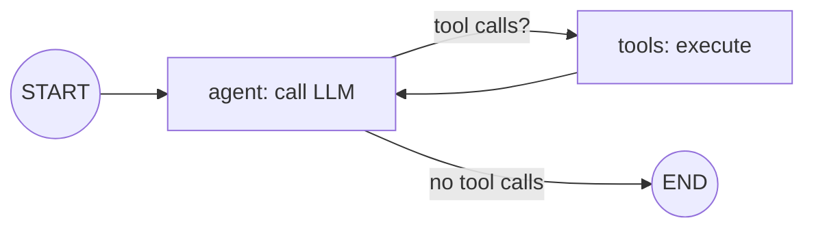
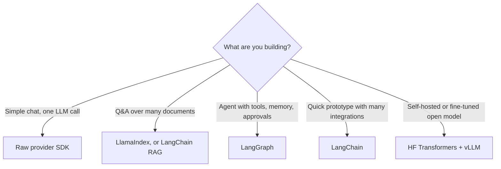

# 10. AI Frameworks

[Home](README.md) › 10. AI Frameworks

> **Level:** Intermediate · **Time:** ~5 hours · **Prerequisites:** [Chapter 05](05-working-with-llm-apis.md), [Chapter 07](07-retrieval-augmented-generation.md)

## Learning objectives

- Explain what LLM frameworks provide and when they're worth using.
- Build chains, structured outputs, tools and RAG with **LangChain**.
- Build document indexes and query engines with **LlamaIndex**.
- Build stateful, controllable workflows with **LangGraph**.
- Run and fine-tune open models with **Hugging Face Transformers**.
- Choose the right framework, or none, for a project.

---

## 1. Why frameworks?

Building LLM apps means solving the same problems again and again: switching providers, prompt templates, parsing outputs, loading documents, chunking, vector stores, retrieval, tool calling, memory, streaming and tracing. Frameworks package these as **reusable components**.



| Benefit | Cost |
|---|---|
| Faster prototyping | Extra abstraction layers to learn and debug |
| Hundreds of integrations (loaders, vector DBs, models) | APIs change quickly between versions |
| Standard interfaces make swapping providers easy | Can hide what's actually sent to the model |
| Built-in tracing, streaming and evaluation hooks | Overkill for simple apps |

> **Engineer's rule:** understand how to do it with raw SDKs first ([Chapters 05–07](05-working-with-llm-apis.md)). Then use frameworks where they clearly save effort.

```bash
pip install -U langchain langchain-openai langchain-community langchain-text-splitters \
    langchain-chroma langgraph llama-index transformers torch pypdf
```

---

## 2. LangChain

**LangChain** provides standard interfaces for chat models, prompts, tools, retrievers and output parsers, plus a large library of integrations. Since v1.0, its high-level agent API (`create_agent`) is built on LangGraph.

### Core concepts

| Concept | Purpose |
|---|---|
| **Chat models** | One interface over providers (`init_chat_model`) |
| **Messages** | `SystemMessage`, `HumanMessage`, `AIMessage`, `ToolMessage` |
| **Prompt templates** | Parameterised prompts |
| **Runnables / LCEL** | Compose steps with the pipe (`\|`) operator; get `invoke`, `batch`, `stream` for free |
| **Tools** | Python functions the model can call |
| **Document loaders / text splitters** | Ingestion and chunking |
| **Embeddings / vector stores / retrievers** | The RAG building blocks |
| **Agents** | Models that use tools in a loop |

### Chat model + prompt template + chain

```python
from langchain.chat_models import init_chat_model
from langchain_core.prompts import ChatPromptTemplate
from langchain_core.output_parsers import StrOutputParser

llm = init_chat_model("openai:gpt-6-luna", temperature=0)
# Switching provider is one string: "anthropic:claude-sonnet-5-5" or "google_genai:gemini-3.8-flash"
# (requires langchain-anthropic / langchain-google-genai)

prompt = ChatPromptTemplate.from_messages([
    ("system", "You are an expert {domain} teacher. Answer in 3 bullet points."),
    ("human", "{question}"),
])

chain = prompt | llm | StrOutputParser()      # LCEL: prompt -> model -> string

print(chain.invoke({"domain": "databases", "question": "What is an index?"}))

for chunk in chain.stream({"domain": "networking", "question": "What is DNS?"}):
    print(chunk, end="", flush=True)

answers = chain.batch([
    {"domain": "python", "question": "What is a decorator?"},
    {"domain": "git", "question": "What is a rebase?"},
])
```

### Structured output

```python
from pydantic import BaseModel, Field

class Candidate(BaseModel):
    name: str
    skills: list[str] = Field(description="Technical skills")
    years_experience: int

extractor = llm.with_structured_output(Candidate)
result = extractor.invoke("Asha has 5 years of experience with Python, FastAPI and PostgreSQL.")
print(result)   # Candidate(name='Asha', skills=['Python', 'FastAPI', 'PostgreSQL'], years_experience=5)
```

### Tools and agents

```python
from langchain.agents import create_agent
from langchain_core.tools import tool

@tool
def get_order_status(order_id: str) -> str:
    """Look up the shipping status of an order by its ID."""
    fake_db = {"A100": "shipped", "A101": "processing"}
    return fake_db.get(order_id, "not found")

@tool
def calculate_refund(amount: float, days_since_purchase: int) -> float:
    """Calculate the refund amount. Full refund within 30 days, 50% within 60 days, else 0."""
    if days_since_purchase <= 30:
        return amount
    return amount * 0.5 if days_since_purchase <= 60 else 0.0

agent = create_agent(
    model="openai:gpt-6-luna",
    tools=[get_order_status, calculate_refund],
    system_prompt="You are a helpful e-commerce support agent. Use tools for facts.",
)

result = agent.invoke({"messages": [{"role": "user",
                                     "content": "What's the status of order A100? And what refund do I get for a $80 item bought 45 days ago?"}]})
print(result["messages"][-1].content)
```

### RAG with LangChain

```python
from langchain_community.document_loaders import PyPDFLoader
from langchain_text_splitters import RecursiveCharacterTextSplitter
from langchain_openai import OpenAIEmbeddings
from langchain_chroma import Chroma
from langchain_core.runnables import RunnablePassthrough

# 1. Load and split
docs = PyPDFLoader("employee_handbook.pdf").load()
chunks = RecursiveCharacterTextSplitter(chunk_size=1000, chunk_overlap=150).split_documents(docs)

# 2. Embed and store
vectorstore = Chroma.from_documents(
    chunks, OpenAIEmbeddings(model="text-embedding-3-small"), persist_directory="./lc_chroma")
retriever = vectorstore.as_retriever(search_kwargs={"k": 4})

# 3. Prompt + chain
rag_prompt = ChatPromptTemplate.from_messages([
    ("system", "Answer only from the context. Cite page numbers. If unsure, say you don't know.\n\n{context}"),
    ("human", "{question}"),
])

def format_docs(docs):
    return "\n\n".join(f"[page {d.metadata.get('page', 0) + 1}] {d.page_content}" for d in docs)

rag_chain = (
    {"context": retriever | format_docs, "question": RunnablePassthrough()}
    | rag_prompt
    | llm
    | StrOutputParser()
)
print(rag_chain.invoke("How many sick days do employees get?"))
```

---

## 3. LlamaIndex

**LlamaIndex** focuses on **connecting LLMs to your data**: ingestion (with many readers via LlamaHub), indexing, advanced retrieval, query engines and document agents. It's very fast for building RAG over documents.

### Core concepts

| Concept | Purpose |
|---|---|
| **Document / Node** | Source document / a chunk of it with metadata and relationships |
| **Readers (LlamaHub)** | Load data from files, APIs and databases |
| **Node parsers** | Chunking (`SentenceSplitter`, semantic, hierarchical) |
| **Index** | `VectorStoreIndex`, `SummaryIndex`, property graph index, ... |
| **Retriever / Query engine / Chat engine** | Retrieval + synthesis; with chat memory |
| **Settings** | Global defaults (LLM, embedding model, chunk size) |
| **Workflows / agents** | Event-driven multi-step pipelines and agents |

### RAG in about 10 lines

```python
from llama_index.core import Settings, SimpleDirectoryReader, StorageContext, VectorStoreIndex, load_index_from_storage
from llama_index.core.node_parser import SentenceSplitter
from llama_index.embeddings.openai import OpenAIEmbedding
from llama_index.llms.openai import OpenAI

Settings.llm = OpenAI(model="gpt-6-luna", temperature=0)
Settings.embed_model = OpenAIEmbedding(model="text-embedding-3-small")
Settings.node_parser = SentenceSplitter(chunk_size=800, chunk_overlap=100)

documents = SimpleDirectoryReader("./docs").load_data()       # PDFs, .md, .docx, ...
index = VectorStoreIndex.from_documents(documents)
index.storage_context.persist("./li_storage")                  # save to disk

# Later: reload instead of re-embedding
index = load_index_from_storage(StorageContext.from_defaults(persist_dir="./li_storage"))

query_engine = index.as_query_engine(similarity_top_k=4)
response = query_engine.query("What is the remote work policy?")
print(response)
for node in response.source_nodes:                              # citations
    print(node.metadata.get("file_name"), round(node.score, 3))

chat_engine = index.as_chat_engine(chat_mode="condense_plus_context")
print(chat_engine.chat("What is the leave policy?"))
print(chat_engine.chat("And for interns?"))                    # follow-up uses chat history
```

> If `llama-index-llms-openai` doesn't recognise a brand-new model name, upgrade the package (`pip install -U llama-index-llms-openai`).

---

## 4. LangGraph

**LangGraph** (from the LangChain team) models an LLM application as a **graph of nodes that share a state**. It supports **cycles** (agent loops), **branching**, **persistence/checkpoints**, **human-in-the-loop** interrupts and **streaming**. It's the go-to library for production-grade agents and multi-step workflows ([Chapter 11](11-ai-agents.md)).

### Core concepts

| Concept | Meaning |
|---|---|
| **State** | A typed dict shared by all nodes (e.g. `messages`) |
| **Node** | A Python function: `state -> partial state update` |
| **Edge** | Fixed transition between nodes |
| **Conditional edge** | A function that picks the next node from the state |
| **Checkpointer** | Saves state after each step: memory, resume, time-travel |
| **Interrupt** | Pauses for human approval or input |

### A tool-calling agent as a graph



```python
from langchain.chat_models import init_chat_model
from langchain_core.tools import tool
from langgraph.checkpoint.memory import InMemorySaver
from langgraph.graph import END, START, MessagesState, StateGraph
from langgraph.prebuilt import ToolNode, tools_condition

@tool
def search_docs(query: str) -> str:
    """Search the internal knowledge base."""
    return "Employees receive 24 days of annual leave per year."

tools = [search_docs]
llm = init_chat_model("openai:gpt-6-luna").bind_tools(tools)

def agent(state: MessagesState):
    return {"messages": [llm.invoke(state["messages"])]}

builder = StateGraph(MessagesState)
builder.add_node("agent", agent)
builder.add_node("tools", ToolNode(tools))
builder.add_edge(START, "agent")
builder.add_conditional_edges("agent", tools_condition)   # -> "tools" or END
builder.add_edge("tools", "agent")

graph = builder.compile(checkpointer=InMemorySaver())      # adds conversation memory

config = {"configurable": {"thread_id": "user-42"}}
out = graph.invoke({"messages": [{"role": "user", "content": "How much annual leave do I get?"}]}, config)
print(out["messages"][-1].content)

out = graph.invoke({"messages": [{"role": "user", "content": "What did I just ask you?"}]}, config)
print(out["messages"][-1].content)                         # remembers via thread_id
```

### A deterministic workflow (no agent loop)

```python
from typing import TypedDict
from langgraph.graph import StateGraph, START, END

class EmailState(TypedDict):
    email: str
    category: str
    reply: str

base_llm = init_chat_model("openai:gpt-6-luna", temperature=0)

def classify(state: EmailState):
    c = base_llm.invoke(f"Classify as 'complaint', 'question' or 'spam'. One word.\n\n{state['email']}")
    return {"category": c.content.strip().lower()}

def draft_reply(state: EmailState):
    r = base_llm.invoke(f"Write a short, polite reply to this {state['category']}:\n\n{state['email']}")
    return {"reply": r.content}

def route(state: EmailState) -> str:
    return END if state["category"] == "spam" else "draft_reply"

wf = StateGraph(EmailState)
wf.add_node("classify", classify)
wf.add_node("draft_reply", draft_reply)
wf.add_edge(START, "classify")
wf.add_conditional_edges("classify", route)
wf.add_edge("draft_reply", END)
app = wf.compile()

print(app.invoke({"email": "My parcel arrived broken and nobody answers the phone!"}))
```

---

## 5. Hugging Face Transformers

**Transformers** is the standard library for **open-weight models**: download from the Hugging Face Hub, run inference, and fine-tune (with PEFT/TRL, [Chapter 09](09-fine-tuning-llms.md)). It covers text, vision, audio and multimodal models.

### Pipelines (highest-level API)

```python
from transformers import pipeline

sentiment = pipeline("sentiment-analysis")       # downloads a default small model
print(sentiment(["I love this product!", "Worst support ever."]))

ner = pipeline("ner", aggregation_strategy="simple")
print(ner("Sundar Pichai is the CEO of Google, based in Mountain View."))

zero_shot = pipeline("zero-shot-classification", model="facebook/bart-large-mnli")
print(zero_shot("My card was charged twice", candidate_labels=["billing", "shipping", "technical"]))

summarizer = pipeline("summarization", model="facebook/bart-large-cnn")
print(summarizer("Long article text ..." * 20, max_length=60, min_length=20)[0]["summary_text"])
```

### Chat generation with an open model

```python
import torch
from transformers import AutoModelForCausalLM, AutoTokenizer

MODEL_ID = "Qwen/Qwen2.5-1.5B-Instruct"
tok = AutoTokenizer.from_pretrained(MODEL_ID)
model = AutoModelForCausalLM.from_pretrained(MODEL_ID, torch_dtype="auto", device_map="auto")

messages = [
    {"role": "system", "content": "You are a concise assistant."},
    {"role": "user", "content": "Give me three tips for writing clean Python."},
]
inputs = tok.apply_chat_template(messages, add_generation_prompt=True, return_tensors="pt").to(model.device)
with torch.no_grad():
    out = model.generate(inputs, max_new_tokens=200, temperature=0.7, do_sample=True)
print(tok.decode(out[0][inputs.shape[-1]:], skip_special_tokens=True))
```

### The Hugging Face ecosystem

| Library / service | Purpose |
|---|---|
| `transformers` | Models, tokenizers, pipelines |
| `datasets` | Load and process datasets |
| `peft`, `trl` | LoRA/QLoRA fine-tuning, SFT/DPO |
| `sentence-transformers` | Embeddings and rerankers |
| `accelerate` | Multi-GPU / mixed-precision training |
| Hub | Hosting models, datasets and Spaces (demos) |
| Inference Providers / TGI | Hosted or self-hosted inference |

For high-throughput **serving** of open models, use **vLLM**, **TGI** or **SGLang**. They expose OpenAI-compatible endpoints, so the code from [Chapter 05](05-working-with-llm-apis.md) works with a `base_url` change.

---

## 6. Framework comparisons

| | LangChain | LlamaIndex | LangGraph | HF Transformers | Raw SDKs |
|---|---|---|---|---|---|
| **Main focus** | Components + integrations | Data ingestion + retrieval | Stateful agent/workflow orchestration | Open-model inference & training | Direct API access |
| **Best for** | General LLM apps, quick agents | Document Q&A, advanced RAG | Complex, controllable, long-running agents | Self-hosting, fine-tuning, classic NLP | Simple apps, max control |
| **Learning curve** | Medium | Low–medium | Medium–high | Medium | Low |
| **Abstraction** | High | High | Low–medium (explicit graph) | Medium | None |
| **Persistence / human-in-the-loop** | Via LangGraph | Workflows | ✅ Native | ❌ | DIY |
| **Observability** | LangSmith | Integrations (Langfuse, Arize, ...) | LangSmith | — | DIY / OpenTelemetry |

Other notable frameworks: **OpenAI Agents SDK**, **Claude Agent SDK**, **Google Agent Development Kit (ADK)**, **CrewAI**, **Microsoft Agent Framework / AutoGen**, **Pydantic AI**, **DSPy** (programmatic prompt optimisation), **Haystack**.

### Decision guide



They combine well: **LlamaIndex retriever + LangGraph agent + vLLM-served fine-tuned model** is a realistic production stack.

---

## 7. Practical implementation: one RAG app, three ways

| Step | Raw SDK ([Chapter 07](07-retrieval-augmented-generation.md)) | LangChain | LlamaIndex |
|---|---|---|---|
| Load | `pypdf` loop | `PyPDFLoader` | `SimpleDirectoryReader` |
| Chunk | Custom splitter | `RecursiveCharacterTextSplitter` | `SentenceSplitter` |
| Embed + store | `embeddings.create` + Chroma | `Chroma.from_documents` | `VectorStoreIndex.from_documents` |
| Retrieve + answer | Custom prompt | LCEL chain | `as_query_engine()` |
| Lines of code | ~120 | ~30 | ~10 |
| Control / transparency | Full | Medium | Lower |

---

## 8. Real-world use cases

| Use case | Typical stack |
|---|---|
| Internal knowledge chatbot | LlamaIndex or LangChain RAG + FastAPI |
| Support agent with refunds and escalations | LangGraph + tools + human-approval interrupts |
| Document-processing pipeline | LangGraph workflow (classify → extract → validate) |
| On-prem LLM for regulated data | HF Transformers / vLLM + LangChain interface |
| Sentiment / NER at scale | HF pipelines with small fine-tuned models |

---

## 9. Advantages, disadvantages and limitations

| Framework | Advantages | Disadvantages |
|---|---|---|
| LangChain | Huge ecosystem; provider-agnostic; fast prototyping | Abstractions can obscure prompts; frequent API changes |
| LlamaIndex | Excellent RAG primitives; many data connectors | Less suited to complex non-RAG control flow |
| LangGraph | Explicit control, persistence, human-in-the-loop, streaming | More code and concepts; graph design takes practice |
| HF Transformers | Full control of open models; training + inference | You manage GPUs, scaling and serving |

---

## 10. Best practices and common mistakes

### Best practices

- **Pin versions** in `requirements.txt`. These libraries move fast.
- **Turn on tracing** (LangSmith, Langfuse) to see the actual prompts and calls the framework makes.
- Keep **business logic outside framework classes** so you can migrate.
- Use frameworks for **plumbing**; keep **prompts and evaluations** under your control.
- Read the **official docs for your installed version**. Blog posts go out of date quickly.

### Common mistakes

| Mistake | Fix |
|---|---|
| Copying outdated tutorials (deprecated imports like `langchain.llms`) | Use current docs; check the package version |
| Using an agent where a fixed workflow would do | Prefer deterministic graphs; agents only where flexibility is needed |
| Not inspecting the final prompt | Enable tracing/debug logging |
| Mixing many frameworks without need | Start with one; add others for clear gains |
| Ignoring async | Use `ainvoke` / `astream` in web servers |

---

## 11. Interview questions and answers

**Q1. What problem does LangChain solve?**
It gives standard interfaces for models, prompts, tools, retrievers and parsers, plus hundreds of integrations, so you can compose LLM applications quickly and swap providers or vector stores without rewriting the app.

**Q2. LangChain vs LlamaIndex?**
Both can build RAG. LlamaIndex specialises in data ingestion, indexing and retrieval strategies, and is very fast for document Q&A. LangChain is broader: general components, integrations and agents. Many teams use LlamaIndex for retrieval inside a LangChain/LangGraph application.

**Q3. Why LangGraph instead of a simple agent loop?**
LangGraph makes control flow explicit as a graph with shared state, supports cycles and branching, persists state with checkpointers (memory, resume after failure), enables human-in-the-loop interrupts, and streams intermediate steps. That makes complex agents more reliable, debuggable and production-ready.

**Q4. What is LCEL?**
The LangChain Expression Language: composing runnables with `|` (prompt | model | parser). Every composed chain automatically supports `invoke`, `batch`, `stream` and async variants.

**Q5. When would you avoid frameworks?**
For simple apps (one or two LLM calls), performance-critical paths, or when you need full transparency and few dependencies. Raw SDKs are simpler there.

**Q6. How do you serve an open-source model in production?**
Use an inference server such as vLLM, TGI or SGLang (continuous batching, paged attention, quantization) on GPUs, behind an OpenAI-compatible API, with autoscaling, monitoring and load testing.

---

## 12. Hands-on exercises

1. **Provider swap.** Write an LCEL chain and run it with OpenAI, Claude and Gemini by changing only the `init_chat_model` string.
2. **Structured extraction.** Use `with_structured_output` to extract invoice fields from 10 sample texts.
3. **LlamaIndex RAG.** Index a folder of PDFs and build a chat engine that handles follow-up questions. Print source citations.
4. **LangGraph workflow.** Build an email triage graph: classify → (complaint → draft apology + escalate) / (question → RAG answer) / (spam → end).
5. **HF pipelines.** Compare zero-shot classification with `bart-large-mnli` against an LLM API on 30 support tickets (accuracy, latency, cost).

### Assignment

Build the **same document Q&A app three times**: raw SDKs, LangChain and LlamaIndex. Compare lines of code, retrieval quality on a 20-question test set, latency and how easy each was to debug. Publish your comparison as a README with a recommendation.

---

## 13. References

- [LangChain documentation](https://docs.langchain.com/oss/python/langchain/overview)
- [LangGraph documentation](https://docs.langchain.com/oss/python/langgraph/overview)
- [LangSmith documentation](https://docs.langchain.com/langsmith/home)
- [LlamaIndex documentation](https://developers.llamaindex.ai/python/framework/)
- [LlamaHub (data connectors)](https://llamahub.ai/)
- [Hugging Face Transformers documentation](https://huggingface.co/docs/transformers)
- [Hugging Face — Pipelines](https://huggingface.co/docs/transformers/main_classes/pipelines)
- [vLLM documentation](https://docs.vllm.ai/)
- [OpenAI Agents SDK](https://openai.github.io/openai-agents-python/) · [Claude Agent SDK](https://docs.claude.com/en/docs/agent-sdk/overview) · [Google ADK](https://google.github.io/adk-docs/)

---

| ← Previous | Index | Next → |
|---|---|---|
| [09. Fine-Tuning LLMs](09-fine-tuning-llms.md) | [Home](README.md) | [11. AI Agents](11-ai-agents.md) |
