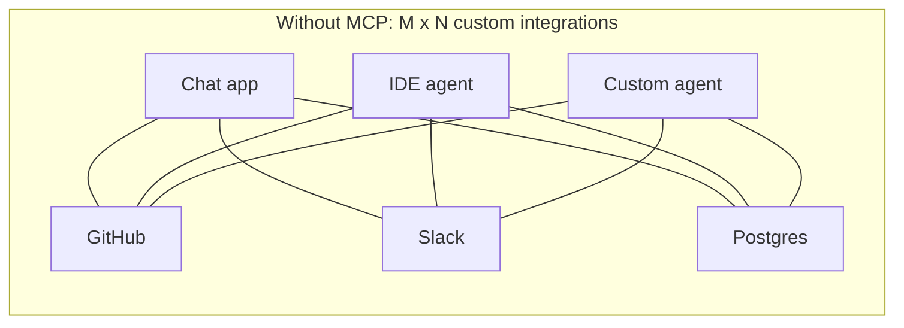
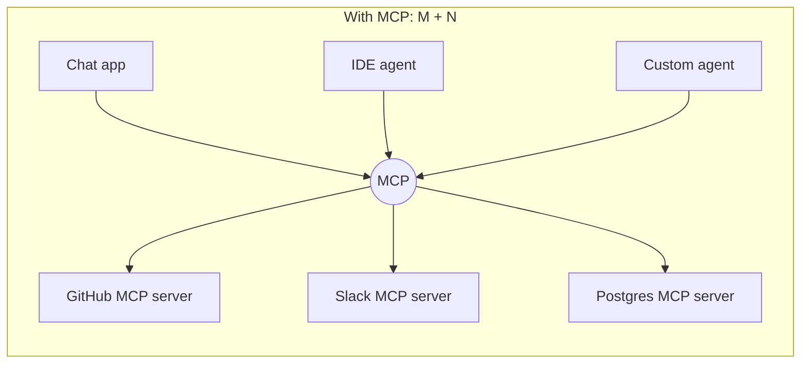
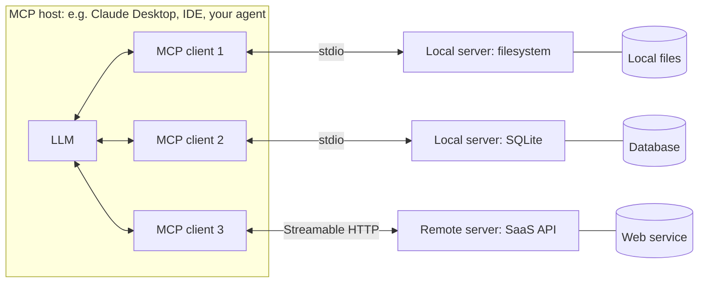
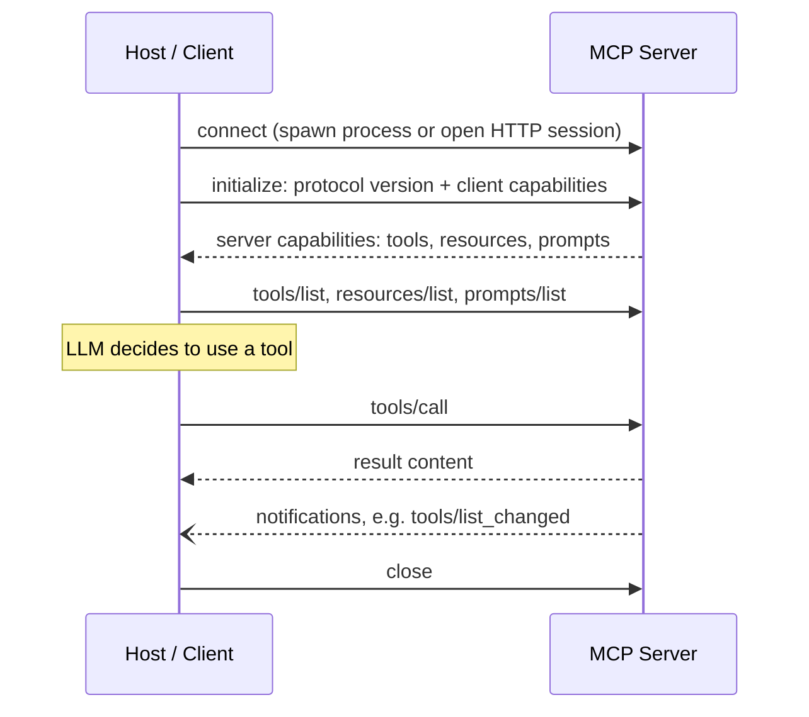

# 12. Model Context Protocol (MCP)

[Home](README.md) › 12. Model Context Protocol

> **Level:** Advanced · **Time:** ~4 hours · **Prerequisites:** [Chapter 05](05-working-with-llm-apis.md) (tool calling), [Chapter 11](11-ai-agents.md), Python `async`/`await`

## Learning objectives

- Explain what MCP is and the integration problem it solves.
- Describe MCP's architecture: hosts, clients, servers, transports and the JSON-RPC message layer.
- Use the three server primitives (tools, resources, prompts) and know the client-side features.
- Build an MCP server in Python and test it.
- Connect MCP servers to Claude Desktop, to a custom Python agent and to LangChain/LangGraph.
- Secure MCP deployments.

---

## 1. What is MCP?

The **Model Context Protocol (MCP)** is an **open standard** for connecting AI applications to external **tools, data and prompts**. Anthropic introduced it in November 2024. It's now supported across the industry (Claude, ChatGPT and the OpenAI Agents SDK, Gemini tooling, VS Code/GitHub Copilot, Cursor and many more) and has an open governance process.

> **Analogy:** MCP is like **USB-C for AI applications**. Instead of a custom cable for every device, there's one standard port. Build an MCP server once and any MCP-compatible app can use it.

---

## 2. Why MCP is needed

### The M × N integration problem

Without a standard, every AI app writes custom integration code for every tool or data source:





### Benefits

| For | Benefit |
|---|---|
| **Tool builders** | Build one server; it works in every MCP host |
| **App / agent builders** | Plug in a growing ecosystem of ready-made servers |
| **Enterprises** | Standard place to enforce authentication, permissions and auditing |
| **Users** | Bring their tools and data into any AI app they choose |

### MCP vs plain function calling

They work together. **Function calling** is how a model asks for a tool *inside one API request*. **MCP** standardises how an application *discovers, describes and invokes* tools (plus resources and prompts) that live in **separate processes or services**. An MCP client typically converts MCP tools into the model's function-calling format.

---

## 3. MCP architecture



| Component | Role |
|---|---|
| **Host** | The AI application the user interacts with (Claude Desktop, Claude Code, VS Code, your app). It manages clients, the LLM, user consent and security policies. |
| **Client** | A connector inside the host that keeps a **1:1 connection** with one server. |
| **Server** | A program that exposes **tools, resources and prompts** for one capability (GitHub, a database, your internal API). |

### Layers

| Layer | Details |
|---|---|
| **Data layer** | **JSON-RPC 2.0** messages: requests, responses, notifications. Covers capability discovery, primitives and lifecycle. |
| **Transport layer** | **stdio** (local subprocess, communicates over stdin/stdout) or **Streamable HTTP** (remote servers; HTTP POST with optional SSE streaming; supports OAuth-based authorisation). |

### A JSON-RPC exchange

```jsonc
// Client -> Server: list tools
{"jsonrpc": "2.0", "id": 1, "method": "tools/list"}

// Server -> Client
{"jsonrpc": "2.0", "id": 1, "result": {"tools": [{
  "name": "get_weather",
  "description": "Get current weather for a city",
  "inputSchema": {"type": "object", "properties": {"city": {"type": "string"}}, "required": ["city"]}
}]}}

// Client -> Server: call a tool
{"jsonrpc": "2.0", "id": 2, "method": "tools/call",
 "params": {"name": "get_weather", "arguments": {"city": "Kochi"}}}

// Server -> Client
{"jsonrpc": "2.0", "id": 2, "result": {"content": [{"type": "text", "text": "31°C, humid"}], "isError": false}}
```

### Lifecycle



> **Spec versions:** MCP's specification is versioned by date, and newer revisions have changed details of the lifecycle and transports. The Python examples here use the stable **`mcp` 1.x SDK**, which handles these details for you. Check [modelcontextprotocol.io/specification](https://modelcontextprotocol.io/specification) for the current revision and the SDK changelog before upgrading major versions.

---

## 4. MCP clients and servers

### Clients (hosts) that support MCP

Claude Desktop, Claude Code, the Claude API (MCP connector), ChatGPT and the OpenAI Responses API / Agents SDK, VS Code (GitHub Copilot), Cursor, Windsurf, Zed, LangChain/LangGraph (via `langchain-mcp-adapters`), and your own Python or TypeScript apps (official SDKs).

### Example servers

| Server | Exposes |
|---|---|
| Filesystem | Read, write and search files in allowed directories |
| GitHub | Issues, PRs, code search |
| Postgres / SQLite | Schema resources, read-only SQL tools |
| Slack | Channels and messages |
| Browser automation (e.g. Playwright) | Navigate, click, screenshot |
| Fetch | Fetch web pages as Markdown |
| Your internal API | Anything your business needs |

Official SDKs: **Python, TypeScript, Java, Kotlin, C#, Go, Ruby, Rust, Swift, PHP**.

---

## 5. Tools, resources and prompts

MCP servers expose three **primitives**, each with a different "controller":

| Primitive | Controlled by | Purpose | Example |
|---|---|---|---|
| **Tools** | **Model** (the LLM decides to call them) | Perform actions / computations; may have side effects | `create_issue`, `query_db`, `send_email` |
| **Resources** | **Application** (the host decides what to attach) | Read-only data identified by URIs, given as context | `file:///docs/policy.md`, `db://schema/users` |
| **Prompts** | **User** (selected explicitly, e.g. slash commands) | Reusable prompt templates with arguments | `/summarise-pr`, `/code-review` |

Client-side features that servers can request:

| Feature | Purpose |
|---|---|
| **Sampling** | The server asks the host's LLM to generate text (agentic servers without their own API key) |
| **Roots** | The client tells the server which directories or URIs it may operate within |
| **Elicitation** | The server asks the user for more input (e.g. a confirmation or a missing parameter) |

---

## 6. Building an MCP server

We'll build a **"Company Knowledge" server** with tools, resources and prompts using **FastMCP** from the official Python SDK.

```bash
mkdir mcp-company && cd mcp-company
python -m venv .venv && source .venv/bin/activate
pip install "mcp[cli]>=1.27,<2"        # stable 1.x line
```

```python
# company_server.py
"""An MCP server exposing company knowledge and HR actions."""
from datetime import date
from mcp.server.fastmcp import FastMCP

mcp = FastMCP("company-knowledge")

POLICIES = {
    "leave": "Employees receive 24 days of paid annual leave. Up to 5 unused days roll over.",
    "remote": "Employees may work remotely up to 3 days per week with manager approval.",
    "expenses": "Expenses over $500 require pre-approval from a director.",
}
EMPLOYEES = {"E001": {"name": "Asha Nair", "leave_balance": 14, "manager": "E010"}}
LEAVE_REQUESTS: list[dict] = []


# ---------- Tools (model-controlled) ----------
@mcp.tool()
def search_policies(query: str) -> str:
    """Search HR policies by keyword. Returns matching policy texts."""
    q = query.lower()
    hits = [f"{k}: {v}" for k, v in POLICIES.items() if q in k or q in v.lower()]
    return "\n".join(hits) or "No matching policy found."


@mcp.tool()
def get_leave_balance(employee_id: str) -> dict:
    """Get an employee's remaining annual leave days."""
    emp = EMPLOYEES.get(employee_id)
    if not emp:
        return {"error": f"Unknown employee {employee_id}"}
    return {"employee_id": employee_id, "name": emp["name"], "leave_balance": emp["leave_balance"]}


@mcp.tool()
def request_leave(employee_id: str, start: str, end: str, reason: str = "") -> dict:
    """Submit a leave request. Dates are ISO format (YYYY-MM-DD)."""
    emp = EMPLOYEES.get(employee_id)
    if not emp:
        return {"error": f"Unknown employee {employee_id}"}
    days = (date.fromisoformat(end) - date.fromisoformat(start)).days + 1
    if days <= 0:
        return {"error": "End date must be on or after start date."}
    if days > emp["leave_balance"]:
        return {"error": f"Insufficient balance: requested {days}, available {emp['leave_balance']}."}
    req = {"id": len(LEAVE_REQUESTS) + 1, "employee_id": employee_id, "start": start,
           "end": end, "days": days, "reason": reason, "status": "pending_manager_approval"}
    LEAVE_REQUESTS.append(req)
    return req


# ---------- Resources (application-controlled) ----------
@mcp.resource("policy://{name}")
def get_policy(name: str) -> str:
    """Full text of a policy, e.g. policy://leave"""
    return POLICIES.get(name, f"Policy '{name}' not found.")


@mcp.resource("policy://index")
def list_policies() -> str:
    """List all available policies."""
    return "\n".join(f"policy://{k}" for k in POLICIES)


# ---------- Prompts (user-controlled) ----------
@mcp.prompt()
def draft_leave_email(employee_name: str, start: str, end: str) -> str:
    """Draft a polite leave request email to a manager."""
    return (f"Write a short, professional email from {employee_name} to their manager requesting "
            f"annual leave from {start} to {end}. Mention that handover notes will be shared.")


if __name__ == "__main__":
    mcp.run()                      # stdio transport (default) for local hosts
    # mcp.run(transport="streamable-http")   # for remote deployment over HTTP
```

**How FastMCP works:** decorators register functions. Type hints and docstrings are turned into JSON Schemas and descriptions automatically, and the SDK handles JSON-RPC, capability negotiation and transport.

### Test with the MCP Inspector

```bash
mcp dev company_server.py
# or: npx @modelcontextprotocol/inspector python company_server.py
```

The Inspector opens a web UI where you can list and call tools, read resources and render prompts, which is ideal for debugging.

### Use it in Claude Desktop

Edit `claude_desktop_config.json` (Settings → Developer → Edit Config):

```json
{
  "mcpServers": {
    "company-knowledge": {
      "command": "/absolute/path/to/mcp-company/.venv/bin/python",
      "args": ["/absolute/path/to/mcp-company/company_server.py"]
    }
  }
}
```

Restart Claude Desktop and ask: *"How many leave days does E001 have left? Book 3 days from 2026-12-22."*

For **Claude Code**: `claude mcp add company-knowledge -- /absolute/path/.venv/bin/python /absolute/path/company_server.py`.

---

## 7. Connecting an AI agent to MCP tools

### 7.1 A raw MCP client (Python SDK)

```python
# mcp_client_demo.py
import asyncio
from mcp import ClientSession, StdioServerParameters
from mcp.client.stdio import stdio_client

server = StdioServerParameters(command="python", args=["company_server.py"])

async def main():
    async with stdio_client(server) as (read, write):
        async with ClientSession(read, write) as session:
            await session.initialize()

            tools = await session.list_tools()
            print("Tools:", [t.name for t in tools.tools])

            result = await session.call_tool("get_leave_balance", {"employee_id": "E001"})
            print("Result:", result.content[0].text)

            policy = await session.read_resource("policy://leave")
            print("Resource:", policy.contents[0].text)

            prompt = await session.get_prompt("draft_leave_email",
                                              {"employee_name": "Asha", "start": "2026-12-22", "end": "2026-12-24"})
            print("Prompt:", prompt.messages[0].content.text)

asyncio.run(main())
```

### 7.2 A Claude agent that uses MCP tools

The client lists MCP tools, converts them to Claude tool definitions, and routes the model's tool calls back to the MCP server.

```python
# mcp_claude_agent.py
import asyncio
import json
from anthropic import AsyncAnthropic
from mcp import ClientSession, StdioServerParameters
from mcp.client.stdio import stdio_client

MODEL = "claude-sonnet-5-5"
claude = AsyncAnthropic()

async def run(question: str):
    server = StdioServerParameters(command="python", args=["company_server.py"])
    async with stdio_client(server) as (read, write):
        async with ClientSession(read, write) as session:
            await session.initialize()
            mcp_tools = (await session.list_tools()).tools

            # MCP tool -> Claude tool definition
            tools = [{"name": t.name, "description": t.description or "", "input_schema": t.inputSchema}
                     for t in mcp_tools]

            messages = [{"role": "user", "content": question}]
            for _ in range(8):                                  # max steps
                resp = await claude.messages.create(model=MODEL, max_tokens=1024,
                                                    tools=tools, messages=messages)
                messages.append({"role": "assistant", "content": resp.content})
                if resp.stop_reason != "tool_use":
                    return "".join(b.text for b in resp.content if b.type == "text")

                results = []
                for block in resp.content:
                    if block.type == "tool_use":
                        out = await session.call_tool(block.name, block.input)   # route to MCP server
                        text = "\n".join(c.text for c in out.content if c.type == "text")
                        results.append({"type": "tool_result", "tool_use_id": block.id,
                                        "content": text, "is_error": bool(out.isError)})
                messages.append({"role": "user", "content": results})
            return "Stopped after max steps."

print(asyncio.run(run("Check E001's leave balance and request leave from 2026-12-22 to 2026-12-24.")))
```

### 7.3 LangChain / LangGraph with MCP adapters

```bash
pip install langchain-mcp-adapters langgraph "langchain[openai]"
```

```python
import asyncio
from langchain.agents import create_agent
from langchain_mcp_adapters.client import MultiServerMCPClient

async def main():
    client = MultiServerMCPClient({
        "company": {"command": "python", "args": ["company_server.py"], "transport": "stdio"},
        # "remote": {"url": "https://example.com/mcp", "transport": "streamable_http"},
    })
    tools = await client.get_tools()                       # MCP tools -> LangChain tools
    agent = create_agent("openai:gpt-6-luna", tools)
    result = await agent.ainvoke({"messages": [{"role": "user", "content": "What is the remote work policy?"}]})
    print(result["messages"][-1].content)

asyncio.run(main())
```

### 7.4 Remote MCP servers directly from provider APIs

Some provider APIs can call **remote** (HTTP) MCP servers for you, with no client code. For example, the OpenAI Responses API accepts an MCP tool:

```python
from openai import OpenAI

client = OpenAI()
resp = client.responses.create(
    model="gpt-6-luna",
    tools=[{
        "type": "mcp",
        "server_label": "company",
        "server_url": "https://mcp.example.com/mcp",     # your deployed Streamable HTTP server
        "require_approval": "always",                   # require approval before tool calls
    }],
    input="How many leave days does E001 have?",
)
print(resp.output_text)
```

Anthropic offers a similar **MCP connector** in the Messages API. See each provider's docs for the current parameters.

---

## 8. Practical examples

| Example | Server tools / resources | Host |
|---|---|---|
| **Database assistant** | `list_tables` resource, `run_readonly_sql` tool | Claude Desktop |
| **DevOps helper** | `get_pod_logs`, `describe_deployment`, `restart_pod` (with approval) | IDE agent |
| **CRM assistant** | `search_contacts`, `create_note`, `update_deal_stage` | Custom LangGraph agent |
| **Docs assistant** | Resources for each doc page; `search_docs` tool | Any MCP host |
| **Personal productivity** | Calendar, email and notes servers | Claude Desktop |

### Example: a read-only SQLite server

```python
# sqlite_server.py
import sqlite3
from mcp.server.fastmcp import FastMCP

mcp = FastMCP("sqlite-readonly")
DB_PATH = "shop.db"

def connect():
    return sqlite3.connect(f"file:{DB_PATH}?mode=ro", uri=True)   # read-only at the DB level

@mcp.resource("schema://tables")
def schema() -> str:
    """The database schema (CREATE statements)."""
    with connect() as conn:
        rows = conn.execute("SELECT sql FROM sqlite_master WHERE type='table'").fetchall()
    return "\n\n".join(r[0] for r in rows if r[0])

@mcp.tool()
def run_query(sql: str, limit: int = 50) -> list[dict]:
    """Run a read-only SELECT query and return up to `limit` rows."""
    if not sql.strip().lower().startswith("select"):
        return [{"error": "Only SELECT queries are allowed."}]
    with connect() as conn:
        conn.row_factory = sqlite3.Row
        rows = conn.execute(sql).fetchmany(min(limit, 200))
    return [dict(r) for r in rows]

if __name__ == "__main__":
    mcp.run()
```

---

## 9. Security considerations

MCP servers can read data and take actions, so treat them like any privileged integration.

| Risk | Description | Mitigation |
|---|---|---|
| **Untrusted servers** | A malicious server can steal data or perform harmful actions | Only install servers from trusted sources; review code; pin versions |
| **Tool poisoning** | Hidden instructions in tool descriptions manipulate the model | Review tool descriptions; hosts should show them to users |
| **Prompt injection via data** | Resources or tool results contain malicious instructions | Treat outputs as data; require approval for sensitive tools |
| **Over-privileged access** | Server credentials allow more than needed | Least privilege, read-only by default, scoped tokens |
| **Confused deputy / token passthrough** | A server misuses tokens meant for another service | Follow the spec's authorisation guidance (OAuth 2.1); never pass client tokens through |
| **Command injection** | Tool arguments are used in shell commands or SQL | Validate inputs; parameterised queries; no `shell=True` |
| **Data exfiltration** | Combining a "read secrets" tool with a "send HTTP" tool | Separate trust zones; egress controls; human approval |

**Host responsibilities:** user consent before tool calls, clear display of what will run, per-server permissions, and audit logs.

---

## 10. Advantages, disadvantages and limitations

| Advantages | Disadvantages / limitations |
|---|---|
| One integration works across many AI apps | Another protocol and process to deploy and secure |
| Large ecosystem of ready-made servers | Server quality and security vary widely |
| Clean separation between AI app and tool code | Many tools at once can bloat context and confuse the model |
| Language-agnostic SDKs | The spec still evolves; SDK major versions can bring breaking changes |
| Supports local (stdio) and remote (HTTP) deployment | Remote auth (OAuth) adds complexity |

---

## 11. Best practices and common mistakes

### Best practices

- **One server per domain** (HR, GitHub, DB) with a **small, focused** set of tools.
- Write **excellent tool descriptions and typed parameters**. They're the model's only documentation.
- Return **concise, structured** results and **errors as content** (`isError`) so the model can recover.
- **Never log to stdout** in stdio servers. stdout carries the protocol, so log to stderr.
- Test with the **MCP Inspector** before connecting to a host.
- Use **resources** for read-only context and **tools** for actions.
- Version and pin SDKs; read the changelog before upgrading major versions.

### Common mistakes

| Mistake | Fix |
|---|---|
| `print()` debugging in a stdio server breaks the protocol | Use `logging` to stderr |
| Relative paths in host config | Use absolute paths for the command and script |
| Exposing destructive tools without approval | Require host or user confirmation; read-only alternatives |
| Dozens of near-duplicate tools | Consolidate; use clear names |
| Raw exceptions returned to the model | Catch and return helpful error messages |

---

## 12. Interview questions and answers

**Q1. What is MCP, and what problem does it solve?**
MCP is an open protocol that standardises how AI applications connect to external tools, data and prompts. It turns the M×N problem (every app building custom integrations for every tool) into M+N: tools implement an MCP server once, and every MCP-compatible host can use them.

**Q2. Explain MCP's architecture.**
A host (the AI app) contains one MCP client per server connection. Servers expose tools, resources and prompts. Communication uses JSON-RPC 2.0 over stdio (local subprocesses) or Streamable HTTP (remote servers). Connections begin with capability negotiation, after which the client can list and call primitives.

**Q3. What's the difference between tools, resources and prompts?**
Tools are model-controlled actions the LLM chooses to invoke. Resources are application-controlled, read-only data identified by URIs that the host attaches as context. Prompts are user-controlled templates, often surfaced as slash commands.

**Q4. How does MCP relate to function calling?**
Function calling is the model-level mechanism for requesting a tool call within an API request. MCP is the application-level protocol for discovering and invoking tools hosted in external servers. A host converts MCP tool definitions into the model's function-calling format and routes calls to the right server.

**Q5. stdio vs Streamable HTTP?**
stdio runs the server as a local subprocess communicating over stdin/stdout: simple, low latency, no network exposure, one client. Streamable HTTP runs the server as a web service supporting many clients, remote access and OAuth-based authorisation, with optional SSE streaming.

**Q6. What are the main security risks with MCP?**
Malicious or compromised servers, tool poisoning through descriptions, prompt injection via returned data, over-privileged credentials, command or SQL injection in server code, and data exfiltration by chaining tools. Mitigate with trusted servers, least privilege, input validation, user approval for sensitive actions and auditing.

**Q7. What is sampling in MCP?**
A client feature that lets a server ask the host's LLM to generate a completion, with user oversight. Servers can then use LLM reasoning without holding their own model API keys.

---

## 13. Hands-on exercises

1. **Run and inspect.** Run `company_server.py` with the MCP Inspector. Call every tool, read every resource and render the prompt.
2. **Claude Desktop.** Connect the server to Claude Desktop (or another MCP host) and complete a leave-booking conversation.
3. **New tool.** Add `cancel_leave(request_id)` with validation, and a resource `leave://requests/{employee_id}`.
4. **SQLite server.** Build the read-only SQLite server over a sample shop database and ask natural-language analytics questions.
5. **Agent integration.** Connect two MCP servers (company + SQLite) to one LangGraph agent via `MultiServerMCPClient`.
6. **Security review.** Write a threat model for your server: what could a malicious prompt make it do? Add mitigations.

### Assignment

Build and publish an **MCP server for a real API** you use (GitHub issues, Notion, Jira, a weather API or your own FastAPI service):
- At least 3 tools, 2 resources and 1 prompt
- Input validation and helpful errors; logging to stderr
- Both stdio and Streamable HTTP transports
- A README with setup for Claude Desktop/Claude Code, a demo GIF, a security section and a Mermaid architecture diagram
- Tests that call the tools through an MCP `ClientSession`

---

## 14. References

- [Model Context Protocol — official site and docs](https://modelcontextprotocol.io/)
- [MCP specification](https://modelcontextprotocol.io/specification)
- [MCP architecture overview](https://modelcontextprotocol.io/docs/learn/architecture)
- [MCP Python SDK](https://github.com/modelcontextprotocol/python-sdk) · [TypeScript SDK](https://github.com/modelcontextprotocol/typescript-sdk)
- [MCP Inspector](https://github.com/modelcontextprotocol/inspector)
- [Reference servers](https://github.com/modelcontextprotocol/servers)
- [MCP security best practices](https://modelcontextprotocol.io/specification/draft/basic/security_best_practices)
- [Anthropic — Introducing the Model Context Protocol](https://www.anthropic.com/news/model-context-protocol)
- [Claude — MCP connector](https://docs.claude.com/en/docs/agents-and-tools/mcp-connector) · [Claude Code MCP](https://docs.claude.com/en/docs/claude-code/mcp)
- [OpenAI — Remote MCP tools](https://developers.openai.com/api/docs/guides/tools-connectors-mcp)
- [LangChain MCP adapters](https://github.com/langchain-ai/langchain-mcp-adapters)

---

| ← Previous | Index | Next → |
|---|---|---|
| [11. AI Agents](11-ai-agents.md) | [Home](README.md) | [13. LLM Evaluation and Production](13-llm-evaluation-and-production.md) |
