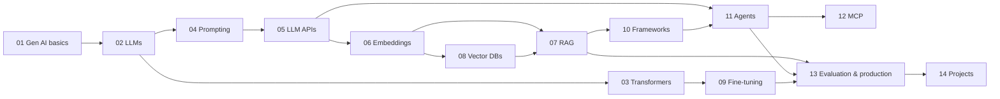

# Generative AI & Large Language Models — Learning Guide

A structured, beginner-to-advanced learning path for becoming an **AI Engineer**. It covers how modern LLMs work and how to build, evaluate and ship production systems on top of them: prompting, APIs, embeddings, RAG, vector databases, fine-tuning, frameworks, agents and the Model Context Protocol.

Every chapter follows the same pattern:

| Section | What you get |
|---|---|
| **Why it matters** | The problem the concept solves |
| **How it works** | Internals, with Mermaid diagrams |
| **Code** | Runnable Python examples |
| **Use cases** | Where it shows up in real products |
| **Trade-offs** | Advantages, disadvantages, limitations |
| **Best practices & common mistakes** | Lessons from production |
| **Interview questions** | Common questions with model answers |
| **Exercises** | Hands-on tasks and an assignment |
| **References** | Official documentation |

---

## Table of contents

| # | Chapter | Level | Key topics |
|---|---|---|---|
| 01 | [Introduction to Generative AI](01-introduction-to-generative-ai.md) | Beginner | AI vs ML vs DL, generative model families, applications |
| 02 | [Understanding Large Language Models](02-understanding-llms.md) | Beginner | Tokens, context windows, parameters, pre-training, popular models |
| 03 | [Transformer Architecture](03-transformer-architecture.md) | Intermediate | Self-attention, multi-head attention, positional encoding, GPT |
| 04 | [Prompt Engineering](04-prompt-engineering.md) | Beginner | Message roles, zero/few-shot, chain-of-thought, structured output |
| 05 | [Working with LLM APIs](05-working-with-llm-apis.md) | Beginner → Intermediate | OpenAI, Gemini, Claude, streaming, tool calling, rate limits |
| 06 | [Embeddings](06-embeddings.md) | Intermediate | Vector representations, semantic similarity, embedding models |
| 07 | [Retrieval-Augmented Generation](07-retrieval-augmented-generation.md) | Intermediate | Ingestion, chunking, retrieval, reranking, evaluation |
| 08 | [Vector Databases](08-vector-databases.md) | Intermediate | ANN search, ChromaDB, FAISS, Pinecone, Weaviate, pgvector |
| 09 | [Fine-Tuning LLMs](09-fine-tuning-llms.md) | Advanced | SFT, LoRA, QLoRA, datasets, RAG vs fine-tuning |
| 10 | [AI Frameworks](10-ai-frameworks.md) | Intermediate | LangChain, LlamaIndex, LangGraph, Hugging Face |
| 11 | [AI Agents](11-ai-agents.md) | Advanced | Agent loop, planning, memory, multi-agent systems |
| 12 | [Model Context Protocol](12-model-context-protocol.md) | Advanced | MCP hosts/clients/servers, tools, resources, prompts |
| 13 | [LLM Evaluation and Production](13-llm-evaluation-and-production.md) | Advanced | Hallucinations, guardrails, observability, cost, security |
| 14 | [Hands-on Projects](14-hands-on-projects.md) | All levels | Seven portfolio projects, step by step |

---

## Learning roadmap



### Suggested study plan (8 weeks, ~8–10 hours/week)

| Week | Chapters | Milestone |
|---|---|---|
| 1 | 01, 02 | Explain tokens, context windows and pre-training in your own words |
| 2 | 03, 04 | Implement scaled dot-product attention in NumPy; write a prompt library |
| 3 | 05 | Build a streaming CLI chatbot with tool calling against two providers |
| 4 | 06, 08 | Build a semantic search over your own notes |
| 5 | 07 | Ship a RAG app with citations and an evaluation set |
| 6 | 10, 11 | Build a LangGraph agent with memory and tools |
| 7 | 12, 09 | Write an MCP server; run a small LoRA fine-tune on Colab |
| 8 | 13, 14 | Add observability and guardrails; polish two portfolio projects |

---

## Prerequisites

- **Python 3.10+**: functions, classes, `async`/`await`, virtual environments
- **Basic maths**: vectors, dot products, matrix multiplication, probability
- **HTTP & JSON**: what an API request and response look like
- **Git & the command line**

You do **not** need a GPU for chapters 01–08 and 10–14. Chapter 09 (fine-tuning) works on a free Google Colab GPU.

## Environment setup

```bash
# Create and activate a virtual environment
python -m venv .venv
source .venv/bin/activate        # Windows: .venv\Scripts\activate

# Core SDKs used throughout the guide
pip install openai anthropic google-genai python-dotenv numpy

# Put your keys in a .env file (never commit it)
cat > .env <<'EOF'
OPENAI_API_KEY=sk-...
ANTHROPIC_API_KEY=sk-ant-...
GEMINI_API_KEY=...
EOF
echo ".env" >> .gitignore
```

> **About model names:** Model IDs change often. Each code example keeps the model ID in a single constant at the top. Before running an example, check the provider's models page ([OpenAI](https://developers.openai.com/api/docs/models), [Gemini](https://ai.google.dev/gemini-api/docs/models), [Claude](https://docs.claude.com/en/docs/about-claude/models/overview)). The IDs in this guide were checked in **October 2026**.

## Conventions

- `python` code blocks are runnable once the listed packages are installed and API keys are set.
- `> **Note**` callouts highlight important caveats.
- Every chapter ends with **Previous / Next** links so you can read it front to back.

---

[Start with Chapter 01 → Introduction to Generative AI](01-introduction-to-generative-ai.md)
